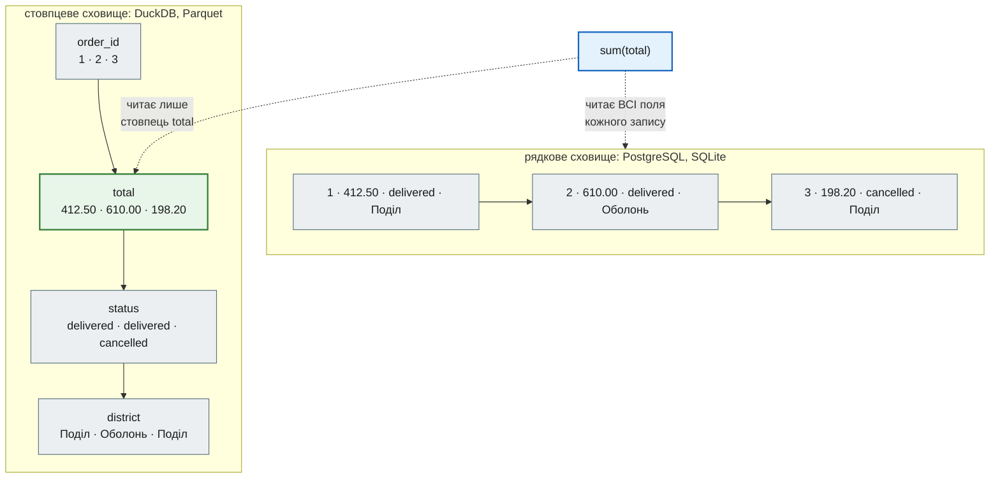
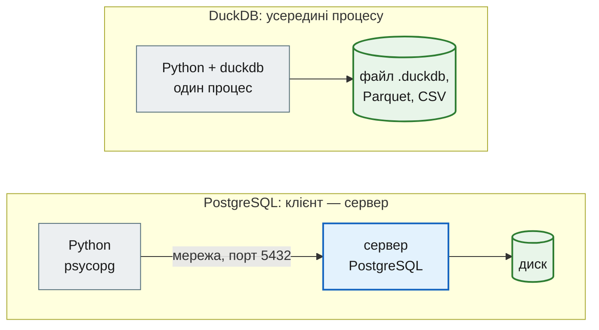
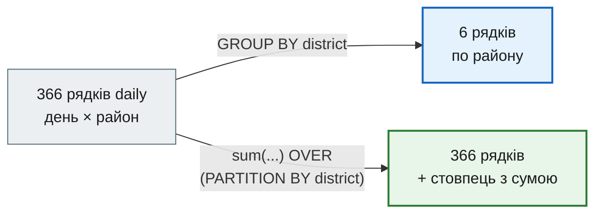
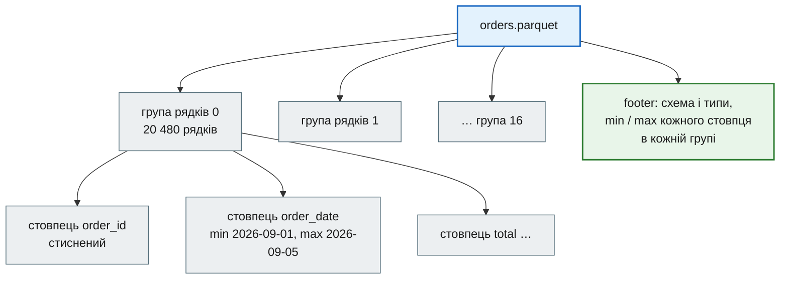
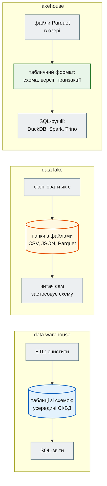
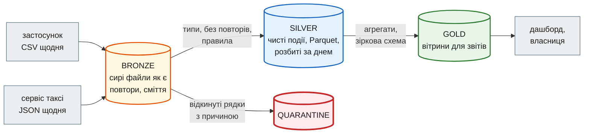
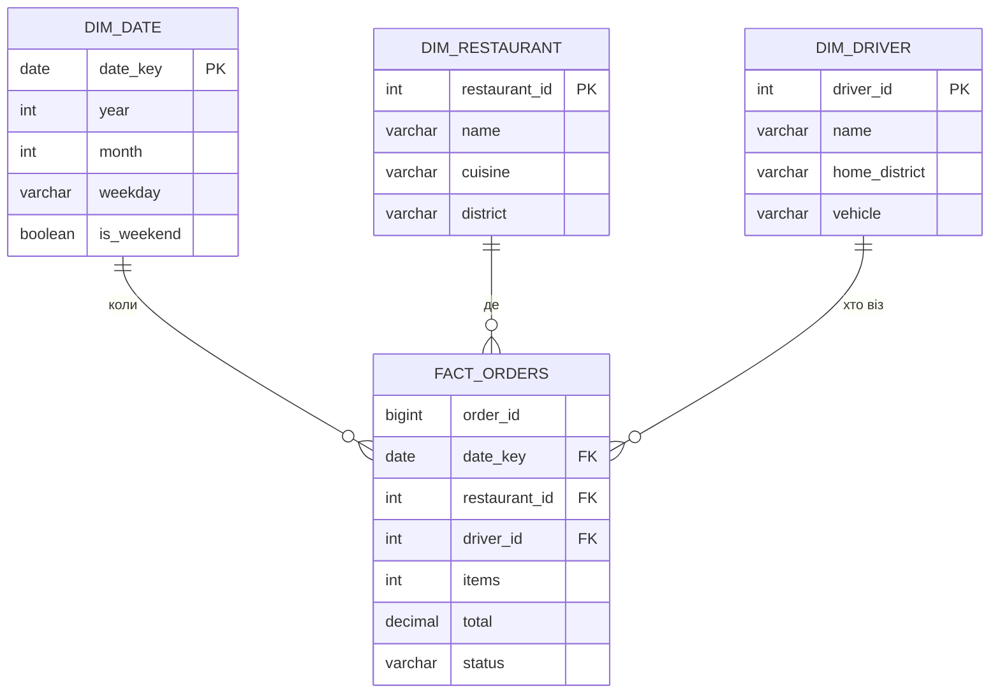
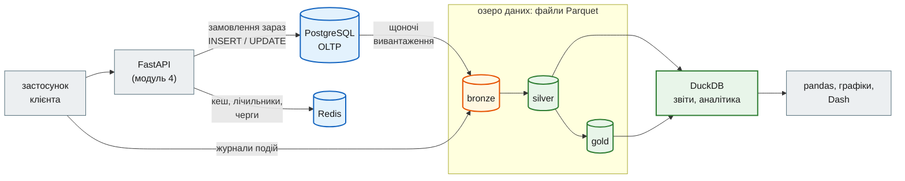

# Бонус. DuckDB і data lake: патерни зберігання та аналізу даних

Диспетчерська «Смачно + Таксі» вже має **PostgreSQL** (урок 30) — для замовлень, що відбуваються просто зараз, і **Redis** (урок 31) — для кешу, лічильників і черг. Але власниця питає вже інше:

- «Який виторг по кожному району за два місяці? А як він змінювався день у день?»
- «Хто три найкращі кур'єри в кожному районі?»
- «Збережіть усю історію замовлень і поїздок таксі, навіть "брудну", — аналітики потім розберуться».
- «І щоб звіт не гальмував базу, через яку зараз приймають замовлення».

Це **аналітика**: мало запитів, але кожен проходить сотні тисяч рядків. Для неї є окремий клас інструментів — **стовпцеві** (колонкові) рушії, серед яких **DuckDB** — найпростіший для старту: `pip install duckdb`, і все. А зберігати історію дешевше не в таблицях на сервері, а у **файлах**: так з'являється **data lake** (озеро даних) зі своїми патернами — Parquet, розбиття на папки, шари bronze / silver / gold, ідемпотентні завантаження, зіркова схема.

**Що потрібно з попередніх уроків:** SQL, `GROUP BY`, `JOIN`, транзакції й параметри замість f-рядків (урок 30), Redis і «що де зберігати» (урок 31), pandas: `groupby`, `merge`, `pivot` (бонус Pandas), модулі й пакети (уроки 13 і 29), pytest (урок 26).

**Після уроку ти зможеш:**

- пояснити різницю між OLTP і OLAP, рядковим і стовпцевим зберіганням — і показати її вимірюванням;
- працювати з DuckDB з Python: запити до DataFrame за іменем, файл бази, параметри `?`, `GROUP BY ALL`, `SUMMARIZE`, `PIVOT`, `EXPLAIN ANALYZE`;
- писати віконні функції (`sum … OVER`, `rank`, `lag`) і фільтрувати їх через `QUALIFY`;
- обрати формат файлу (CSV, JSON, Parquet) і пояснити projection і predicate pushdown;
- розкласти дані озера за Hive-розбиттям і уникнути проблеми дрібних файлів;
- побудувати конвеєр bronze → silver → gold з карантином, ідемпотентним і інкрементним завантаженням, перевірками якості й тестами;
- спроєктувати зіркову схему (факти й виміри) і вітрини для звітів;
- пояснити, де в архітектурі місце PostgreSQL, Redis і DuckDB і коли DuckDB брати не можна.

**Задача розділу.** Озеро даних «Смачно + Таксі» на синтетичних даних (330 тисяч замовлень і 166 тисяч поїздок за вересень–жовтень 2026 року): від «брудних» CSV і JSON до вітрин для дашборду. Повний розбір — у розділі [«Практика»](#practice).

**Ноутбук заняття:** [Відкрити вправи в Colab](https://colab.research.google.com/github/NikoriakViktor/PY-Course-Victor-Nikoriak-22-09-2026/blob/main/module_3/bonus/duckdb_data_lake/note_bonus_duckdb_data_lake_student.ipynb){ .md-button .md-button--primary } [Переглянути розв’язки](https://github.com/NikoriakViktor/PY-Course-Victor-Nikoriak-22-09-2026/blob/main/module_3/bonus/duckdb_data_lake/note_bonus_duckdb_data_lake.ipynb){ .solutions-link } — дані генеруються в ноутбуці, мережа не потрібна; усі приклади цієї сторінки — звідти, з їхніми справжніми результатами.

## Пригадай

1. Що робить `GROUP BY` з рядками таблиці і де фільтрують групи — у `WHERE` чи в `HAVING` (урок 30)?
2. Чому `f"... WHERE name = '{name}'"` небезпечний?
3. Чому Redis не замінює PostgreSQL (урок 31)?

??? success "Відповіді"

    1. Згортає рядки в групи — по рядку на групу; групи фільтрує `HAVING`, бо на кроці `WHERE` груп ще немає. Сьогодні з'явиться третій фільтр — `QUALIFY`, для віконних функцій.
    2. Текст користувача стає частиною SQL — ін'єкція. У DuckDB, як і в psycopg, значення передають параметрами (`?`).
    3. Redis тримає дані в пам'яті й заточений під прості швидкі операції з ключами; правила даних, транзакції й складні запити — у PostgreSQL. Так само сьогодні: DuckDB не замінює PostgreSQL, а стоїть поруч для іншої задачі.

## Дані уроку { #data }

Справжніх замовлень у нас немає, тому ноутбук їх **генерує**: 36 ресторанів (6 кухонь × 6 районів Києва), 60 кур'єрів і водіїв, замовлення їжі й поїздки таксі. Генератор отримує `np.random.default_rng(42)` — однакове зерно дає однакові дані, тож числа в ноутбуці збігатимуться з цією сторінкою. Закладені закономірності: у вихідні замовлень на 30 % більше, ресторани різні за популярністю, середній чек залежить від кухні, 90 % замовлень доставлені.

```python
rng = np.random.default_rng(42)
restaurants = make_restaurants()
drivers = make_drivers(rng)
orders = make_orders(restaurants, drivers, rng)
rides = make_rides(drivers, rng)

print(f"ресторанів: {len(restaurants)}, кур'єрів і водіїв: {len(drivers)}")
print(f"замовлень: {len(orders):_}, поїздок таксі: {len(rides):_}".replace("_", " "))
print(orders.head(3).to_string())
```

```text
ресторанів: 36, кур'єрів і водіїв: 60
замовлень: 329 894, поїздок таксі: 166 186
   order_id                  ts  order_date  restaurant_id  driver_id  customer_id  items   total     status
0         1 2026-09-01 09:00:00  2026-09-01             17          2         5856      2  243.34  delivered
1         2 2026-09-01 09:00:26  2026-09-01             36         11        30343      4  438.39  delivered
2         3 2026-09-01 09:00:28  2026-09-01             23         47         3959      4  325.10  delivered
```

| таблиця | рядків | ключові стовпці |
|---|---|---|
| `restaurants` | 36 | `restaurant_id`, `name`, `cuisine`, `district` |
| `drivers` | 60 | `driver_id`, `name`, `district`, `vehicle` (авто / скутер / велосипед) |
| `orders` | 329 894 | `order_id`, `ts`, `order_date`, `restaurant_id`, `driver_id`, `customer_id`, `items`, `total`, `status` |
| `rides` | 166 186 | `ride_id`, `ts`, `ride_date`, `driver_id`, `from_district`, `to_district`, `distance_km`, `fare` |

## OLTP і OLAP: рядки проти стовпців { #oltp-olap }

Бази даних розв'язують дві дуже різні задачі.

| | **OLTP** — транзакції | **OLAP** — аналітика |
|---|---|---|
| приклад | «створи замовлення № 330 001», «познач доставленим» | «виторг по районах за два місяці» |
| один запит торкається | кількох рядків | сотень тисяч чи мільйонів рядків |
| запитів | тисячі на секунду, від багатьох клієнтів | кілька на хвилину, від аналітика чи звіту |
| важливо | швидко знайти й змінити **рядок**, не загубити жодної зміни | швидко прочитати **кілька стовпців** усієї таблиці |
| інструмент | PostgreSQL, MySQL, SQLite | DuckDB, ClickHouse, BigQuery, Snowflake |
| зберігання | **рядкове**: запис за записом | **стовпцеве**: стовпець за стовпцем |

Як лягають на диск ті самі три замовлення:



Щоб порахувати `sum(total)`, рядкове сховище читає кожен запис цілком. Стовпцеве — лише стовпець `total`. До того ж значення одного типу лежать поруч: їх легко **стиснути** (у `status` лише три різні слова) і обробляти **векторами** — пачками по 2048 значень за одну операцію процесора, а не по одному.

### Вимірюємо: той самий GROUP BY

Як рядкову базу візьмемо **SQLite** — вона вбудована в Python (`import sqlite3`) і, як PostgreSQL, зберігає дані рядками. Звіт власниці з уроку 30 — однаковий SQL для обох баз:

```python
REPORT_SQL = """
SELECT r.district,
       count(*)                AS orders,
       round(sum(o.total), 2)  AS revenue,
       round(avg(o.total), 2)  AS avg_check
FROM orders AS o
JOIN restaurants AS r USING (restaurant_id)
WHERE o.status = 'delivered'
GROUP BY r.district
ORDER BY revenue DESC
"""

mem = duckdb.connect()                                   # DuckDB у пам'яті
mem.sql("CREATE TABLE orders AS SELECT * FROM orders")
mem.sql("CREATE TABLE restaurants AS SELECT * FROM restaurants")

lite_rows = lite.execute(REPORT_SQL).fetchall()
duck_rows = mem.sql(REPORT_SQL).fetchall()
assert lite_rows == duck_rows, "результати мають збігатися"

t_lite = best_time(lambda: lite.execute(REPORT_SQL).fetchall())
t_duck = best_time(lambda: mem.sql(REPORT_SQL).fetchall())
for row in duck_rows:
    print(row)
print(f"SQLite (рядки): {t_lite:.4f} с | DuckDB (стовпці): {t_duck:.4f} с | DuckDB швидший у {t_lite / t_duck:.0f} разів")
```

```text
('Печерськ', 96996, 28758575.03, 296.49)
('Поділ', 48349, 17484853.42, 361.64)
('Голосіїв', 49521, 17096915.39, 345.25)
('Оболонь', 37583, 15046466.34, 400.35)
('Дарниця', 41078, 13504667.18, 328.76)
('Святошин', 23208, 8717125.98, 375.61)
SQLite (рядки): 0.0985 с | DuckDB (стовпці): 0.0032 с | DuckDB швидший у 31 разів
```

Результат однаковий до копійки, але DuckDB рахує в десятки разів швидше: читає 4 потрібні стовпці з 9, обробляє їх векторами і на всіх ядрах процесора. Час у тебе буде іншим — важливе співвідношення.

### Дрібні транзакції: тут виграє рядкова база

А тепер — робота диспетчерської: 2000 вставок по одному замовленню і 2000 пошуків за первинним ключем.

```python
def oltp_inserts(execute, n=2000):
    for i in range(n):
        execute("INSERT INTO tiny VALUES (?, ?)", (i, 100.0 + i))


def oltp_lookups(execute, n=2000):
    for i in range(n):
        execute("SELECT total FROM tiny WHERE id = ?", (i,)).fetchone()

lite.execute("CREATE TABLE tiny (id INTEGER PRIMARY KEY, total REAL)")
mem.execute("CREATE TABLE tiny (id INTEGER PRIMARY KEY, total DOUBLE)")

timings = {}
for name, execute in [("SQLite", lite.execute), ("DuckDB", mem.execute)]:
    start = time.perf_counter()
    oltp_inserts(execute)
    inserts = time.perf_counter() - start
    start = time.perf_counter()
    oltp_lookups(execute)
    timings[name] = (inserts, time.perf_counter() - start)
    print(f"{name}: 2000 INSERT — {inserts:.3f} с, 2000 пошуків за id — {timings[name][1]:.3f} с")
print(f"на дрібних операціях SQLite швидший у {timings['DuckDB'][0] / timings['SQLite'][0]:.0f} разів")
```

```text
SQLite: 2000 INSERT — 0.001 с, 2000 пошуків за id — 0.002 с
DuckDB: 2000 INSERT — 0.948 с, 2000 пошуків за id — 0.456 с
на дрібних операціях SQLite швидший у 709 разів
```

Картина перевернулася: на дрібних операціях рядкова база швидша в сотні разів — стовпцевій кожен новий рядок треба розкласти по стовпцях. Отже, це не «краща» і «гірша» бази, а два інструменти під два типи навантаження:

!!! tip "Правило"
    **Замовлення, що відбуваються зараз** (OLTP) — у PostgreSQL. **Аналітика над історією** (OLAP) — у стовпцевому рушії. Звіт не повинен сканувати базу, через яку в цей момент приймають замовлення.

## DuckDB: аналітична база всередині програми { #duckdb }

DuckDB — **вбудована** (in-process) аналітична СКБД. Як SQLite, вона працює всередині твого процесу Python: без сервера, порту, логіна й пароля. База — або в пам'яті, або в одному файлі `.duckdb`. Але всередині — стовпцевий векторний рушій для аналітики й діалект SQL, близький до PostgreSQL.



### Встановлення

=== "pip (свій комп'ютер)"

    ```bash
    pip install duckdb pyarrow pandas
    ```

    Перевірка: `python -c "import duckdb; print(duckdb.__version__)"`. Приклади сторінки виконано на DuckDB 1.5.

=== "Google Colab"

    DuckDB у Colab уже встановлено, але версія може бути старішою. Перша клітинка ноутбука перевіряє версії **до** імпорту й доставляє лише те, чого бракує:

    ```python
    missing = [f"{name}>={'.'.join(map(str, version))}" for name, version in NEED.items()
               if (installed_version(name) or (0, 0)) < version]
    if missing:
        subprocess.run([sys.executable, "-m", "pip", "install", "-q", *missing], check=True)
    print("встановлено:", ", ".join(f"{name} {importlib.metadata.version(name)}" for name in NEED))
    ```

=== "Консоль DuckDB"

    Окрема програма `duckdb` (як `psql` для PostgreSQL) — з [duckdb.org](https://duckdb.org/docs/installation/): `duckdb smachno.duckdb` відкриває файл бази, далі — звичайний SQL. Для уроку вона не потрібна.

### Перший запит і запит до DataFrame

`duckdb.sql(...)` виконує SQL у базі за замовчуванням (у пам'яті) і повертає **relation** — лінивий об'єкт-результат: запит виконується, коли результат знадобився (друк, `.df()`, `.fetchall()`). Головна зручність у ноутбуках: у `FROM` можна написати **ім'я змінної** з pandas DataFrame — DuckDB прочитає його напряму, без копіювання (replacement scan).

```python
STATUS_SQL = """
SELECT status, count(*) AS orders, round(avg(total), 2) AS avg_check
FROM orders                      -- це pandas DataFrame з розділу 0
GROUP BY status
ORDER BY orders DESC
"""

duckdb.sql(STATUS_SQL)
```

```text
┌───────────┬────────┬───────────┐
│  status   │ orders │ avg_check │
│  varchar  │ int64  │  double   │
├───────────┼────────┼───────────┤
│ delivered │ 296735 │    339.05 │
│ cancelled │  23179 │    339.33 │
│ returned  │   9980 │    342.65 │
└───────────┴────────┴───────────┘
```

Результат перетворюється на звичні об'єкти Python:

| метод | що повертає | коли брати |
|---|---|---|
| `.df()` | pandas DataFrame | далі аналіз чи графік у pandas |
| `.fetchall()` | список кортежів | як `cursor.fetchall()` у psycopg |
| `.fetchone()` | один кортеж | одне число: `count(*)`, `max(...)` |
| `.to_arrow_table()` | `pyarrow.Table` | передати в інший стовпцевий інструмент |

```python
status_rel = duckdb.sql(STATUS_SQL)
status_df = status_rel.df()
status_rows = status_rel.fetchall()
total_orders = duckdb.sql("SELECT count(*) FROM orders").fetchone()[0]

print(type(status_df).__name__, status_df.shape)
print(status_rows)
print("усього замовлень:", total_orders)
assert sum(row[1] for row in status_rows) == total_orders
```

```text
DataFrame (3, 3)
[('delivered', 296735, 339.05), ('cancelled', 23179, 339.33), ('returned', 9980, 342.65)]
усього замовлень: 329894
```

### База у файлі і CREATE TABLE AS

`duckdb.connect("шлях.duckdb")` відкриває або створює базу в одному файлі; таблиці переживають перезапуск. `CREATE TABLE … AS SELECT` (CTAS) створює таблицю одразу з даними, а типи бере з DataFrame. Гроші в DataFrame — `float`, тому в базі підмінимо їх точним `DECIMAL(10, 2)` (як `numeric` в уроці 30): `SELECT * REPLACE (вираз AS стовпець)` бере всі стовпці, але один замінює.

```python
DB_PATH = LAB / "smachno.duckdb"


MONEY = {"orders": "total", "rides": "fare"}       # стовпці з гривнями


def create_database(path):
    """Файл бази з чотирма таблицями з DataFrame. Повертає відкрите з'єднання."""
    con = duckdb.connect(str(path))
    for name, df in [("orders", orders), ("restaurants", restaurants), ("drivers", drivers), ("rides", rides)]:
        columns = f"* REPLACE ({MONEY[name]}::DECIMAL(10, 2) AS {MONEY[name]})" if name in MONEY else "*"
        con.sql(f"CREATE OR REPLACE TABLE {name} AS SELECT {columns} FROM df")
    return con

con = create_database(DB_PATH)
con.close()                                     # закрили — дані лишилися у файлі

con = duckdb.connect(str(DB_PATH))              # відкрили знову
print(con.sql("SHOW TABLES").fetchall())
print(f"розмір файлу: {DB_PATH.stat().st_size / 1e6:.1f} МБ")
con.sql("DESCRIBE orders")
```

```text
[('drivers',), ('orders',), ('restaurants',), ('rides',)]
розмір файлу: 6.0 МБ
┌───────────────┬───────────────┬─────────┬─────────┬─────────┬─────────┐
│  column_name  │  column_type  │  null   │   key   │ default │  extra  │
│    varchar    │    varchar    │ varchar │ varchar │ varchar │ varchar │
├───────────────┼───────────────┼─────────┼─────────┼─────────┼─────────┤
│ order_id      │ BIGINT        │ YES     │ NULL    │ NULL    │ NULL    │
│ ts            │ TIMESTAMP     │ YES     │ NULL    │ NULL    │ NULL    │
│ order_date    │ DATE          │ YES     │ NULL    │ NULL    │ NULL    │
│ restaurant_id │ BIGINT        │ YES     │ NULL    │ NULL    │ NULL    │
│ driver_id     │ BIGINT        │ YES     │ NULL    │ NULL    │ NULL    │
│ customer_id   │ BIGINT        │ YES     │ NULL    │ NULL    │ NULL    │
│ items         │ BIGINT        │ YES     │ NULL    │ NULL    │ NULL    │
│ total         │ DECIMAL(10,2) │ YES     │ NULL    │ NULL    │ NULL    │
│ status        │ VARCHAR       │ YES     │ NULL    │ NULL    │ NULL    │
└───────────────┴───────────────┴─────────┴─────────┴─────────┴─────────┘
```

Ім'я таблиці тут підставлено f-рядком, а дані — змінною `df`. Імена таблиць і стовпців параметром передати не можна, тому їх беремо лише з власного коду, ніколи від користувача.

`CREATE TABLE … AS` зберігає **копію** результату, `CREATE VIEW` — лише **текст** запиту, що виконується щоразу. Подання `delivered` (доставлені замовлення з районом і кухнею) і таблиця `daily` (виторг за день і район) знадобляться далі:

```python
DELIVERED_VIEW = """
CREATE OR REPLACE VIEW delivered AS
SELECT o.*, r.name AS restaurant, r.cuisine, r.district
FROM orders AS o
JOIN restaurants AS r USING (restaurant_id)
WHERE o.status = 'delivered'
"""
DAILY_TABLE = """
CREATE OR REPLACE TABLE daily AS
SELECT order_date, district, count(*) AS orders, round(sum(total), 2) AS revenue
FROM delivered
GROUP BY order_date, district
"""

con.sql(DELIVERED_VIEW)
con.sql(DAILY_TABLE)
print("доставлених:", con.sql("SELECT count(*) FROM delivered").fetchone()[0])
print("рядків у daily (61 день × 6 районів):", con.sql("SELECT count(*) FROM daily").fetchone()[0])
```

```text
доставлених: 296735
рядків у daily (61 день × 6 районів): 366
```

### Параметри `?`, а не f-рядки

Правило з уроку 30 діє й тут: значення від користувача — лише **параметрами**. У DuckDB місце для значення позначають `?` (або `$name`), а значення передають списком.

```python
def restaurant_orders_unsafe(con, name):
    """❌ Текст користувача стає частиною SQL."""
    return con.sql(f"SELECT count(*) FROM delivered WHERE restaurant = '{name}'").fetchone()[0]


def restaurant_orders(con, name):
    """✅ Значення йде окремо від SQL — базі все одно, які в ньому лапки."""
    return con.execute("SELECT count(*) FROM delivered WHERE restaurant = ?", [name]).fetchone()[0]

attack = "x' OR '1'='1"
print("чесний запит:     ", restaurant_orders(con, "Суші Оболонь"))
print("ін'єкція, f-рядок:", restaurant_orders_unsafe(con, attack), "← повернула ВСІ замовлення")
print("ін'єкція, ?:      ", restaurant_orders(con, attack), "← такого ресторану немає")
```

```text
чесний запит:      10400
ін'єкція, f-рядок: 296735 ← повернула ВСІ замовлення
ін'єкція, ?:       0 ← такого ресторану немає
```

`con.execute(sql, params)` повертає саме з'єднання, як курсор; `con.sql(sql, params=[...])` — relation. Обидва приймають параметри.

### Зручний SQL: GROUP BY ALL, SUMMARIZE, PIVOT

DuckDB додає до стандартного SQL кілька зручностей ([Friendly SQL](https://duckdb.org/docs/stable/sql/dialect/friendly_sql)):

| синтаксис | що робить |
|---|---|
| `GROUP BY ALL` | групує за всіма неагрегованими стовпцями `SELECT` — не треба повторювати їх |
| `ORDER BY ALL` | сортує за всіма стовпцями зліва направо |
| `SELECT * EXCLUDE (a, b)` | усі стовпці, крім перелічених |
| `SELECT * REPLACE (вираз AS a)` | усі стовпці, але `a` замінено виразом |
| `FROM таблиця` | скорочення для `SELECT * FROM таблиця` |
| `SUMMARIZE таблиця` | огляд усіх стовпців: min, max, унікальні, квартилі, частка `NULL` |
| `PIVOT … ON … USING …` | значення стовпця стають іменами стовпців |

```python
CLASSIC_SQL = """
SELECT district, cuisine, count(*) AS orders
FROM delivered
GROUP BY district, cuisine
ORDER BY district, cuisine
"""
FRIENDLY_SQL = """
SELECT district, cuisine, count(*) AS orders
FROM delivered
GROUP BY ALL
ORDER BY ALL
"""

assert con.sql(CLASSIC_SQL).fetchall() == con.sql(FRIENDLY_SQL).fetchall()
print(con.sql(FRIENDLY_SQL).limit(4))
print(con.sql("FROM drivers SELECT * EXCLUDE (vehicle) LIMIT 3"))
```

`assert` пройшов: обидва запити дають однакові рядки, але в другому не треба стежити, щоб `GROUP BY` збігався з `SELECT`.

`SUMMARIZE` — перше, що роблять з незнайомими даними (як `df.describe()` у pandas, але для всіх стовпців). Ось його частина:

```python
SUMMARY_SQL = """
SELECT column_name, column_type, min, max, approx_unique, null_percentage
FROM (SUMMARIZE orders)
"""
con.sql(SUMMARY_SQL)
```

```text
┌───────────────┬───────────────┬─────────────────────┬─────────────────────┬───────────────┬─────────────────┐
│  column_name  │  column_type  │         min         │         max         │ approx_unique │ null_percentage │
│    varchar    │    varchar    │       varchar       │       varchar       │     int64     │  decimal(9,2)   │
├───────────────┼───────────────┼─────────────────────┼─────────────────────┼───────────────┼─────────────────┤
│ order_id      │ BIGINT        │ 1                   │ 329894              │        305780 │            0.00 │
│ ts            │ TIMESTAMP     │ 2026-09-01 09:00:00 │ 2026-10-31 22:59:57 │        352224 │            0.00 │
│ order_date    │ DATE          │ 2026-09-01          │ 2026-10-31          │            60 │            0.00 │
│ restaurant_id │ BIGINT        │ 1                   │ 36                  │            37 │            0.00 │
│ driver_id     │ BIGINT        │ 1                   │ 60                  │            56 │            0.00 │
│ customer_id   │ BIGINT        │ 1                   │ 40000               │         37555 │            0.00 │
│ items         │ BIGINT        │ 1                   │ 6                   │             6 │            0.00 │
│ total         │ DECIMAL(10,2) │ 52.12               │ 2652.71             │         65373 │            0.00 │
│ status        │ VARCHAR       │ cancelled           │ returned            │             3 │            0.00 │
└───────────────┴───────────────┴─────────────────────┴─────────────────────┴───────────────┴─────────────────┘
```

`approx_unique` — **приблизна** оцінка (алгоритм HyperLogLog): днів насправді 61, ресторанів 36. Точний підрахунок унікальних на мільйонах рядків дорогий, а для огляду досить «близько».

`PIVOT` — звіт «райони в рядках, кухні в стовпцях», як `pivot_table` у бонусі Pandas:

```python
PIVOT_SQL = """
PIVOT delivered
ON cuisine
USING count(*)
GROUP BY district
ORDER BY district
"""
con.sql(PIVOT_SQL)
```

```text
┌──────────┬───────┬────────┬───────┬───────┬───────┬─────────┐
│ district │ Борщ  │ Бургер │ Вега  │ Піца  │ Суші  │ Хінкалі │
│ varchar  │ int64 │ int64  │ int64 │ int64 │ int64 │  int64  │
├──────────┼───────┼────────┼───────┼───────┼───────┼─────────┤
│ Голосіїв │  5768 │  13558 │  7314 │ 11157 │  6289 │    5435 │
│ Дарниця  │  5290 │   7290 │ 13962 │  5559 │  4039 │    4938 │
│ Оболонь  │   972 │  12800 │  2303 │  4224 │ 10400 │    6884 │
│ Печерськ │ 24573 │  18485 │ 35207 │  6134 │  3903 │    8694 │
│ Поділ    │  2187 │  19846 │  6850 │  6559 │  8945 │    3962 │
│ Святошин │  1854 │   7201 │   759 │  5466 │  4825 │    3103 │
└──────────┴───────┴────────┴───────┴───────┴───────┴─────────┘
```

### EXPLAIN і EXPLAIN ANALYZE

`EXPLAIN` показує **план** запиту, `EXPLAIN ANALYZE` виконує запит і додає реальну кількість рядків і час на кожному кроці. План читається **знизу вгору**.

```python
def explain(con, sql, analyze=False):
    """Надрукувати план запиту (текстом, як у консолі DuckDB)."""
    prefix = "EXPLAIN ANALYZE " if analyze else "EXPLAIN "
    print(con.sql(prefix + sql).fetchall()[0][1])

explain(con, "SELECT district, sum(total) FROM delivered GROUP BY district")
```

```text
┌───────────────────────────┐
│       HASH_GROUP_BY       │
│    ────────────────────   │
│         Groups: #0        │
│    Aggregates: sum(#1)    │
│                           │
│        ~91,374 rows       │
└─────────────┬─────────────┘
┌─────────────┴─────────────┐
│         PROJECTION        │
│    ────────────────────   │
│          district         │
│           total           │
│                           │
│       ~106,992 rows       │
└─────────────┬─────────────┘
┌─────────────┴─────────────┐
│         HASH_JOIN         │
│    ────────────────────   │
│      Join Type: INNER     │
│                           │
│        Conditions:        ├──────────────┐
│      restaurant_id =      │              │
│        restaurant_id      │              │
│                           │              │
│       ~106,992 rows       │              │
└─────────────┬─────────────┘              │
┌─────────────┴─────────────┐┌─────────────┴─────────────┐
│          SEQ_SCAN         ││          SEQ_SCAN         │
│    ────────────────────   ││    ────────────────────   │
│           Table:          ││           Table:          │
│    smachno.main.orders    ││  smachno.main.restaurants │
│                           ││                           │
│   Type: Sequential Scan   ││   Type: Sequential Scan   │
│                           ││                           │
│        Projections:       ││        Projections:       │
│       restaurant_id       ││       restaurant_id       │
│           total           ││          district         │
│                           ││                           │
│          Filters:         ││                           │
│     status='delivered'    ││                           │
│                           ││                           │
│       ~109,965 rows       ││          ~36 rows         │
└───────────────────────────┘└───────────────────────────┘
```

Знизу — сканування двох таблиць. З `orders` читаються лише потрібні стовпці (**Projections**: `restaurant_id`, `total`), а умова `status = 'delivered'` перевіряється прямо під час сканування (**Filters**). Далі — `HASH_JOIN` і `HASH_GROUP_BY`. Числа з тильдою (`~106,992 rows`) — оцінки планувальника. `EXPLAIN ANALYZE` дає замість них факт — ось нижня частина його виводу:

```text
┌─────────────┴─────────────┐┌─────────────┴─────────────┐
│         TABLE_SCAN        ││         TABLE_SCAN        │
│    ────────────────────   ││    ────────────────────   │
│           Table:          ││           Table:          │
│    smachno.main.orders    ││  smachno.main.restaurants │
│                           ││                           │
│   Type: Sequential Scan   ││   Type: Sequential Scan   │
│                           ││                           │
│        Projections:       ││        Projections:       │
│       restaurant_id       ││       restaurant_id       │
│           total           ││          district         │
│                           ││                           │
│          Filters:         ││                           │
│     status='delivered'    ││                           │
│                           ││                           │
│      Dynamic Filters:     ││           0.00s           │
│ optional: restaurant_id>=1││                           │
│        AND optional:      ││                           │
│      restaurant_id<=36    ││                           │
│                           ││                           │
│                           ││                           │
│                           ││                           │
│        296,735 rows       ││          36 rows          │
│           0.00s           ││          (0.00s)          │
└───────────────────────────┘└───────────────────────────┘
```

Насправді доставлених рядків 296 735, а з'єднання й групування зайняли тисячні частки секунди. Зверни увагу на **Dynamic Filters**: побачивши, що `restaurant_id` у `restaurants` — від 1 до 36, DuckDB додав цей фільтр до сканування `orders` вже під час виконання.

## Віконні функції { #windows }

`GROUP BY` **згортає** рядки. **Віконна функція** рахує по групі, але **не згортає**: кожен рядок лишається на місці й отримує новий стовпець — накопичену суму, місце в рейтингу, значення попереднього дня.

```text
функція(...) OVER (PARTITION BY district   -- окреме «вікно» для кожного району
                   ORDER BY order_date)    -- порядок усередині вікна
```



**Накопичений виторг:** з `ORDER BY` усередині `OVER` сума рахується від початку вікна до поточного рядка.

```python
RUNNING_SQL = """
SELECT order_date, district, revenue,
       sum(revenue) OVER (PARTITION BY district ORDER BY order_date) AS running_revenue
FROM daily
WHERE district = 'Поділ'
ORDER BY order_date
LIMIT 5
"""
con.sql(RUNNING_SQL)
```

```text
┌────────────┬──────────┬───────────────┬─────────────────┐
│ order_date │ district │    revenue    │ running_revenue │
│    date    │ varchar  │ decimal(38,2) │  decimal(38,2)  │
├────────────┼──────────┼───────────────┼─────────────────┤
│ 2026-09-01 │ Поділ    │     275399.11 │       275399.11 │
│ 2026-09-02 │ Поділ    │     274586.44 │       549985.55 │
│ 2026-09-03 │ Поділ    │     266770.27 │       816755.82 │
│ 2026-09-04 │ Поділ    │     268461.48 │      1085217.30 │
│ 2026-09-05 │ Поділ    │     335834.64 │      1421051.94 │
└────────────┴──────────┴───────────────┴─────────────────┘
```

**Рейтинг у групі і QUALIFY.** `rank() OVER (PARTITION BY district ORDER BY sum(total) DESC)` нумерує ресторани всередині кожного району. Віконні функції виконуються після `GROUP BY`, тому всередині `OVER` можна писати агрегат. Щоб лишити лише двох лідерів, у PostgreSQL потрібен підзапит (у `WHERE` віконних функцій ще немає), а в DuckDB є **`QUALIFY`** — `WHERE` для віконних функцій:

```python
QUALIFY_SQL = """
SELECT district, restaurant, round(sum(total), 2) AS revenue,
       rank() OVER (PARTITION BY district ORDER BY sum(total) DESC) AS place
FROM delivered
GROUP BY district, restaurant
QUALIFY place <= 2
ORDER BY district, place
"""
con.sql(QUALIFY_SQL)
```

```text
┌──────────┬─────────────────┬───────────────┬───────┐
│ district │   restaurant    │    revenue    │ place │
│ varchar  │     varchar     │ decimal(38,2) │ int64 │
├──────────┼─────────────────┼───────────────┼───────┤
│ Голосіїв │ Бургер Голосіїв │    4177162.70 │     1 │
│ Голосіїв │ Піца Голосіїв   │    3808438.16 │     2 │
│ Дарниця  │ Вега Дарниця    │    3873930.55 │     1 │
│ Дарниця  │ Суші Дарниця    │    2322271.40 │     2 │
│ Оболонь  │ Суші Оболонь    │    5995310.64 │     1 │
│ Оболонь  │ Бургер Оболонь  │    3966158.23 │     2 │
│ Печерськ │ Вега Печерськ   │    9719047.68 │     1 │
│ Печерськ │ Бургер Печерськ │    5691216.05 │     2 │
│ Поділ    │ Бургер Поділ    │    6149695.70 │     1 │
│ Поділ    │ Суші Поділ      │    5148001.76 │     2 │
│ Святошин │ Суші Святошин   │    2758358.78 │     1 │
│ Святошин │ Бургер Святошин │    2231567.10 │     2 │
└──────────┴─────────────────┴───────────────┴───────┘
  12 rows                                  4 columns
```

У ноутбуці поруч — варіант з підзапитом `WITH ranked AS (...) SELECT … WHERE place <= 2`; `assert` перевіряє, що результати однакові.

Порядок виконання з вікнами: FROM → WHERE → GROUP BY → HAVING → **віконні функції** → **QUALIFY** → SELECT → ORDER BY → LIMIT.

| функція | значення при виторгах 900, 700, 700, 500 |
|---|---|
| `row_number()` | 1, 2, 3, 4 — різні номери, порядок однакових довільний |
| `rank()` | 1, 2, 2, 4 — однакове місце, далі пропуск |
| `dense_rank()` | 1, 2, 2, 3 — однакове місце, без пропуску |
| `lag(x)` / `lead(x)` | значення з попереднього / наступного рядка вікна |
| `sum(x) OVER (ORDER BY …)` | накопичений підсумок |

!!! warning "QUALIFY і GROUP BY ALL"
    У DuckDB 1.5 `QUALIFY` разом із `GROUP BY ALL` не працює: `Binder Error: Combining QUALIFY with GROUP BY ALL is not supported yet`. Стовпці групування в таких запитах перелічуй явно.

**Зміна день до дня:** `lag(revenue)` — значення попереднього рядка вікна. День тижня — зі списку назв: `isodow` дає 1 для понеділка … 7 для неділі, а списки в DuckDB нумеруються з 1.

```python
LAG_SQL = """
SELECT order_date, ['пн', 'вт', 'ср', 'чт', 'пт', 'сб', 'нд'][isodow(order_date)] AS weekday, revenue,
       revenue - lag(revenue) OVER (PARTITION BY district ORDER BY order_date) AS change
FROM daily
WHERE district = 'Поділ'
ORDER BY order_date
LIMIT 8
"""
con.sql(LAG_SQL)
```

```text
┌────────────┬─────────┬───────────────┬───────────────┐
│ order_date │ weekday │    revenue    │    change     │
│    date    │ varchar │ decimal(38,2) │ decimal(38,2) │
├────────────┼─────────┼───────────────┼───────────────┤
│ 2026-09-01 │ вт      │     275399.11 │          NULL │
│ 2026-09-02 │ ср      │     274586.44 │       -812.67 │
│ 2026-09-03 │ чт      │     266770.27 │      -7816.17 │
│ 2026-09-04 │ пт      │     268461.48 │       1691.21 │
│ 2026-09-05 │ сб      │     335834.64 │      67373.16 │
│ 2026-09-06 │ нд      │     355476.20 │      19641.56 │
│ 2026-09-07 │ пн      │     243428.98 │    -112047.22 │
│ 2026-09-08 │ вт      │     248061.83 │       4632.85 │
└────────────┴─────────┴───────────────┴───────────────┘
```

Для першого дня попереднього немає — `lag` дає `NULL`. Добре видно вихідні: у суботу виторг стрибає на 67 тисяч, у понеділок падає на 112.

## pandas і DuckDB { #pandas }

DuckDB не заміняє pandas, а доповнює. Той самий звіт двома способами — над тими самими DataFrame:

```python
def report_pandas(orders, restaurants):
    delivered = orders[orders["status"] == "delivered"].merge(restaurants, on="restaurant_id")
    return (delivered.groupby("district")
            .agg(orders=("order_id", "count"), revenue=("total", "sum"), avg_check=("total", "mean"))
            .round(2).sort_values("revenue", ascending=False).reset_index())


def report_duckdb(orders, restaurants):
    return duckdb.sql(REPORT_SQL).df()       # orders і restaurants у SQL — ці самі DataFrame

by_pandas = report_pandas(orders, restaurants)
by_duckdb = report_duckdb(orders, restaurants)
assert by_pandas["district"].tolist() == by_duckdb["district"].tolist()
assert np.allclose(by_pandas["revenue"], by_duckdb["revenue"])

t_pandas = best_time(lambda: report_pandas(orders, restaurants))
t_duckdb = best_time(lambda: report_duckdb(orders, restaurants))
print(by_duckdb.to_string(index=False))
print(f"pandas: {t_pandas:.4f} с | DuckDB над тими самими DataFrame: {t_duckdb:.4f} с")
```

```text
district  orders     revenue  avg_check
Печерськ   96996 28758575.03     296.49
   Поділ   48349 17484853.42     361.64
Голосіїв   49521 17096915.39     345.25
 Оболонь   37583 15046466.34     400.35
 Дарниця   41078 13504667.18     328.76
Святошин   23208  8717125.98     375.61
pandas: 0.0399 с | DuckDB над тими самими DataFrame: 0.0288 с
```

Числа однакові, час на 330 тисячах рядків — майже однаковий: pandas теж рахує векторно (NumPy). Різниця росте з обсягом: pandas створює проміжний DataFrame на кожному кроці (`merge` — ще 300 тисяч рядків у пам'яті) і рахує одним ядром, а DuckDB виконує весь запит за один прохід на всіх ядрах і вміє обробляти дані, більші за оперативну пам'ять.

| задача | зручніше |
|---|---|
| з'єднання кількох великих таблиць, групування, віконні функції | DuckDB (SQL) |
| дані більші за пам'ять, файли Parquet / CSV на диску | DuckDB — читає файли частинами |
| графік, дрібне перетворення, машинне навчання | pandas |
| звіт, який читатиме аналітик, що знає SQL | DuckDB |

**Apache Arrow** — стандартний формат стовпцевих даних **у пам'яті**. DuckDB, pandas, Polars і бібліотеки Parquet розуміють його однаково, тож таблиця переходить між ними без перетворення рядок за рядком (zero-copy, наскільки дозволяють типи):

```python
rides_arrow = con.sql("SELECT ride_id, ride_date, driver_id, distance_km, fare FROM rides").to_arrow_table()

print(type(rides_arrow).__name__, rides_arrow.num_rows, "рядків")
print(rides_arrow.schema)
print(duckdb.sql("SELECT round(avg(fare), 2) AS avg_fare, round(avg(distance_km), 1) AS avg_km FROM rides_arrow"))
rides_back = rides_arrow.to_pandas()
print("назад у pandas:", rides_back.shape)
```

```text
Table 166186 рядків
ride_id: int64
ride_date: date32[day]
driver_id: int64
distance_km: double
fare: decimal128(10, 2)
┌──────────┬────────┐
│ avg_fare │ avg_km │
│  double  │ double │
├──────────┼────────┤
│   194.46 │    6.5 │
└──────────┴────────┘

назад у pandas: (166186, 5)
```

Типи збереглися: `ride_date` — `date32`, `fare` — `decimal128(10, 2)`. DuckDB читає Arrow-таблицю за іменем змінної, як і DataFrame.

## Формати файлів: CSV, JSON, Parquet { #formats }

Аналітичні дані часто живуть не в базі, а у **файлах**: їх дешево зберігати, легко передати іншій команді й прочитати будь-яким інструментом. DuckDB читає й пише їх напряму SQL: `COPY … TO 'файл' (FORMAT …)`, `read_csv`, `read_json`, `read_parquet`.

| | CSV | JSON (по рядку на запис) | Parquet |
|---|---|---|---|
| вигляд | текст, рядок = запис | текст, рядок = об'єкт | двійковий, **стовпцевий** |
| типи | немає — усе текст, типи вгадують | числа, рядки, `null`; дат немає | збережені: `DATE`, `TIMESTAMP`, `DECIMAL`… |
| стиснення | немає (або gzip усього файлу) | немає | кожен стовпець окремо: словник, різниці, Snappy / ZSTD |
| прочитати 2 стовпці з 9 | читаємо весь файл | читаємо весь файл | лише 2 стовпці |
| відкрити в Excel / блокноті | так | так | ні |
| для чого | обмін з людьми і старими системами | події, API, логи | аналітика, data lake |

### Розмір і швидкість

```python
FILES = LAB / "files"
FILES.mkdir(exist_ok=True)
CSV_PATH = FILES / "orders.csv"
PARQUET_PATH = FILES / "orders.parquet"
ZSTD_PATH = FILES / "orders_zstd.parquet"


def write_formats(con):
    con.sql(f"COPY orders TO '{CSV_PATH}' (HEADER)")
    con.sql(f"COPY orders TO '{PARQUET_PATH}' (FORMAT PARQUET, ROW_GROUP_SIZE 20000)")
    con.sql(f"COPY orders TO '{ZSTD_PATH}' (FORMAT PARQUET, COMPRESSION ZSTD, ROW_GROUP_SIZE 20000)")

write_formats(con)
for path in [CSV_PATH, PARQUET_PATH, ZSTD_PATH]:
    print(f"{path.name:22} {path.stat().st_size / 1e6:6.1f} МБ")
print(f"Parquet менший за CSV у {CSV_PATH.stat().st_size / PARQUET_PATH.stat().st_size:.1f} раза")
```

```text
orders.csv               22.4 МБ
orders.parquet            6.8 МБ
orders_zstd.parquet       3.7 МБ
Parquet менший за CSV у 3.3 раза
```

Parquet утричі менший: `status` з трьома значеннями зберігається **словником** (номер замість слова), відсортовані `order_id` і `ts` — різницями сусідніх значень, і все це ще стискається. ZSTD стискає сильніше за типовий Snappy, але трохи повільніше. Тепер той самий звіт з обох файлів:

```python
FILE_REPORT = """
SELECT status, count(*) AS orders, round(sum(total), 2)::DECIMAL(14, 2) AS revenue   -- однаковий тип для CSV і Parquet
FROM {source}
GROUP BY ALL
ORDER BY ALL
"""


def report_from(con, source):
    return con.sql(FILE_REPORT.format(source=source)).fetchall()

csv_source, parquet_source = f"read_csv('{CSV_PATH}')", f"read_parquet('{PARQUET_PATH}')"
assert report_from(con, csv_source) == report_from(con, parquet_source)
t_csv = best_time(lambda: report_from(con, csv_source))
t_parquet = best_time(lambda: report_from(con, parquet_source))
for status, n, revenue in report_from(con, parquet_source):
    print(f"{status:10} {n:7} {revenue:>13} грн")
print(f"CSV: {t_csv:.3f} с | Parquet: {t_parquet:.4f} с | Parquet швидший у {t_csv / t_parquet:.0f} разів")
```

```text
cancelled    23179    7865379.13 грн
delivered   296735  100608603.34 грн
returned      9980    3419616.11 грн
CSV: 0.098 с | Parquet: 0.0038 с | Parquet швидший у 26 разів
```

CSV треба **розібрати** — кожен символ кожного рядка, хоч потрібні лише два стовпці, і ще вгадати типи. Parquet віддає два стовпці вже з типами. У pandas так само: `pd.read_parquet(path, columns=["status", "total"])` читає з диска лише ці стовпці, а `pd.read_csv(path, usecols=...)` однаково проходить увесь файл.

### Що всередині Parquet



Файл ділиться на **групи рядків** (row groups), група — на **шматки стовпців** (column chunks). У кінці файлу — метадані: схема й статистика (min, max, кількість `NULL`) для кожного стовпця в кожній групі. DuckDB показує їх функціями `parquet_schema` / `parquet_metadata`:

```python
SCHEMA_SQL = f"SELECT column_name, column_type FROM (DESCRIBE SELECT * FROM read_parquet('{PARQUET_PATH}'))"
ROW_GROUPS_SQL = f"""
SELECT row_group_id, row_group_num_rows AS rows, stats_min AS min_date, stats_max AS max_date
FROM parquet_metadata('{PARQUET_PATH}')
WHERE path_in_schema = 'order_date'
ORDER BY row_group_id
"""

print(con.sql(SCHEMA_SQL))
print(con.sql(ROW_GROUPS_SQL).limit(5))
print("груп рядків:", len(con.sql(ROW_GROUPS_SQL).fetchall()))
```

```text
┌───────────────┬───────────────┐
│  column_name  │  column_type  │
│    varchar    │    varchar    │
├───────────────┼───────────────┤
│ order_id      │ BIGINT        │
│ ts            │ TIMESTAMP     │
│ order_date    │ DATE          │
│ restaurant_id │ BIGINT        │
│ driver_id     │ BIGINT        │
│ customer_id   │ BIGINT        │
│ items         │ BIGINT        │
│ total         │ DECIMAL(10,2) │
│ status        │ VARCHAR       │
└───────────────┴───────────────┘
```

```text
┌──────────────┬───────┬────────────┬────────────┐
│ row_group_id │ rows  │  min_date  │  max_date  │
│    int64     │ int64 │  varchar   │  varchar   │
├──────────────┼───────┼────────────┼────────────┤
│            0 │ 20480 │ 2026-09-01 │ 2026-09-05 │
│            1 │ 20480 │ 2026-09-05 │ 2026-09-08 │
│            2 │ 20480 │ 2026-09-08 │ 2026-09-12 │
│            3 │ 20480 │ 2026-09-12 │ 2026-09-16 │
│            4 │ 20480 │ 2026-09-16 │ 2026-09-20 │
└──────────────┴───────┴────────────┴────────────┘

груп рядків: 17
```

Типи збереглися всі, навіть `DECIMAL(10,2)`. Розмір групи DuckDB округлює до 20 480 (кратне вектору 2048). Дані відсортовані за часом, тому сусідні групи ділять щонайбільше один межовий день.

### Projection pushdown і predicate pushdown

- **Projection pushdown** — читати лише потрібні стовпці: у плані сканування — рядок `Projections`.
- **Predicate pushdown** — фільтрувати під час читання (`Filters`), а групи рядків, де за `min`/`max` потрібних значень бути не може, **пропускати** зовсім.

```python
ONE_DAY_SQL = f"""
SELECT count(*) AS orders, round(sum(total), 2) AS revenue
FROM read_parquet('{PARQUET_PATH}')
WHERE order_date = DATE '2026-10-15'
"""

explain(con, ONE_DAY_SQL)
```

```text
┌─────────────┴─────────────┐
│        READ_PARQUET       │
│    ────────────────────   │
│         Function:         │
│        READ_PARQUET       │
│                           │
│     Projections: total    │
│                           │
│          Filters:         │
│  order_date='2026-10-15': │
│           :DATE           │
│                           │
│        ~65,978 rows       │
└───────────────────────────┘
```

```python
all_groups = con.sql(f"SELECT count(*) FROM ({ROW_GROUPS_SQL})").fetchone()[0]
groups = con.sql(f"SELECT count(*) FROM ({ROW_GROUPS_SQL}) WHERE min_date <= '2026-10-15' AND max_date >= '2026-10-15'").fetchone()[0]
day_orders, day_revenue = con.sql(ONE_DAY_SQL).fetchone()
print(f"15 жовтня: {day_orders} замовлень, {day_revenue} грн | груп рядків, де може бути цей день: {groups} з {all_groups}")
```

```text
15 жовтня: 4898 замовлень, 1653786.18 грн | груп рядків, де може бути цей день: 1 з 17
```

У плані — `Projections: total`: з 9 стовпців у запит іде один (`order_date` потрібен лише фільтру, а він виконується всередині сканування). За метаданими 15 жовтня може бути тільки в одній групі рядків з 17 — решту DuckDB навіть не читає з диска. Тому дані, які часто фільтрують за датою, **сортують за датою** перед записом.

### CSV: типи вгадуються

У CSV типів немає. `read_csv` (синонім — `read_csv_auto`) читає початок файлу і **вгадує** роздільник, заголовок і типи (sniffing):

```python
SNIFF_SQL = f"DESCRIBE SELECT * FROM read_csv_auto('{CSV_PATH}')"
con.sql(SNIFF_SQL).select("column_name, column_type")
```

```text
┌───────────────┬─────────────┐
│  column_name  │ column_type │
│    varchar    │   varchar   │
├───────────────┼─────────────┤
│ order_id      │ BIGINT      │
│ ts            │ TIMESTAMP   │
│ order_date    │ DATE        │
│ restaurant_id │ BIGINT      │
│ driver_id     │ BIGINT      │
│ customer_id   │ BIGINT      │
│ items         │ BIGINT      │
│ total         │ DOUBLE      │
│ status        │ VARCHAR     │
└───────────────┴─────────────┘
```

Майже все вгадано, бо файл записав сам DuckDB. Але `total` у базі був `DECIMAL(10,2)`, а з CSV повернувся `DOUBLE`: у тексті `412.50` — просто число з крапкою, грошовий тип загубився. З чужими файлами буває гірше: `"0501234567"` стане числом і втратить нуль, дата `03.10.2026` лишиться текстом. Тоді типи задають явно — `read_csv('f.csv', types = {'phone': 'VARCHAR'})` — або читають усе текстом (`all_varchar = true`) і перетворюють самі, як у розділі [«Медальйонна архітектура»](#medallion).

### JSON і багато файлів одразу

Події від застосунків і API приходять у **JSON**, зазвичай по об'єкту на рядок (NDJSON, JSON Lines):

```python
JSON_PATH = FILES / "rides.json"


def write_rides_json(con):
    con.sql(f"COPY (SELECT * FROM rides LIMIT 1000) TO '{JSON_PATH}' (FORMAT JSON)")

write_rides_json(con)
with open(JSON_PATH, encoding="utf-8") as f:
    print(f.readline().strip())
print(con.sql(f"DESCRIBE SELECT * FROM read_json_auto('{JSON_PATH}')").select("column_name, column_type"))
```

```text
{"ride_id":1,"ts":"2026-09-01 00:00:22","ride_date":"2026-09-01","driver_id":22,"from_district":"Оболонь","to_district":"Дарниця","distance_km":4.6,"fare":174.64}
┌───────────────┬─────────────┐
│  column_name  │ column_type │
│    varchar    │   varchar   │
├───────────────┼─────────────┤
│ ride_id       │ BIGINT      │
│ ts            │ TIMESTAMP   │
│ ride_date     │ DATE        │
│ driver_id     │ BIGINT      │
│ from_district │ VARCHAR     │
│ to_district   │ VARCHAR     │
│ distance_km   │ DOUBLE      │
│ fare          │ DOUBLE      │
└───────────────┴─────────────┘
```

JSON зберігає імена ключів у кожному рядку — на тих самих даних він найбільший з трьох форматів. Типи DuckDB вгадав навіть для дат, але `fare`, як і в CSV, став `DOUBLE`.

Шаблон `*` у шляху читає **всі** відповідні файли як одну таблицю, а `filename = true` додає стовпець з іменем файлу:

```python
def write_rides_by_month(con):
    for month in (9, 10):
        con.execute(f"COPY (SELECT * FROM rides WHERE month(ride_date) = {month}) "
                    f"TO '{FILES / f'rides_2026_{month:02}.parquet'}' (FORMAT PARQUET)")


GLOB_SQL = f"""
SELECT parse_filename(filename) AS file, count(*) AS rides, round(sum(fare), 2) AS revenue
FROM read_parquet('{FILES}/rides_*.parquet', filename = true)
GROUP BY ALL
ORDER BY ALL
"""

write_rides_by_month(con)
con.sql(GLOB_SQL)
```

```text
┌───────────────────────┬───────┬───────────────┐
│         file          │ rides │    revenue    │
│        varchar        │ int64 │ decimal(38,2) │
├───────────────────────┼───────┼───────────────┤
│ rides_2026_09.parquet │ 81358 │   15819638.53 │
│ rides_2026_10.parquet │ 84828 │   16496549.48 │
└───────────────────────┴───────┴───────────────┘
```

Це вже крок до озера даних: **таблиця — це папка з файлами**, а не об'єкт усередині бази.

## Data lake: озеро даних { #data-lake }

| | **data warehouse** (сховище) | **data lake** (озеро) | **lakehouse** |
|---|---|---|---|
| що зберігає | очищені таблиці зі суворою схемою | будь-які файли: сирі й чисті, CSV, JSON, Parquet, картинки | файли в озері + шар таблиць поверх них |
| схема | **schema-on-write**: перевірка під час запису | **schema-on-read**: схему застосовує той, хто читає | схема таблиці в метаданих, файли — Parquet |
| де дані | усередині СКБД | папки на диску чи в об'єктному сховищі (S3) | об'єктне сховище |
| сильна сторона | надійні SQL-звіти | дешево, будь-який формат, «зберегти все» | обидва світи: дешеве сховище і транзакції |
| ризик | дорого, повільно додавати нові джерела | «болото даних»: ніхто не знає, що де і чи можна цьому вірити | складніша інфраструктура |
| приклади | PostgreSQL як сховище, Snowflake, BigQuery | папки Parquet + DuckDB / Spark | Apache Iceberg, Delta Lake, DuckLake |



### Schema-on-write проти schema-on-read

Таблиця з типами й обмеженнями (як у PostgreSQL) не пустить поганий рядок. Файл приймає що завгодно — перевіряти доводиться під час читання:

```python
RAW_CSV = FILES / "raw_sample.csv"
RAW_TEXT = """order_id,total,status
1,412.50,delivered
2,"610,00",Delivered
3,n/a,delivered
4,-50,cancelled
"""
STRICT_TABLE = """
CREATE OR REPLACE TABLE strict_orders (
    order_id INTEGER PRIMARY KEY,
    total    DECIMAL(10, 2) NOT NULL CHECK (total > 0),
    status   VARCHAR CHECK (status IN ('delivered', 'cancelled', 'returned'))
)
"""

con.sql(STRICT_TABLE)
con.execute("INSERT INTO strict_orders VALUES (?, ?, ?)", [1, 412.50, "delivered"])
try:
    con.execute("INSERT INTO strict_orders VALUES (?, ?, ?)", [4, -50, "cancelled"])
except duckdb.ConstraintException as error:
    print("schema-on-write:", str(error).splitlines()[0])

RAW_CSV.write_text(RAW_TEXT, encoding="utf-8")       # файлу байдуже, що в ньому
print("schema-on-read, усе як текст:")
print(con.sql(f"SELECT * FROM read_csv('{RAW_CSV}', all_varchar = true)"))
print(con.sql(f"SELECT order_id, total, TRY_CAST(total AS DECIMAL(10, 2)) AS total_typed FROM read_csv('{RAW_CSV}', all_varchar = true)"))
```

```text
schema-on-write: Constraint Error: CHECK constraint failed on table strict_orders with expression CHECK((total > 0))
schema-on-read, усе як текст:
┌──────────┬─────────┬───────────┐
│ order_id │  total  │  status   │
│ varchar  │ varchar │  varchar  │
├──────────┼─────────┼───────────┤
│ 1        │ 412.50  │ delivered │
│ 2        │ 610,00  │ Delivered │
│ 3        │ n/a     │ delivered │
│ 4        │ -50     │ cancelled │
└──────────┴─────────┴───────────┘

┌──────────┬─────────┬───────────────┐
│ order_id │  total  │  total_typed  │
│ varchar  │ varchar │ decimal(10,2) │
├──────────┼─────────┼───────────────┤
│ 1        │ 412.50  │        412.50 │
│ 2        │ 610,00  │          NULL │
│ 3        │ n/a     │          NULL │
│ 4        │ -50     │        -50.00 │
└──────────┴─────────┴───────────────┘
```

База відмовилась записати `-50` одразу. Файл прийняв усе: `"610,00"` з комою, `n/a`, `Delivered` з великої літери. `TRY_CAST` перетворює, а де не вийшло — дає `NULL` замість помилки (звичайний `CAST` упав би на першому ж `n/a`). Зверни увагу: `-50` перетворилося успішно — тип правильний, а значення неможливе. Перевірити **тип** і перевірити **правило** — дві різні речі. Озеро зберігає все, тому **очищення — окремий крок** конвеєра.

### Hive-розбиття і partition pruning

**Розбиття** (partitioning) — дані однієї таблиці розкладено по папках за значенням стовпця. У стилі Hive ім'я папки — `стовпець=значення`, і `COPY … (PARTITION_BY (...))` розкладає дані сам:

```python
LAKE = LAB / "lake"
BY_MONTH = LAKE / "orders_by_month"
LAKE.mkdir(exist_ok=True)


def write_partitioned(con):
    con.sql(f"""
        COPY (SELECT *, year(order_date) AS year, month(order_date) AS month FROM orders)
        TO '{BY_MONTH}' (FORMAT PARQUET, PARTITION_BY (year, month, status), OVERWRITE_OR_IGNORE)
    """)


def tree(root, limit=12):
    """Надрукувати файли під root: шлях відносно root і розмір. Лише перші limit файлів."""
    files = sorted(p for p in Path(root).rglob("*") if p.is_file())
    for path in files[:limit]:
        print(f"  {path.relative_to(root).as_posix():55} {path.stat().st_size / 1e3:8.1f} КБ")
    if len(files) > limit:
        print(f"  ... ще {len(files) - limit}")
    size = sum(p.stat().st_size for p in files)
    print(f"  файлів: {len(files)}, разом " + (f"{size / 1e6:.1f} МБ" if size >= 1e6 else f"{size / 1e3:.1f} КБ"))

write_partitioned(con)
tree(BY_MONTH)
```

```text
  year=2026/month=10/status=cancelled/data_0.parquet         253.4 КБ
  year=2026/month=10/status=delivered/data_0.parquet        3079.7 КБ
  year=2026/month=10/status=returned/data_0.parquet          112.0 КБ
  year=2026/month=9/status=cancelled/data_0.parquet          239.0 КБ
  year=2026/month=9/status=delivered/data_0.parquet         2960.6 КБ
  year=2026/month=9/status=returned/data_0.parquet           104.9 КБ
  файлів: 6, разом 6.7 МБ
```

У самих файлах стовпців `year`, `month`, `status` **немає** — їхні значення лише в іменах папок. `read_parquet(..., hive_partitioning = true)` повертає їх як звичайні стовпці, а якщо фільтр стосується ключа розбиття, зайві папки відкидаються ще **до** читання — це **partition pruning**:

```python
PRUNING_SQL = f"""
SELECT count(*) AS orders, round(sum(total), 2) AS revenue
FROM read_parquet('{BY_MONTH}/**/*.parquet', hive_partitioning = true)
WHERE year = 2026 AND month = 10 AND status = 'delivered'
"""

pruned_orders, pruned_revenue = con.sql(PRUNING_SQL).fetchone()
print(f"доставлено в жовтні: {pruned_orders} замовлень на {pruned_revenue} грн")
explain(con, PRUNING_SQL)
```

```text
доставлено в жовтні: 151349 замовлень на 51333143.99 грн
…
┌─────────────┴─────────────┐
│        READ_PARQUET       │
│    ────────────────────   │
│         Function:         │
│        READ_PARQUET       │
│                           │
│     Projections: total    │
│                           │
│       File Filters:       │
│   (status = 'delivered')  │
│        (month = 10)       │
│                           │
│    Scanning Files: 1/6    │
│                           │
│        ~11,930 rows       │
└───────────────────────────┘
```

`File Filters` і `Scanning Files: 1/6`: з шести файлів прочитано один. На озері за кілька років це різниця між секундами й годинами.

!!! warning "Ключі розбиття — латиницею або числами"
    Значення ключа стає ім'ям папки. Кирилицю DuckDB кодує як `district=%D0%9F%D0%BE…` — прочитати таке озеро можна, але людині незручно, а інші інструменти можуть розкодувати інакше. Розбивай за датою, роком, місяцем, кодом чи `id`.

### Проблема дрібних файлів

Якщо розбити надто дрібно, файлів стає забагато: кожен треба відкрити й прочитати його метадані, а в хмарному сховищі — ще й зробити окремий мережевий запит. Розіб'ємо ті самі замовлення за **рестораном і днем**: 36 × 61 = 2196 розділів по ~150 рядків.

```python
TINY = LAKE / "orders_tiny_files"


def write_tiny_files(con):
    con.sql(f"""
        COPY orders TO '{TINY}'
        (FORMAT PARQUET, PARTITION_BY (restaurant_id, order_date), OVERWRITE_OR_IGNORE)
    """)


def compare_small_files(con):
    tiny_sql = f"SELECT status, sum(total) FROM read_parquet('{TINY}/**/*.parquet', hive_partitioning = true) GROUP BY ALL"
    one_sql = f"SELECT status, sum(total) FROM read_parquet('{PARQUET_PATH}') GROUP BY ALL"
    return best_time(lambda: con.sql(tiny_sql).fetchall()), best_time(lambda: con.sql(one_sql).fetchall())

write_tiny_files(con)
partitions = sum(1 for p in TINY.glob("*/*") if p.is_dir())
tiny_files = list(TINY.rglob("*.parquet"))
print(f"розділів: {partitions}, файлів: {len(tiny_files)}, "
      f"разом {sum(p.stat().st_size for p in tiny_files) / 1e6:.1f} МБ проти {PARQUET_PATH.stat().st_size / 1e6:.1f} МБ одного файлу")
t_tiny, t_one = compare_small_files(con)
print(f"дрібні файли: {t_tiny:.3f} с | один файл: {t_one:.4f} с | у {t_tiny / t_one:.0f} разів повільніше")
```

```text
розділів: 2196, файлів: 2207, разом 10.5 МБ проти 6.8 МБ одного файлу
дрібні файли: 0.201 с | один файл: 0.0027 с | у 76 разів повільніше
```

Файлів трохи більше, ніж розділів: DuckDB пише в кілька потоків, і інколи в розділ потрапляють два файли (`data_0`, `data_1`). Ті самі дані займають більше місця (у кожному файлі — своя схема й метадані) і читаються в десятки разів повільніше.

!!! tip "Розмір файлів і розбиття"
    - Файл Parquet — від десятків до сотень мегабайтів, групи рядків — десятки-сотні тисяч рядків.
    - Розбивай за ключем, за яким **справді фільтрують** (дата, місяць), і так, щоб у розділі були хоча б мегабайти.
    - Якщо дрібні файли накопичились (новий файл кожні 5 хвилин) — періодично **ущільнюй** (compaction): переписуй розділ в один файл.

## Медальйонна архітектура: bronze → silver → gold { #medallion }

Найпоширеніший спосіб навести лад в озері — **три шари**, як медалі:



| шар | що там | хто читає | правило |
|---|---|---|---|
| **bronze** | копія джерела байт у байт | конвеєр, розслідування помилок | лише дописувати, ніколи не правити |
| **silver** | ті самі події, але чисті: типи, без повторів, перевірені | аналітики, data science | одна подія — один рядок |
| **gold** | агрегати й вітрини під конкретні питання | дашборди, власниця | маленькі, швидкі, зрозумілі |

Bronze зберігає все, тому будь-яку помилку очищення можна виправити й **перерахувати** silver і gold заново.

| | **ETL** (extract → transform → load) | **ELT** (extract → load → transform) |
|---|---|---|
| коли чистимо | до завантаження у сховище | після: спершу кладемо сире (bronze) |
| де перетворення | окрема програма | SQL усередині аналітичного рушія |
| сире джерело | часто губиться | лишається в bronze — можна перерахувати |
| типово для | класичних сховищ | озер і lakehouse (наш конвеєр) |

### Bronze: сирі журнали

Ноутбук бере справжні замовлення дня і «псує» їх так, як буває в житті: повтори (застосунок відправив двічі), `"412,50"` з комою, `n/a` замість суми, від'ємні суми, порожній або неіснуючий ресторан, ` Delivered` з пробілом і великою літерою. Множина `BROKEN` запам'ятовує, які `id` зіпсовано безповоротно, — з нею звіримо результат. Початок файлу за 1 вересня:

```text
order_id,ts,restaurant_id,driver_id,customer_id,items,total,status
4105,2026-09-01 20:28:30,36,6,37525,2,294.71,cancelled
3706,2026-09-01 19:22:29,34,46,39479,1,286.5,delivered
3818,2026-09-01 19:39:36,31,17,5550,6,392.55,delivered
2028,2026-09-01 14:36:39,16,20,32058,3,299.27,delivered
4559,2026-09-01 21:46:34,17,4,21353,2,222.41,delivered
```

Перш ніж чистити, з'ясуємо, **що саме** зламано: читаємо всі CSV як текст (`all_varchar = true`), щоб жоден рядок не загубився через помилку типу, і рахуємо проблеми через `count(*) FILTER (WHERE …)`:

```python
PROFILE_SQL = f"""
SELECT count(*)                                                   AS rows,
       count(DISTINCT order_id)                                   AS unique_ids,
       count(*) FILTER (WHERE total LIKE '%,%')                   AS comma_total,
       count(*) FILTER (WHERE TRY_CAST(replace(total, ',', '.') AS DECIMAL(10, 2)) IS NULL) AS bad_total,
       count(*) FILTER (WHERE total LIKE '-%')                    AS negative,
       count(*) FILTER (WHERE restaurant_id IS NULL)              AS no_restaurant,
       count(*) FILTER (WHERE status NOT IN ('delivered', 'cancelled', 'returned')) AS odd_status
FROM read_csv('{BRONZE}/orders/*.csv', all_varchar = true)
"""
con.sql(PROFILE_SQL)
```

```text
┌────────┬────────────┬─────────────┬───────────┬──────────┬───────────────┬────────────┐
│  rows  │ unique_ids │ comma_total │ bad_total │ negative │ no_restaurant │ odd_status │
│ int64  │   int64    │    int64    │   int64   │  int64   │     int64     │   int64    │
├────────┼────────────┼─────────────┼───────────┼──────────┼───────────────┼────────────┤
│ 297568 │     291758 │        5942 │      1493 │      956 │          1455 │       8920 │
└────────┴────────────┴─────────────┴───────────┴──────────┴───────────────┴────────────┘
```

### Пакет конвеєра

Код конвеєра живе не в ноутбуці, а в **пакеті**, розкладеному за ролями:

```text
duckdb_lab/
├── smachno_lake/
│   ├── __init__.py
│   ├── transform.py   ← чисті функції: DataFrame → DataFrame (без файлів) — легко тестувати
│   ├── pipeline.py    ← extract і load: читає bronze, пише silver і quarantine
│   └── quality.py     ← перевірки якості даних
└── tests/
    └── test_transform.py
```

`transform.py` нічого не знає про файли: на вході сирий DataFrame, на виході — пара «чисті, відкинуті». SQL виконується у **власній** DuckDB-базі в пам'яті, тож функція не залежить від зовнішнього стану:

```python title="smachno_lake/transform.py"
"""Silver-шар: чисті перетворення «сирий DataFrame → (чисті, відкинуті)».

Без файлів, мережі й глобального стану — тому функції легко тестувати.
"""
import duckdb
import pandas as pd

VALID_STATUSES = ("delivered", "cancelled", "returned")

TYPED_ORDERS_SQL = """
SELECT
    TRY_CAST(order_id AS BIGINT)       AS order_id,
    TRY_CAST(ts AS TIMESTAMP)          AS ts,
    TRY_CAST(restaurant_id AS INTEGER) AS restaurant_id,
    TRY_CAST(driver_id AS INTEGER)     AS driver_id,
    TRY_CAST(customer_id AS INTEGER)   AS customer_id,
    TRY_CAST(items AS INTEGER)         AS items,
    TRY_CAST(replace(replace(trim(total), ' ', ''), ',', '.') AS DECIMAL(10, 2)) AS total,
    lower(trim(status))                AS status,
    total                              AS total_raw
FROM raw
QUALIFY row_number() OVER (PARTITION BY order_id ORDER BY ts) = 1   -- повтори: лишаємо один запис
"""

CHECKED_SQL = """
SELECT *,
    CASE
        WHEN order_id IS NULL OR ts IS NULL                         THEN 'bad_id_or_time'
        WHEN restaurant_id IS NULL                                  THEN 'no_restaurant'
        WHEN restaurant_id NOT IN (SELECT restaurant_id FROM known) THEN 'unknown_restaurant'
        WHEN total IS NULL                                          THEN 'bad_total'
        WHEN total <= 0                                             THEN 'non_positive_total'
        WHEN NOT list_contains(?, status)                           THEN 'bad_status'
    END AS reject_reason
FROM typed
"""


def clean_orders(raw: pd.DataFrame, known_restaurants) -> tuple[pd.DataFrame, pd.DataFrame]:
    """Сирі замовлення (усе текстом) → (чисті рядки, відкинуті рядки з причиною)."""
    con = duckdb.connect()                          # своя порожня база в пам'яті
    con.register("raw", raw)
    con.register("known", pd.DataFrame({"restaurant_id": list(known_restaurants)}))
    con.execute(f"CREATE TEMP TABLE typed AS {TYPED_ORDERS_SQL}")
    con.execute(f"CREATE TEMP TABLE checked AS {CHECKED_SQL}", [list(VALID_STATUSES)])
    good = con.sql("SELECT * EXCLUDE (total_raw, reject_reason) FROM checked "
                   "WHERE reject_reason IS NULL ORDER BY order_id").df()
    rejected = con.sql("SELECT order_id, restaurant_id, total_raw, status, reject_reason FROM checked "
                       "WHERE reject_reason IS NOT NULL ORDER BY order_id").df()
    con.close()
    return good, rejected
```

Два кроки: `TYPED_ORDERS_SQL` перетворює текст на типи (`TRY_CAST` — без падінь) і прибирає повтори через `QUALIFY row_number() … = 1`; `CHECKED_SQL` пише для кожного рядка **першу** причину відмови або `NULL`. Один день:

```python
from smachno_lake.transform import clean_orders

KNOWN_RESTAURANTS = restaurants["restaurant_id"].tolist()
raw_day = con.sql(f"SELECT * FROM read_csv('{BRONZE}/orders/orders_2026-09-01.csv', all_varchar = true)").df()

good_day, rejected_day = clean_orders(raw_day, KNOWN_RESTAURANTS)
print(f"сирих рядків: {len(raw_day)}, чистих: {len(good_day)}, відкинуто: {len(rejected_day)}")
print(rejected_day["reject_reason"].value_counts().to_string())
print(good_day.dtypes.to_string())
```

```text
сирих рядків: 5135, чистих: 4955, відкинуто: 80
reject_reason
bad_total             29
no_restaurant         24
non_positive_total    18
unknown_restaurant     9
order_id                  int64
ts               datetime64[us]
restaurant_id             int32
driver_id                 int32
customer_id               int32
items                     int32
total                   float64
status                      str
```

З 5135 сирих рядків — 5035 унікальних замовлень: 4955 чистих і 80 у карантин з причиною. `total` у pandas — `float64` (DuckDB так перетворює `DECIMAL` для pandas), тому під час запису в silver повернемо `DECIMAL(10, 2)`.

### Тест для перетворення

Чисту функцію перевіряємо **маленьким** DataFrame, де відомий кожен рядок, — як в уроці 26:

```python title="tests/test_transform.py"
import pandas as pd

from smachno_lake.transform import clean_orders

RAW = pd.DataFrame({
    "order_id":      ["1", "1", "2", "3", "4", "5"],
    "ts":            ["2026-09-01 10:00:00"] * 6,
    "restaurant_id": ["7", "7", "7", None, "999", "7"],
    "driver_id":     ["3"] * 6,
    "customer_id":   ["100"] * 6,
    "items":         ["2"] * 6,
    "total":         ["412,50", "412,50", "n/a", "300", "250", "-10"],
    "status":        [" Delivered", " Delivered", "delivered", "delivered", "cancelled", "delivered"],
})
# …
def test_every_bad_row_has_reason():
    _, rejected = clean_orders(RAW, known_restaurants=[7])
    assert dict(zip(rejected["order_id"], rejected["reject_reason"])) == {
        2: "bad_total", 3: "no_restaurant", 4: "unknown_restaurant", 5: "non_positive_total"}


def test_nothing_lost():
    good, rejected = clean_orders(RAW, known_restaurants=[7])
    assert len(good) + len(rejected) == RAW["order_id"].nunique()
```

```text
$ python -m pytest -q tests
3 passed in 0.38s
```

Останній тест — головний інваріант будь-якого очищення: **чисті + відкинуті = унікальні сирі**, жоден рядок не зник мовчки.

### Ідемпотентне завантаження

Конвеєр перезапускають: впав посередині, виправили правило, дозавантажили день. **Ідемпотентне** завантаження — таке, що повторний запуск для того самого дня дає той самий результат, а не подвоєні дані. У файловому озері найпростіше **перезаписати розділ дня цілком**: новий файл пишемо в тимчасову папку поруч, потім видаляємо старий розділ і перейменовуємо тимчасову.

```python title="smachno_lake/pipeline.py"
"""Extract і load: усе, що торкається файлів. Логіка очищення — у transform.py."""
import shutil
from datetime import date
from pathlib import Path

import duckdb
import pandas as pd

from .transform import clean_orders

SILVER_SELECT = """
SELECT order_id::BIGINT AS order_id, ts::TIMESTAMP AS ts, restaurant_id::INTEGER AS restaurant_id,
       driver_id::INTEGER AS driver_id, customer_id::INTEGER AS customer_id, items::INTEGER AS items,
       total::DECIMAL(10, 2) AS total, status::VARCHAR AS status
FROM data
"""
# …
def pending_days(lake: Path) -> list[date]:
    """Інкрементне завантаження: дні, що є в bronze, але ще не потрапили в silver."""
    done = set(silver_days(lake))
    return [day for day in bronze_days(lake) if day not in done]
# …
def write_partition(data: pd.DataFrame, target: Path, select_sql: str = "SELECT * FROM data") -> Path:
    """Ідемпотентно записати розділ: спершу в target.tmp, потім замінити target цілком."""
    tmp = target.with_name(target.name + ".tmp")
    shutil.rmtree(tmp, ignore_errors=True)
    tmp.mkdir(parents=True)
    with duckdb.connect() as con:
        con.register("data", data)
        con.execute(f"COPY ({select_sql}) TO '{tmp / 'data.parquet'}' (FORMAT PARQUET)")
    shutil.rmtree(target, ignore_errors=True)
    tmp.rename(target)
    return target


def load_day(lake: Path, day: date, known_restaurants) -> dict:
    raw = extract_orders(lake, day)
    good, rejected = clean_orders(raw, known_restaurants)
    write_partition(good, lake / "silver" / "orders" / f"order_date={day}", SILVER_SELECT)
    write_partition(rejected, lake / "quarantine" / "orders" / f"order_date={day}")
    return {"day": day, "raw": len(raw), "silver": len(good), "rejected": len(rejected)}
```

Для порівняння ноутбук має **наївне** `load_day_append`, яке щоразу дописує в розділ новий файл `part-<випадкове ім'я>.parquet`. Обидва варіанти — двічі для 1 вересня:

```python
day = date(2026, 9, 1)
for run in (1, 2):
    load_day_append(LAKE, day, KNOWN_RESTAURANTS)
    print(f"наївне, запуск {run}:       {count_rows(LAKE / 'silver_append' / 'orders')} рядків")
for run in (1, 2):
    pipeline.load_day(LAKE, day, KNOWN_RESTAURANTS)
    print(f"ідемпотентне, запуск {run}: {count_rows(LAKE / 'silver' / 'orders')} рядків")
```

```text
наївне, запуск 1:       4955 рядків
наївне, запуск 2:       9910 рядків
ідемпотентне, запуск 1: 4955 рядків
ідемпотентне, запуск 2: 4955 рядків
```

Наївне завантаження подвоїло день — і подвоїло б виторг у кожному звіті. Запис через `.tmp` захищає ще й від падіння посередині: поки новий файл не дописано, старий розділ цілий.

### Інкрементне завантаження

`pending_days` порівнює дні в bronze і в silver, `run_pending` завантажує лише відсутні. Перший запуск пропускає 1 вересня (воно вже є):

```python
start = time.perf_counter()
report = pd.DataFrame(pipeline.run_pending(LAKE, KNOWN_RESTAURANTS))
print(f"завантажено днів: {len(report)} за {time.perf_counter() - start:.1f} с; перший — {report['day'].iloc[0]}")
print(report[["raw", "silver", "rejected"]].sum().to_string())
print("днів у silver:", len(pipeline.silver_days(LAKE)))
```

```text
завантажено днів: 53 за 5.6 с; перший — 2026-09-02
raw         292433
silver      282430
rejected      4293
днів у silver: 54
```

Минув тиждень — у bronze з'явилися файли за 25–31 жовтня:

```python
for day in LAST_WEEK:
    write_bronze_day(day, bronze_rng)
print("чекають обробки:", [str(d) for d in pipeline.pending_days(LAKE)])

new = pipeline.run_pending(LAKE, KNOWN_RESTAURANTS)
print("оброблено днів:", len(new), "| у silver тепер:", len(pipeline.silver_days(LAKE)))
print("повторний запуск:", pipeline.run_pending(LAKE, KNOWN_RESTAURANTS), "— нічого нового")
```

```text
чекають обробки: ['2026-10-25', '2026-10-26', '2026-10-27', '2026-10-28', '2026-10-29', '2026-10-30', '2026-10-31']
оброблено днів: 7 | у silver тепер: 61
повторний запуск: [] — нічого нового
```

Оброблено лише нове, а повторний запуск нічого не робить. Якщо дані можуть **запізнюватися** (поїздка вчорашнього вечора прийшла сьогодні), перезавантажують кілька останніх днів — завдяки ідемпотентності це безпечно.

### Перевірки якості як код

Перевірка якості — функція, що рахує порушення правила і повертає опис проблеми або `None`. Набір перевірок запускають після кожного завантаження: краще впасти з повідомленням, ніж мовчки показати власниці неправильний виторг. Так працюють `dbt tests`, Great Expectations, Soda — тут найпростіша версія:

```python title="smachno_lake/quality.py"
"""Перевірки якості даних. Кожна повертає None (усе гаразд) або текст проблеми.

Імена таблиць і стовпців підставляються f-рядком — лише з коду конвеєра, не від користувача.
"""


def check_not_null(con, table, column):
    bad = con.sql(f"SELECT count(*) FROM {table} WHERE {column} IS NULL").fetchone()[0]
    return f"{table}.{column}: {bad} порожніх" if bad else None


def check_unique(con, table, column):
    bad = con.sql(f"SELECT count({column}) - count(DISTINCT {column}) FROM {table}").fetchone()[0]
    return f"{table}.{column}: {bad} повторів" if bad else None
# …
def run_checks(con, checks):
    """checks — список кортежів (функція, аргументи…). Повертає список проблем: порожній — дані в порядку."""
    return [problem for check, *args in checks if (problem := check(con, *args))]
```

```python
from smachno_lake.quality import (check_accepted, check_foreign_key, check_not_null, check_range,
                                  check_unique, run_checks)

SILVER_ORDERS = LAKE / "silver" / "orders"
SILVER_VIEW = f"CREATE OR REPLACE VIEW silver_orders AS SELECT * FROM read_parquet('{SILVER_ORDERS}/*/*.parquet', hive_partitioning = true)"
BRONZE_VIEW = f"CREATE OR REPLACE VIEW bronze_orders AS SELECT * FROM read_csv('{BRONZE}/orders/*.csv', all_varchar = true)"

def order_checks(table):
    """Однакові правила для будь-якої таблиці замовлень — сирої чи чистої."""
    return [
        (check_not_null, table, "order_id"),
        (check_unique, table, "order_id"),
        (check_not_null, table, "restaurant_id"),
        (check_accepted, table, "status", ["delivered", "cancelled", "returned"]),
    ]


SILVER_ONLY = [
    (check_range, "silver_orders", "total", 0.01, 50_000),
    (check_foreign_key, "silver_orders", "restaurant_id", "restaurants", "restaurant_id"),
]

con.sql(SILVER_VIEW)
con.sql(BRONZE_VIEW)
print("silver:", run_checks(con, order_checks("silver_orders") + SILVER_ONLY) or "усі перевірки пройдено ✅")
print("bronze:")
for problem in run_checks(con, order_checks("bronze_orders")):
    print("  ⚠️", problem)
```

```text
silver: усі перевірки пройдено ✅
bronze:
  ⚠️ bronze_orders.order_id: 6571 повторів
  ⚠️ bronze_orders.restaurant_id: 1665 порожніх
  ⚠️ bronze_orders.status: 10027 недозволених значень
```

Ті самі правила на bronze знаходять три проблеми, на silver — жодної. Генератор знає «правду», тож звіримо й її: у silver мають бути всі замовлення, крім зіпсованих безповоротно, і з тими самими сумами.

```text
silver: 324935 замовлень, карантин: 4959, зіпсовано генератором: 4959
сума silver = сума оригіналу: 110 215 587.22 грн
```

## Gold і зіркова схема { #star }

Silver — чисті **події**. Для питань власниці («виторг по кухнях у вихідні», «найкращий кур'єр місяця») дані організовують за **зірковою схемою** (star schema, методологія Ральфа Кімбола):



- **таблиця фактів** (`fact_`) — події з числами, які сумують: кількість, сума. Довга й вузька;
- **таблиці вимірів** (`dim_`) — «хто, де, коли»: описи, за якими групують і фільтрують. Короткі й широкі.

Питання до зірки завжди однакове за формою: факти `JOIN` потрібні виміри → `WHERE` → `GROUP BY` атрибути вимірів → агрегати фактів. На відміну від нормалізованої схеми уроку 30, тут виміри навмисно «пласкі» (район прямо в `dim_restaurant`), щоб звіт робив мінімум з'єднань.

### Сховище: виміри — таблиці, факти — подання над озером

```python
WAREHOUSE = LAB / "warehouse.duckdb"
STAR_SQL = [
    "CREATE OR REPLACE TABLE dim_restaurant AS SELECT restaurant_id, name, cuisine, district FROM restaurants",
    "CREATE OR REPLACE TABLE dim_driver AS SELECT driver_id, name, district AS home_district, vehicle FROM drivers",
    """CREATE OR REPLACE TABLE dim_date AS
       SELECT d::DATE AS date_key, year(d) AS year, month(d) AS month, isodow(d) AS weekday_num,
              ['пн', 'вт', 'ср', 'чт', 'пт', 'сб', 'нд'][isodow(d)] AS weekday, isodow(d) >= 6 AS is_weekend
       FROM range(DATE '2026-09-01', DATE '2026-11-01', INTERVAL 1 DAY) AS t(d)""",
    f"""CREATE OR REPLACE VIEW fact_orders AS
        SELECT order_id, order_date AS date_key, restaurant_id, driver_id, customer_id, items, total, status
        FROM read_parquet('{SILVER_ORDERS}/*/*.parquet', hive_partitioning = true)""",
]


def build_warehouse(path):
    wh = duckdb.connect(str(path))
    for statement in STAR_SQL:
        wh.sql(statement)
    return wh

wh = build_warehouse(WAREHOUSE)
wh.sql("SELECT table_name, table_type FROM information_schema.tables ORDER BY table_name")
```

```text
┌────────────────┬────────────┐
│   table_name   │ table_type │
│    varchar     │  varchar   │
├────────────────┼────────────┤
│ dim_date       │ BASE TABLE │
│ dim_driver     │ BASE TABLE │
│ dim_restaurant │ BASE TABLE │
│ fact_orders    │ VIEW       │
└────────────────┴────────────┘
```

`fact_orders` — **подання** над Parquet-файлами silver: дані не копіюються, сховище читає озеро. `dim_date` згенеровано SQL-функцією `range` по днях — у вимірі дат зручно тримати все, за чим групують: день тижня, вихідний, місяць.

```python
WEEKDAY_SQL = """
SELECT d.weekday_num, d.weekday,
       round(count(*) / count(DISTINCT f.date_key))::INTEGER AS orders_per_day,
       round(avg(f.total), 2)                        AS avg_check
FROM fact_orders AS f
JOIN dim_date AS d USING (date_key)
WHERE f.status = 'delivered'
GROUP BY ALL
ORDER BY d.weekday_num
"""
wh.sql(WEEKDAY_SQL)
```

```text
┌─────────────┬─────────┬────────────────┬───────────┐
│ weekday_num │ weekday │ orders_per_day │ avg_check │
│    int64    │ varchar │     int32      │  double   │
├─────────────┼─────────┼────────────────┼───────────┤
│           1 │ пн      │           4383 │    337.24 │
│           2 │ вт      │           4434 │    339.06 │
│           3 │ ср      │           4435 │    338.81 │
│           4 │ чт      │           4420 │    340.36 │
│           5 │ пт      │           4419 │    339.46 │
│           6 │ сб      │           5763 │    339.31 │
│           7 │ нд      │           5748 │    338.89 │
└─────────────┴─────────┴────────────────┴───────────┘
```

У суботу й неділю замовлень на третину більше, а середній чек той самий — як і закладено в генератор.

### Вітрини і ідемпотентна публікація

**Вітрина** (data mart) — готова маленька таблиця під конкретний звіт: дашборд читає її миттєво, не скануючи сотні тисяч фактів.

```python
GOLD = LAKE / "gold"
MARTS = {
    "daily_district": """
        SELECT f.date_key, r.district, count(*) AS orders, round(sum(f.total), 2) AS revenue,
               round(avg(f.total), 2) AS avg_check
        FROM fact_orders AS f JOIN dim_restaurant AS r USING (restaurant_id)
        WHERE f.status = 'delivered'
        GROUP BY ALL ORDER BY ALL""",
    "driver_monthly": """
        SELECT d.year, d.month, dr.name AS driver, dr.vehicle, count(*) AS orders, round(sum(f.total), 2) AS revenue
        FROM fact_orders AS f JOIN dim_driver AS dr USING (driver_id) JOIN dim_date AS d USING (date_key)
        WHERE f.status = 'delivered'
        GROUP BY ALL ORDER BY ALL""",
}


def publish_marts(wh):
    GOLD.mkdir(exist_ok=True)
    for name, sql in MARTS.items():
        wh.sql(f"COPY ({sql}) TO '{GOLD / f'{name}.parquet'}' (FORMAT PARQUET)")

publish_marts(wh)
tree(GOLD)
print(wh.sql(f"""
    SELECT district, round(sum(revenue) / 1e6, 2) AS revenue_mln, sum(orders)::BIGINT AS orders
    FROM '{GOLD / "daily_district.parquet"}'
    GROUP BY ALL ORDER BY revenue_mln DESC
"""))
```

```text
  daily_district.parquet                                       7.2 КБ
  driver_monthly.parquet                                       3.1 КБ
  файлів: 2, разом 10.2 КБ
┌──────────┬─────────────┬────────┐
│ district │ revenue_mln │ orders │
│ varchar  │   double    │ int64  │
├──────────┼─────────────┼────────┤
│ Печерськ │       28.32 │  95519 │
│ Поділ    │       17.24 │  47666 │
│ Голосіїв │       16.83 │  48737 │
│ Оболонь  │       14.82 │  37039 │
│ Дарниця  │        13.3 │  40466 │
│ Святошин │        8.59 │  22847 │
└──────────┴─────────────┴────────┘
```

Вітрина `daily_district` — 366 рядків замість 330 тисяч і 7 КБ. (Числа менші, ніж у звіті розділу OLTP/OLAP: у silver немає 4959 зіпсованих замовлень.)

Якщо вітрина живе **таблицею** в базі, ідемпотентність дає транзакція (урок 30): видалити рядки дня і вставити нові — разом або ніяк.

```python
MART_TABLE = """
CREATE TABLE IF NOT EXISTS mart_daily_district (
    date_key DATE, district VARCHAR, orders BIGINT, revenue DECIMAL(14, 2), avg_check DECIMAL(10, 2),
    PRIMARY KEY (date_key, district)
)
"""
INSERT_DAY = """
INSERT INTO mart_daily_district
SELECT f.date_key, r.district, count(*), sum(f.total), avg(f.total)
FROM fact_orders AS f JOIN dim_restaurant AS r USING (restaurant_id)
WHERE f.status = 'delivered' AND f.date_key = ?
GROUP BY ALL
"""


def publish_day(wh, day):
    """Перерахувати вітрину за один день: DELETE + INSERT атомарно."""
    wh.execute("BEGIN TRANSACTION")
    try:
        wh.execute("DELETE FROM mart_daily_district WHERE date_key = ?", [day])
        wh.execute(INSERT_DAY, [day])
        wh.execute("COMMIT")
    except Exception:
        wh.execute("ROLLBACK")
        raise
    return wh.execute("SELECT count(*) FROM mart_daily_district").fetchone()[0]

wh.sql(MART_TABLE)
for run in (1, 2):
    print(f"запуск {run}: рядків у вітрині — {publish_day(wh, date(2026, 10, 3))}")
for day in ALL_DAYS:
    publish_day(wh, day)
print("після всіх 61 днів:", wh.sql("SELECT count(*) FROM mart_daily_district").fetchone()[0])
```

```text
запуск 1: рядків у вітрині — 6
запуск 2: рядків у вітрині — 6
після всіх 61 днів: 366
```

Без `DELETE` другий запуск упав би на `PRIMARY KEY (date_key, district)` — первинний ключ вітрини теж захищає від подвоєння.

| спосіб ідемпотентності | де | як |
|---|---|---|
| перезапис розділу | файли озера | новий файл у `.tmp`, потім заміна папки розділу |
| DELETE + INSERT у транзакції | таблиця бази | `BEGIN` → `DELETE … WHERE day = ?` → `INSERT …` → `COMMIT` |
| `INSERT … ON CONFLICT DO UPDATE` (upsert) | таблиця з первинним ключем | рядок з тим самим ключем оновлюється, а не дублюється |
| `MERGE INTO` | табличні формати (Iceberg, Delta, DuckLake) | вставити нові, оновити наявні — однією командою |

### Каталог даних

Коли наборів даних десятки, потрібна відповідь на «що тут є, звідки, яка схема, коли оновлено?». Це **каталог метаданих**. Найпростіший — файл `catalog.json`, який конвеєр оновлює після кожного запуску; великі системи (AWS Glue Data Catalog, Unity Catalog, каталоги Iceberg) роблять те саме в масштабі компанії.

```python
DATASETS = [
    ("orders", "bronze", f"{BRONZE}/orders/*.csv", "csv", "—"),
    ("orders", "silver", f"{SILVER_ORDERS}/*/*.parquet", "parquet", "order_date"),
    ("orders_rejected", "quarantine", f"{LAKE}/quarantine/orders/*/*.parquet", "parquet", "order_date"),
    ("daily_district", "gold", f"{GOLD}/daily_district.parquet", "parquet", "—"),
    ("driver_monthly", "gold", f"{GOLD}/driver_monthly.parquet", "parquet", "—"),
]


def describe_dataset(con, name, layer, pattern, fmt, partition):
    reader = "read_csv(?, all_varchar = true)" if fmt == "csv" else "read_parquet(?, hive_partitioning = true)"
    relation = con.sql(f"SELECT * FROM {reader}", params=[pattern])
    files = sorted(Path().glob(pattern))
    return {
        "dataset": name, "layer": layer, "path": pattern, "format": fmt, "partitioned_by": partition,
        "files": len(files), "rows": con.execute(f"SELECT count(*) FROM {reader}", [pattern]).fetchone()[0],
        "size_mb": round(sum(f.stat().st_size for f in files) / 1e6, 2),
        "columns": dict(zip(relation.columns, map(str, relation.types))),
        "updated_at": time.strftime("%Y-%m-%d %H:%M", time.localtime(max(f.stat().st_mtime for f in files))),
    }


def build_catalog(con, path):
    catalog = [describe_dataset(con, *dataset) for dataset in DATASETS]
    path.write_text(json.dumps(catalog, ensure_ascii=False, indent=2), encoding="utf-8")
    return catalog

catalog = build_catalog(con, LAKE / "catalog.json")
print(pd.DataFrame(catalog).drop(columns=["path", "columns", "updated_at"]).to_string(index=False))
print("схема silver.orders:", catalog[1]["columns"])
```

```text
        dataset      layer  format partitioned_by  files   rows  size_mb
         orders     bronze     csv              —     61 336465    19.16
         orders     silver parquet     order_date     61 324935     6.75
orders_rejected quarantine parquet     order_date     61   4959     0.13
 daily_district       gold parquet              —      1    366     0.01
 driver_monthly       gold parquet              —      1    120     0.00
схема silver.orders: {'order_id': 'BIGINT', 'ts': 'TIMESTAMP', 'restaurant_id': 'INTEGER', 'driver_id': 'INTEGER', 'customer_id': 'INTEGER', 'items': 'INTEGER', 'total': 'DECIMAL(10,2)', 'status': 'VARCHAR', 'order_date': 'DATE'}
```

Каталог показує шлях даних: bronze — 61 CSV з повторами (336 465 рядків), silver — 61 розділ Parquet з типами, карантин, дві маленькі вітрини. Шлях до файлів тут передано параметром `?` — `read_csv` і `read_parquet` приймають його так само, як значення.

## Архітектура: що де живе { #architecture }



| питання | інструмент |
|---|---|
| «створи замовлення, спиши гроші, не загуби» | PostgreSQL |
| «скільки замовлень за останню хвилину», «кеш звіту на 60 с» | Redis |
| «виторг по районах за рік», «топ кур'єрів» | DuckDB над gold / silver |
| «збережи все як є, розберемось потім» | bronze-шар озера |

Структура конвеєра повторює шари: чиста логіка (`transform.py`) окремо від файлів (`pipeline.py`) і від правил якості (`quality.py`); оркестрація — хто й коли запускає `run_pending` — окремо: cron, GitHub Actions за розкладом, Airflow чи Dagster.

### Коли DuckDB не підходить

DuckDB — бібліотека **всередині одного процесу**. Файл `.duckdb` на запис може відкрити лише один процес. Перевірка: поки ноутбук тримає `warehouse.duckdb`, окремий процес Python пробує записати в нього, а потім — коли файл закрито — лише прочитати:

```python
WRITER = f"""
import duckdb
duckdb.connect({str(WAREHOUSE)!r}).sql("INSERT INTO dim_date SELECT * FROM dim_date LIMIT 1")
"""
READER = f"""
import duckdb
print(duckdb.connect({str(WAREHOUSE)!r}, read_only=True).sql("SELECT count(*) FROM dim_date").fetchone()[0])
"""

print("поки wh відкрите, другий процес пише:  ", run_python(WRITER))
wh.close()
print("wh закрите, другий процес лише читає:  ", run_python(READER))
```

`run_python(code)` (визначена в ноутбуці) запускає код в окремому процесі через `subprocess.run` і повертає код виходу та коротке повідомлення.

```text
поки wh відкрите, другий процес пише:   (1, 'IOException: Could not set lock on file')
wh закрите, другий процес лише читає:   (0, '61')
```

| ✅ DuckDB підходить | ❌ DuckDB не підходить |
|---|---|
| аналітика в ноутбуці, скрипті, конвеєрі | бекенд вебсервісу, куди одночасно пишуть сотні користувачів |
| звіти над Parquet / CSV, data lake | дрібні транзакції «створи замовлення» |
| один процес пише, багато читають готові файли (`read_only=True`) | кілька серверів пишуть в одну базу |
| дані до сотень гігабайтів на одній машині | петабайти на кластері (Spark, Trino, BigQuery) |

### Табличні формати й об'єктне сховище

Папка з Parquet-файлами не має транзакцій: якщо два конвеєри одночасно перезаписують розділ, хтось побачить половину; змінити схему чи «відкотити» вчорашнє завантаження — вручну. Ці проблеми розв'язують **табличні формати** — шар метаданих поверх тих самих Parquet-файлів:

| формат | де метадані | що дає |
|---|---|---|
| [Apache Iceberg](https://iceberg.apache.org/docs/latest/) | файли метаданих і маніфестів поруч з даними + каталог | транзакції, знімки й «подорож у часі», зміна схеми й розбиття без переписування |
| [Delta Lake](https://docs.delta.io/latest/index.html) | журнал транзакцій `_delta_log/` у папці таблиці | транзакції, історія версій, `MERGE`, `OPTIMIZE` (ущільнення) |
| [DuckLake](https://ducklake.select/) | звичайна SQL-база (PostgreSQL, SQLite, DuckDB) | те саме, але метадані — таблиці SQL; розширення DuckDB `ducklake` |

**Об'єктне сховище** (Amazon S3, Google Cloud Storage, Azure Blob, Cloudflare R2, MinIO) — де такі озера зазвичай лежать: дешево, без обмежень за розміром, доступ за HTTP. Для DuckDB шлях змінюється, а код — ні (розширення `httpfs`, потрібні мережа й ключі доступу; у ноутбуці не запускаємо):

```sql
-- концептуально: те саме озеро в S3
INSTALL httpfs;
LOAD httpfs;
CREATE SECRET (TYPE s3, KEY_ID '...', SECRET '...', REGION 'eu-central-1');
SELECT order_date, sum(total)
FROM read_parquet('s3://smachno-lake/silver/orders/*/*.parquet', hive_partitioning = true)
WHERE order_date >= DATE '2026-10-01'
GROUP BY ALL;
```

## Практика { #practice }

У ноутбуці — три задачі з автоматичною перевіркою: **топ-3 кур'єри кожного району** з `QUALIFY` і параметром `?` (після розділу про віконні функції); **silver для поїздок таксі** — функція `clean_rides` з дедуплікацією, типами й карантином, звірена з «правдою» генератора і перевірками якості; **ідемпотентне завантаження поїздок за день** у Hive-розділ `ride_date=<день>/`. Нижче — ще чотири вправи на зірковій схемі й конвеєрі.

### Розібраний приклад: найкращий кур'єр вихідних для кожного транспорту

«Хто з кур'єрів найбільше заробив для нас **у вихідні** — окремо серед авто, скутерів і велосипедів?» Запит до сховища `warehouse.duckdb`:

```python
WEEKEND_TOP_SQL = """
SELECT dr.vehicle, dr.name AS driver, count(*) AS orders, round(sum(f.total), 2) AS revenue,
       rank() OVER (PARTITION BY dr.vehicle ORDER BY sum(f.total) DESC) AS place
FROM fact_orders AS f
JOIN dim_driver AS dr USING (driver_id)
JOIN dim_date AS d USING (date_key)
WHERE f.status = 'delivered' AND d.is_weekend
GROUP BY dr.vehicle, dr.name
QUALIFY place = 1
ORDER BY revenue DESC
"""
wh = duckdb.connect("duckdb_lab/warehouse.duckdb")
print(wh.sql(WEEKEND_TOP_SQL))
```

```text
┌───────────┬───────────┬────────┬───────────────┬───────┐
│  vehicle  │  driver   │ orders │    revenue    │ place │
│  varchar  │  varchar  │ int64  │ decimal(38,2) │ int64 │
├───────────┼───────────┼────────┼───────────────┼───────┤
│ авто      │ Сергій К. │   1699 │     597826.34 │     1 │
│ велосипед │ Ігор К.   │   1691 │     577186.76 │     1 │
│ скутер    │ Галина К. │   1674 │     570742.08 │     1 │
└───────────┴───────────┴────────┴───────────────┴───────┘
```

Порядок думання — за формою зіркового запиту:

1. **факти**: `fact_orders`, лише доставлені;
2. **виміри**: `dim_driver` (транспорт, ім'я) і `dim_date` (`is_weekend`) — фільтр за вихідними живе у вимірі, а не в арифметиці з датами;
3. **групи**: пара «транспорт — кур'єр»; `GROUP BY` перелічено явно, бо з `GROUP BY ALL` `QUALIFY` не працює;
4. **вікно**: `rank()` усередині кожного транспорту за виторгом;
5. **фільтр вікна**: `QUALIFY place = 1`.

### Зміни приклад: найкращий кур'єр місяця

Перероби запит: замість вихідних — **кожен місяць** (`d.month`), лиши по **два** найкращих кур'єри на кожен транспорт у кожному місяці, а кількість місць передай параметром `?`.

**Критерії перевірки:**

- 12 рядків: 2 місяці × 3 види транспорту × 2 місця;
- у `PARTITION BY` — і `d.month`, і `dr.vehicle`;
- `QUALIFY place <= ?`, значення — списком у `wh.execute(sql, [2])`.

??? tip "Підказка"
    `GROUP BY d.month, dr.vehicle, dr.name`, `rank() OVER (PARTITION BY d.month, dr.vehicle ORDER BY sum(f.total) DESC)`. Сортування — `ORDER BY d.month, dr.vehicle, place`.

### Спробуй самостійно: вітрина таксі

Після задачі 3 у silver є поїздки за два дні. Розшир конвеєр:

- завантаж через `load_rides_day` усі 61 день (виклик удруге не має нічого змінити);
- побудуй gold-вітрину `gold/taxi_daily.parquet`: день, район посадки (`from_district`), кількість поїздок, виторг, середня відстань;
- додай перевірки якості з `quality.py`: `ride_id` унікальний, `fare` між 50 і 2000, `driver_id` є в `drivers`.

**Критерії перевірки:**

- у вітрині 61 × 6 = 366 рядків;
- сума `fare` у вітрині дорівнює сумі `fare` за ці дні в DataFrame `rides`;
- `run_checks` повертає порожній список; другий запуск `load_rides_day` не змінює жодного числа.

### Знайди помилку { #find-bug }

Колега вирішив, що весь наш silver-шар — зайве ускладнення, і написав очищення одним запитом:

```python
BUGGY_SQL = """
SELECT DISTINCT order_id, TRY_CAST(total AS DECIMAL(10, 2)) AS total, status
FROM read_csv('duckdb_lab/lake/bronze/orders/*.csv', all_varchar = true)
WHERE TRY_CAST(total AS DECIMAL(10, 2)) > 0
"""
print(wh.sql(f"SELECT count(*) AS rows, count(*) FILTER (WHERE status <> lower(trim(status))) AS odd_status FROM ({BUGGY_SQL})"))
print(wh.sql("SELECT count(*) AS silver_rows FROM fact_orders"))
```

```text
┌────────┬────────────┐
│  rows  │ odd_status │
│ int64  │   int64    │
├────────┼────────────┤
│ 320661 │       9564 │
└────────┴────────────┘

┌─────────────┐
│ silver_rows │
│    int64    │
├─────────────┤
│      324935 │
└─────────────┘
```

Запит відпрацював без жодної помилки. Що з ним не так?

??? success "Відповідь"
    Три проблеми. **Перша:** `TRY_CAST('412,50' AS DECIMAL)` дає `NULL`, а `NULL > 0` — не `true`, тож `WHERE` мовчки викинув замовлення з комою, які можна було виправити (`replace(total, ',', '.')`): 320 661 рядок проти 324 935 у silver — 4 274 справжні замовлення зникли з виторгу. **Друга:** статус не нормалізовано — 9 564 рядки з ` Delivered` не потраплять у жоден звіт з `status = 'delivered'`. **Третя:** відкинуті рядки не лишили сліду — ні причини, ні карантину, і помітити втрату можна лише звіркою. Тому silver-шар — це не «зайвий крок», а місце, де кожен рядок або виправлено, або відкладено з причиною, і де інваріант «чисті + відкинуті = унікальні сирі» перевіряє тест. (`DISTINCT` тут спрацював, бо повтори в нас — точні копії; якби копії відрізнялися пробілом у статусі, і він би не допоміг.)

## Підсумок

| поняття | що запам'ятати |
|---|---|
| OLTP / OLAP | багато дрібних транзакцій (PostgreSQL) / мало великих сканувань (DuckDB) |
| рядкове / стовпцеве сховище | читати запис цілком / лише потрібні стовпці, стискати, обробляти векторами |
| DuckDB | вбудована аналітична база: `duckdb.sql`, `duckdb.connect('файл.duckdb')`, DataFrame за іменем |
| результат | `.df()`, `.fetchall()`, `.fetchone()`, `.to_arrow_table()` |
| параметри | `?` і список значень; імена таблиць — лише з власного коду |
| зручний SQL | `GROUP BY ALL`, `EXCLUDE`, `REPLACE`, `SUMMARIZE`, `PIVOT`; план — `EXPLAIN ANALYZE` |
| віконні функції, `QUALIFY` | рахувати по групі, не згортаючи рядки; фільтр після вікон |
| Parquet | стовпцевий, типізований, стиснений; групи рядків з min / max; projection і predicate pushdown |
| data lake / warehouse / lakehouse | будь-які файли, schema-on-read / таблиці зі схемою / таблиці поверх файлів |
| Hive-розбиття | `ключ=значення/` у шляху; partition pruning; не дрібніше за мегабайти |
| медальйонна архітектура | bronze (як є) → silver (чисто) → gold (вітрини); карантин для відкинутого |
| ETL / ELT | чистити до завантаження / завантажити сире й чистити в рушії |
| ідемпотентність | перезапис розділу або DELETE + INSERT у транзакції; повтор не дублює |
| інкрементне завантаження | обробляти лише нові дні: bronze мінус silver |
| зіркова схема | факти (події, числа) + виміри (хто, де, коли) |
| якість, каталог | перевірки як код після кожного завантаження; опис наборів даних |
| табличні формати | Iceberg, Delta Lake, DuckLake: транзакції й версії поверх Parquet |

### Самоперевірка

1. Чому той самий `GROUP BY` у DuckDB в десятки разів швидший, ніж у SQLite, а 2000 вставок — навпаки?
2. Звідки DuckDB бере таблицю `orders` у `duckdb.sql("SELECT … FROM orders")`, якщо ми її не створювали?
3. Чим `QUALIFY` відрізняється від `WHERE` і `HAVING`?
4. Чому Parquet менший за CSV і читається швидше? Що таке projection pushdown і predicate pushdown?
5. Що таке schema-on-read? Чому bronze читаємо як текст?
6. Навіщо Hive-розбиття і чим шкодить розбиття «за рестораном і днем»?
7. Що робить завантаження ідемпотентним? Назви два способи.
8. Чому відкинуті рядки кладуть у карантин, а не видаляють?
9. Чим таблиця фактів відрізняється від таблиці вимірів?
10. Коли DuckDB — поганий вибір і що взяти натомість?

??? success "Відповіді"

    1. Стовпцеве сховище читає лише потрібні стовпці й обробляє їх векторами на всіх ядрах. Зате кожну дрібну вставку треба розкласти по стовпцях — рядкова база тут простіша й швидша.
    2. DuckDB працює в процесі Python і шукає `orders` серед змінних: це pandas DataFrame (replacement scan). Так само — Arrow-таблиці. PostgreSQL — окремий сервер, він бачить лише свої таблиці.
    3. `WHERE` фільтрує рядки до групування, `HAVING` — групи після `GROUP BY`, `QUALIFY` — рядки після віконних функцій.
    4. Значення одного стовпця добре стискаються (словник, різниці), типи вже збережені — нічого не треба розбирати. Projection pushdown — читати лише потрібні стовпці; predicate pushdown — фільтрувати під час читання і пропускати групи рядків за їхніми min / max.
    5. Схему застосовує той, хто читає, а не той, хто пише. Текстом — щоб жоден рядок не загубився через помилку типу: перетворюємо самі через `TRY_CAST` і бачимо, що саме зламано.
    6. Щоб запит із фільтром за ключем читав лише потрібні папки (partition pruning). Надто дрібне розбиття дає тисячі крихітних файлів: метаданих більше, ніж даних, і кожен файл — окреме відкриття (а в S3 — окремий запит).
    7. Повторний запуск дає той самий результат. Перезапис розділу дня цілком (через тимчасову папку) або `DELETE` рядків дня + `INSERT` в одній транзакції.
    8. Щоб нічого не губити мовчки: втрату видно й можна порахувати, розібратися з джерелом, виправити правило і перезавантажити (bronze лишився).
    9. Факти — події з числами, довга таблиця (замовлення, сума). Виміри — описи, за якими групують і фільтрують (ресторан, кур'єр, дата).
    10. Коли багато клієнтів одночасно пишуть дрібні транзакції (бекенд сервісу): тут PostgreSQL. Файл `.duckdb` на запис відкриває лише один процес; для петабайтів на кластері — Spark, Trino чи хмарні сховища.

### Що далі

- Ноутбук заняття: [Відкрити вправи в Colab](https://colab.research.google.com/github/NikoriakViktor/PY-Course-Victor-Nikoriak-22-09-2026/blob/main/module_3/bonus/duckdb_data_lake/note_bonus_duckdb_data_lake_student.ipynb){ .md-button .md-button--primary } [Переглянути розв’язки](https://github.com/NikoriakViktor/PY-Course-Victor-Nikoriak-22-09-2026/blob/main/module_3/bonus/duckdb_data_lake/note_bonus_duckdb_data_lake.ipynb){ .solutions-link } — 50 прикладів, три задачі з перевірками, пакет конвеєра з тестами.
- [Урок 31. Redis](lesson_31.md) — другий сусід PostgreSQL: кеш, лічильники й черги. Разом з цим бонусом — три типи сховищ однієї диспетчерської.
- [Бонус. Pandas](bonus_pandas.md) — графіки й Dash-застосунок, які можна будувати прямо з gold-вітрин (`pd.read_parquet` або `duckdb.sql(...).df()`).
- У модулі 4 FastAPI писатиме замовлення в PostgreSQL (урок 39), а нічне вивантаження в озеро — природне продовження конвеєра з цієї сторінки.

## Документація і джерела

- DuckDB: [Why DuckDB](https://duckdb.org/why_duckdb); [Python API](https://duckdb.org/docs/stable/clients/python/overview); [SQL on Pandas](https://duckdb.org/docs/stable/guides/python/sql_on_pandas); [SQL on Apache Arrow](https://duckdb.org/docs/stable/guides/python/sql_on_arrow); [Friendly SQL](https://duckdb.org/docs/stable/sql/dialect/friendly_sql); [Window functions](https://duckdb.org/docs/stable/sql/functions/window_functions); [QUALIFY](https://duckdb.org/docs/stable/sql/query_syntax/qualify); [PIVOT](https://duckdb.org/docs/stable/sql/statements/pivot); [SUMMARIZE](https://duckdb.org/docs/stable/guides/meta/summarize); [EXPLAIN ANALYZE](https://duckdb.org/docs/stable/guides/meta/explain_analyze); [COPY](https://duckdb.org/docs/stable/sql/statements/copy)
- Файли в DuckDB: [CSV](https://duckdb.org/docs/stable/data/csv/overview); [JSON](https://duckdb.org/docs/stable/data/json/overview); [Parquet](https://duckdb.org/docs/stable/data/parquet/overview); [Hive partitioning](https://duckdb.org/docs/stable/data/partitioning/hive_partitioning); [Partitioned writes](https://duckdb.org/docs/stable/data/partitioning/partitioned_writes); [File formats — performance](https://duckdb.org/docs/stable/guides/performance/file_formats); [S3 API (httpfs)](https://duckdb.org/docs/stable/core_extensions/httpfs/s3api); [Concurrency](https://duckdb.org/docs/stable/connect/concurrency)
- Формати: [Apache Parquet — документація](https://parquet.apache.org/docs/) і [File Format](https://parquet.apache.org/docs/file-format/); [Apache Arrow для Python](https://arrow.apache.org/docs/python/); [pandas.read_parquet](https://pandas.pydata.org/docs/reference/api/pandas.read_parquet.html)
- Табличні формати: [Apache Iceberg](https://iceberg.apache.org/docs/latest/); [Delta Lake](https://docs.delta.io/latest/index.html); [DuckLake](https://ducklake.select/)
- Моделювання і архітектура: [Kimball Group — Dimensional Modeling Techniques](https://www.kimballgroup.com/data-warehouse-business-intelligence-resources/kimball-techniques/dimensional-modeling-techniques/) (факти, виміри, зіркова схема); [Databricks — Medallion architecture](https://www.databricks.com/glossary/medallion-architecture)
- Python: [sqlite3](https://docs.python.org/3/library/sqlite3.html)
