# Бонус. Патерни програмування: від чистої архітектури до UML 2 і GoF

> **Для кого:** після уроків 20–26 модуля 2 (класи, наслідування, інкапсуляція, `@property` і dunder-методи, ітератори, тести).
> **Що вмієш після уроку:** розкладати код на шари чистої архітектури; читати й малювати UML-діаграми класів, послідовності та станів; упізнавати 23 класичні патерни в чужому коді; рефакторити власний код патернами — або свідомо від них відмовлятися, бо в Python часто достатньо функції.

Увесь урок — одна система: сервіс доставки й таксі **«Смачно + Таксі»**. Ресторани («Борщ і Ко», «Піца Поділ», «Суші Оболонь») готують замовлення, водії й кур'єри (Тарас, Марія, Олексій) їх возять, диспетчерська все координує. Кожен патерн розв'язує одну реальну задачу цієї системи.

Кожен приклад коду — самодостатній: скопіюй у файл чи клітинку, запусти, і отримаєш рівно той вивід, що наведено під ним.

## Зміст

| # | Розділ | Що всередині |
|---|---|---|
| 0 | [Що таке патерн](#0-що-таке-патерн) | історія від Александера до Cosmic Python, як описано кожен патерн |
| 1 | [Чиста архітектура: спершу шари](#1-чиста-архітектура-спершу-шари-потім-патерни) | 4 кола Мартіна, правило залежностей, порти й адаптери, той самий код по шарах |
| 2 | [UML 2 для ООП](#2-uml-2-для-ооп-мова-схем) | клас, 6 зв'язків, кратність, інтерфейси; послідовності, стани, активності; 14 діаграм |
| 3 | [ООП і принципи](#3-ооп-і-принципи-на-яких-стоять-патерни) | 4 стовпи ООП, SOLID з кодом, принцип Лісков, функціональні інтерфейси |
| 4 | [Породжувальні патерни](#4-породжувальні-патерни-creational) | проста фабрика, Factory Method, Abstract Factory, Builder, Prototype, Singleton (5 способів) |
| 5 | [Структурні патерни](#5-структурні-патерни-structural) | Adapter, Bridge, Composite, Decorator, Facade, Flyweight, Proxy |
| 6 | [Поведінкові патерни](#6-поведінкові-патерни-behavioral) | Chain, Command, Interpreter, Iterator, Mediator, Memento, Observer, State, Strategy, Template Method, Visitor |
| 7 | [Архітектурні патерни в Python](#7-архітектурні-патерни-як-чиста-архітектура-виглядає-в-python-коді) | DDD, Repository, Unit of Work, Service Layer, CQRS, події й Message Bus, bootstrap; API та UI |
| 8 | [Рефакторинг нашого коду](#8-рефакторинг-патерни-на-коді-з-наших-уроків) | «Смачно + Таксі» з уроків 20–21 крок за кроком; «Титанік» (урок 20); машини (уроки 22, 24) |
| 9 | [Як обрати патерн](#9-як-обрати-патерн) | таблиця «біль → патерн → пітонічна форма» |
| 10 | [Чистий код і антипатерни](#10-чистий-код-запахи-антипатерни-й-коли-патерн-зайвий) | правила Бека, G14, G23, закон Деметри, CQS, антипатерни, F.I.R.S.T. |
| 11 | [Патерни у stdlib](#11-патерни-у-стандартній-бібліотеці-python) | де ти вже користуєшся патернами |
| 12 | [Самоперевірка](#12-самоперевірка) | 16 питань з відповідями, 6 завдань, 5 тем есе |
| 13 | [Глосарій](#13-глосарій) | |
| 14 | [Джерела](#14-джерела) | |

Як читати: **розділи 0–3** — фундамент, читай по порядку. **4–6** — довідник: можна відкривати потрібний патерн. **7–8** — збирають усе разом; розділ 8 найкраще проходити з редактором, повторюючи кожен крок.

---

## 0. Що таке патерн

У диспетчерській «Смачно + Таксі» вартість доставки рахують трьома способами: за відстанню, фіксовано для партнерів і з нічною надбавкою. Перший розробник написав `if/elif` на 40 рядків. Другий виніс кожен спосіб в окремий об'єкт з однаковим методом `cost(order)`. Третій, прочитавши код другого, сказав: «А, це Strategy» — і одразу зрозумів, як додати четвертий спосіб.

**Патерн** — це назва для рішення, яке повторюється: «задача такого типу розв'язується такою формою коду». Не бібліотека й не готовий код, а **схема ролей**: хто що знає, хто кого викликає, що можна замінити.

Назва дає дві речі:

1. **Словник.** «Тут Observer» замінює абзац пояснень на код-рев'ю.
2. **Відомі наслідки.** Разом із формою приходить знання, що вона дає і чим за це платиш.

У 1994 році Еріх Гамма, Річард Гелм, Ральф Джонсон і Джон Вліссідес — «Банда чотирьох», **GoF** — описали 23 патерни об'єктно-орієнтованого проєктування. Вони поділені за метою:

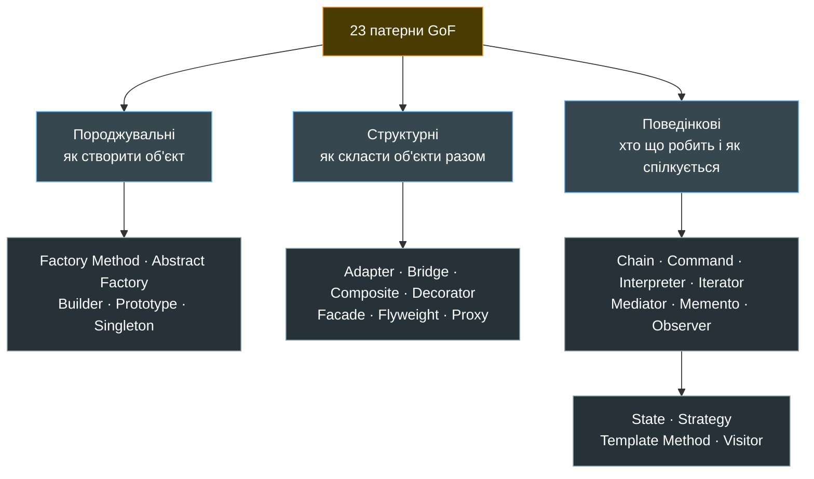

### Коротка історія патернів

| Рік | Хто | Що | Чому важливо |
|---|---|---|---|
| 1977 | Крістофер Александер | *A Pattern Language* — 253 патерни **архітектури будівель і міст** | саме слово «патерн» і форма «контекст → проблема → рішення» |
| 1987 | Кент Бек, Ворд Каннінгем | доповідь на OOPSLA: патерни Александера для інтерфейсів на Smalltalk | ідея прийшла в програмування |
| 1987 | Барбара Лісков | принцип підстановки (L у SOLID) | правило коректного наслідування |
| 1994 | Гамма, Гелм, Джонсон, Вліссідес — **GoF** | *Design Patterns* — 23 патерни ООП на C++ і Smalltalk | спільний словник для всієї галузі |
| 1999 | Мартін Фаулер | *Refactoring* — каталог запахів і рефакторингів | як прийти до патерну від робочого коду |
| 2000 | Роберт Мартін | стаття *Design Principles and Design Patterns* → згодом акронім **SOLID** | принципи, з яких «виводяться» патерни |
| 2002 | Мартін Фаулер | *Patterns of Enterprise Application Architecture* | Repository, Unit of Work, Service Layer, Active Record |
| 2003 | Ерік Еванс | *Domain-Driven Design* | Entity, Value Object, Aggregate, Bounded Context |
| 2005 | Алістер Кокберн | гексагональна архітектура (порти й адаптери) | бізнес-ядро без залежностей від інфраструктури |
| 2008 | Роберт Мартін | *Clean Code* | запахи G1–G36, F.I.R.S.T. |
| 2012–2017 | Роберт Мартін | стаття й книга *Clean Architecture* | 4 кола і правило залежностей |
| 2020 | Гаррі Персіваль, Боб Грегорі | *Architecture Patterns with Python* («Cosmic Python») | усе вищезгадане — у Python з pytest |

Помітна тенденція: патерни піднімались **від рівня класів до рівня систем**. Тому урок іде у зворотному порядку: спершу велика рамка (чиста архітектура), потім мова схем (UML), потім цеглинки (GoF), і нарешті — як усе це зібрати на коді, який ти вже писав.

### Як описаний кожен патерн у цьому уроці

Урок 20 навчив спершу **проєктувати**, а потім писати клас: картка класу (що за річ / що знає / що вміє / які правила / чого не робить). Для патерну — така сама картка:

| Поле картки | Питання |
|---|---|
| **Намір** | Яку проблему розв'язує — одним реченням |
| **Задача в «Смачно + Таксі»** | Де саме вона виникла в нашій системі |
| **Учасники** | Які ролі (класи чи функції) і що кожна знає й уміє |
| **Коли брати** | Ознаки в коді, що патерн окупиться |
| **Коли не брати** | Коли він лише додасть шар, який треба читати |
| **Пітонічно** | Як те саме роблять засобами Python — часто без класів |

Потім: **UML-діаграма класів** (структура), **діаграма взаємодії** (як ролі говорять під час роботи), **код** і **вивід**.

> [!NOTE]
> **Python — не Java**
>
> Більшість патернів GoF описано для мов, де функцію не можна передати як значення, а клас не можна створити «на льоту». У Python функції — об'єкти першого класу (урок 19), є duck typing, генератори, декоратори, модулі. Тому частина патернів у Python стискається до кількох рядків або вбудована в мову. Для кожного патерну розділ «Пітонічно» показує цю коротшу форму. Знати класичну форму все одно треба: її впізнаєш у Django, FastAPI, бібліотеках і на співбесіді.

---

## 1. Чиста архітектура: спершу шари, потім патерни

Патерни GoF відповідають на питання «як влаштувати кілька класів». Але спершу треба відповісти на більше питання: **де в програмі живе кожен клас і від кого йому дозволено залежати**. Без цієї відповіді навіть ідеальна Strategy опиниться в обробнику HTTP-запиту поруч із SQL — і її не вдасться ні протестувати, ні перенести.

Роберт Мартін («дядько Боб») у книзі *Clean Architecture* (2017) звів разом ідеї гексагональної архітектури (Алістер Кокберн, «порти й адаптери»), «цибулевої» архітектури (Джеффрі Палермо) та DDD в одну схему — **чисту архітектуру**.

### 1.1. Проблема: усе в одній функції

Ось як часто виглядає перша версія оформлення замовлення в «Смачно + Таксі»:

```python
import sqlite3

db = sqlite3.connect(":memory:")
db.execute("CREATE TABLE orders (customer TEXT, total INT, status TEXT)")


def handle_post_order(request_json):           # «контролер» робить усе
    items = request_json["items"]
    total = sum(item["price"] * item["qty"] for item in items)
    if total < 100:                            # бізнес-правило
        return {"status": 400, "error": "мінімальне замовлення 100 грн"}
    if request_json.get("night"):
        total = round(total * 1.2)             # ще одне бізнес-правило
    db.execute("INSERT INTO orders VALUES (?, ?, 'new')",
               (request_json["customer"], total))          # база
    print(f"SMS {request_json['customer']}: прийнято, {total} грн")  # сповіщення
    return {"status": 201, "total": total}


print(handle_post_order({"customer": "Олена", "items": [{"price": 120, "qty": 1}]}))
```

```text
SMS Олена: прийнято, 120 грн
{'status': 201, 'total': 120}
```

Працює. Але:

- щоб перевірити правило «мінімум 100 грн», тест мусить створювати базу й ловити SMS;
- Telegram-бот, який теж оформлює замовлення, скопіює ці правила — і за місяць вони розійдуться;
- перехід з SQLite на PostgreSQL зачепить функцію, в якій живуть правила про гроші.

Причина одна: **бізнес-правила змішані з деталями** — веб, база, SMS.

### 1.2. Чотири кола

Чиста архітектура розкладає код на концентричні шари. Чим ближче до центру — тим стабільніший і цінніший код, тим менше він знає про зовнішній світ.

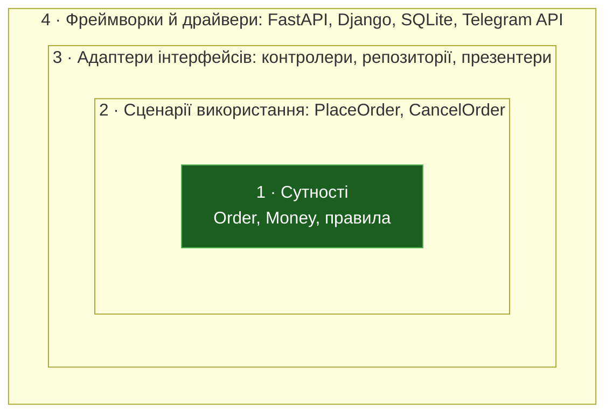

| Коло | Що там живе | У «Смачно + Таксі» | Змінюється, коли… |
|---|---|---|---|
| **1. Сутності** (Entities) | бізнес-об'єкти й правила, що діяли б і без програми | `Order`, `Money`, правило «мінімум 100 грн», «нічна надбавка 20%» | змінюється сам бізнес |
| **2. Сценарії використання** (Use Cases) | що *робить* застосунок: послідовність кроків однієї дії користувача | `PlaceOrder`: перевірити → зберегти → сповістити | з'являється нова функція продукту |
| **3. Адаптери інтерфейсів** (Interface Adapters) | перекладачі між форматом сценаріїв і форматом зовнішнього світу | HTTP-контролер, `SqliteOrderRepository`, `SmsNotifier`, презентер JSON | змінюється API, схема бази, формат відповіді |
| **4. Фреймворки й драйвери** (Frameworks & Drivers) | чужий код, який ми лише налаштовуємо | FastAPI, Django ORM, `sqlite3`, бібліотека Telegram | оновлюється бібліотека чи міняємо постачальника |

### 1.3. Правило залежностей

Усе тримається на одному правилі:

> **Залежності в коді спрямовані лише всередину.** Внутрішнє коло нічого не знає про зовнішнє: не імпортує його модулі, не згадує його класи, функції чи формати даних.

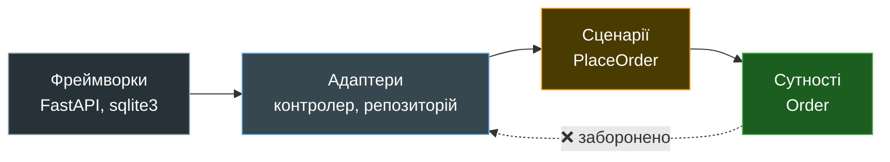

`domain/order.py` не робить `import sqlite3` і не робить `from fastapi import ...`. Перевірити це можна буквально — пошуком імпортів (у великих проєктах це автоматизують інструментом `import-linter`).

### 1.4. Як сценарій кличе базу, якщо не може її імпортувати

Сценарій `PlaceOrder` мусить зберегти замовлення. База — у зовнішньому колі. Як викликати зовнішнє, не залежачи від нього?

**Інверсія залежностей** (буква D в SOLID): внутрішнє коло **саме оголошує інтерфейс**, який йому потрібен, — **порт**. Зовнішнє коло його **реалізує** — **адаптер**. Стрілка виклику йде назовні, а стрілка залежності в коді — всередину.

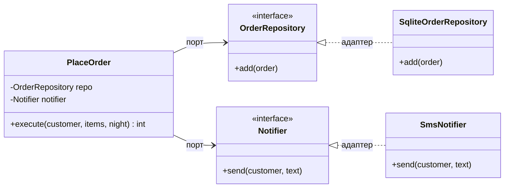

`PlaceOrder` і обидва інтерфейси лежать у внутрішньому колі. `SqliteOrderRepository` і `SmsNotifier` — у зовнішньому, і вони дивляться (стрілкою реалізації) **всередину**.

Під час роботи запит перетинає межі так:

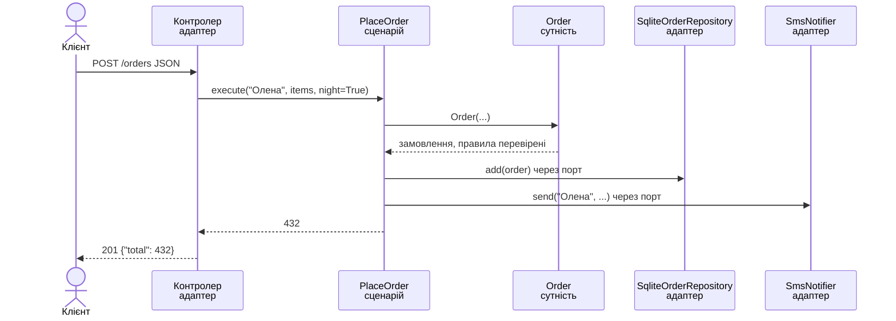

### 1.5. Той самий код — по шарах

Нижче той самий сценарій, розкладений по колах. У проєкті це були б окремі пакети (див. 1.6); тут — один файл, щоб його можна було запустити.

```python
# ───────── 1. Сутності: domain/ ─────────────────────────────────────
from dataclasses import dataclass
from typing import Protocol


class DomainError(Exception):
    pass


@dataclass(frozen=True)
class Item:
    dish: str
    price: int
    qty: int = 1


@dataclass
class Order:
    customer: str
    items: tuple
    night: bool = False
    status: str = "new"

    MIN_TOTAL = 100

    def __post_init__(self):
        if self.subtotal() < self.MIN_TOTAL:
            raise DomainError(f"мінімальне замовлення {self.MIN_TOTAL} грн")

    def subtotal(self):
        return sum(item.price * item.qty for item in self.items)

    def total(self):
        return round(self.subtotal() * 1.2) if self.night else self.subtotal()


# ───────── 2. Сценарії: application/ (+ порти, які їм потрібні) ─────
class OrderRepository(Protocol):
    def add(self, order: Order) -> None: ...


class Notifier(Protocol):
    def send(self, customer: str, text: str) -> None: ...


class PlaceOrder:
    def __init__(self, repo: OrderRepository, notifier: Notifier):
        self.repo, self.notifier = repo, notifier

    def execute(self, customer, items, night=False):
        order = Order(customer, tuple(Item(**i) for i in items), night)
        self.repo.add(order)
        self.notifier.send(customer, f"прийнято, {order.total()} грн")
        return order.total()


# ───────── 3. Адаптери: adapters/ ───────────────────────────────────
import sqlite3


class SqliteOrderRepository:
    def __init__(self, connection):
        self.db = connection
        self.db.execute("CREATE TABLE IF NOT EXISTS orders (customer, total, status)")

    def add(self, order):
        self.db.execute("INSERT INTO orders VALUES (?, ?, ?)",
                        (order.customer, order.total(), order.status))


class SmsNotifier:
    def send(self, customer, text):
        print(f"SMS {customer}: {text}")


def post_order_controller(request_json, use_case):   # HTTP → сценарій → HTTP
    try:
        total = use_case.execute(request_json["customer"], request_json["items"],
                                 request_json.get("night", False))
        return {"status": 201, "total": total}
    except DomainError as error:
        return {"status": 400, "error": str(error)}


# ───────── 4. Збирання (composition root): main.py ──────────────────
use_case = PlaceOrder(SqliteOrderRepository(sqlite3.connect(":memory:")), SmsNotifier())
print(post_order_controller({"customer": "Олена", "night": True,
                             "items": [{"dish": "борщ", "price": 120, "qty": 3}]}, use_case))
print(post_order_controller({"customer": "Тарас",
                             "items": [{"dish": "узвар", "price": 35}]}, use_case))
```

```text
SMS Олена: прийнято, 432 грн
{'status': 201, 'total': 432}
{'status': 400, 'error': 'мінімальне замовлення 100 грн'}
```

Тепер бізнес-правила перевіряються **без бази, без HTTP і без SMS** — підставляємо в порти прості фейки (урок 26):

```python
from dataclasses import dataclass


class DomainError(Exception):
    pass


@dataclass
class Order:
    customer: str
    subtotal: int
    night: bool = False

    def __post_init__(self):
        if self.subtotal < 100:
            raise DomainError("мінімальне замовлення 100 грн")

    def total(self):
        return round(self.subtotal * 1.2) if self.night else self.subtotal


class PlaceOrder:
    def __init__(self, repo, notifier):
        self.repo, self.notifier = repo, notifier

    def execute(self, customer, subtotal, night=False):
        order = Order(customer, subtotal, night)
        self.repo.add(order)
        self.notifier.send(customer, f"прийнято, {order.total()} грн")
        return order.total()


class FakeRepo:                         # адаптер для тестів: список у пам'яті
    def __init__(self):
        self.saved = []

    def add(self, order):
        self.saved.append(order)


class FakeNotifier:
    def __init__(self):
        self.sent = []

    def send(self, customer, text):
        self.sent.append((customer, text))


def test_night_surcharge():
    repo, notifier = FakeRepo(), FakeNotifier()
    assert PlaceOrder(repo, notifier).execute("Олена", 360, night=True) == 432
    assert len(repo.saved) == 1
    assert notifier.sent == [("Олена", "прийнято, 432 грн")]


def test_minimum_rejected_and_nothing_saved():
    repo = FakeRepo()
    try:
        PlaceOrder(repo, FakeNotifier()).execute("Тарас", 35)
    except DomainError:
        pass
    assert repo.saved == []


test_night_surcharge()
test_minimum_rejected_and_nothing_saved()
print("тести сценарію пройшли — без бази й без мережі")
```

```text
тести сценарію пройшли — без бази й без мережі
```

### 1.6. Шари як пакети (діаграма пакетів UML)

У реальному проєкті кола — це пакети. Стрілки на діаграмі пакетів — дозволені `import`:

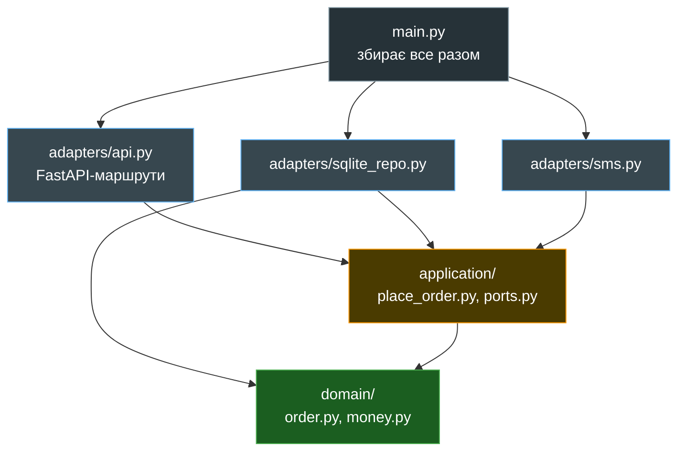

```text
smachno_taxi/
├── domain/              # 1 · сутності: чистий Python, жодних import фреймворків
│   ├── order.py
│   └── money.py
├── application/         # 2 · сценарії + порти (Protocol / ABC)
│   ├── ports.py
│   └── place_order.py
├── adapters/            # 3 · реалізації портів і вхідні адаптери
│   ├── api.py           #     FastAPI-маршрути → виклик сценарію
│   ├── sqlite_repo.py
│   └── sms.py
└── main.py              # 4 · composition root: створює адаптери й передає в сценарії
```

Єдине місце, яке знає **все**, — `main.py` (**composition root**). Саме там конкретні адаптери підставляються в порти. У FastAPI цю роль часто грає `Depends(...)`, у Django — `settings.py` і `apps.py`.

### 1.7. Межа між шарами: що через неї передають

Через межу йдуть **прості дані**, а не об'єкти фреймворку. Сценарій отримує `customer: str` і список словників, а не `fastapi.Request`; повертає число чи `dataclass`, а не `JSONResponse`. Інакше внутрішнє коло почне залежати від зовнішнього через «чужі» типи — правило залежностей порушене, хоч `import` і нема.

| Через межу передаємо | Не передаємо |
|---|---|
| `str`, `int`, `dataclass`, DTO, словник | `Request`, `HttpResponse`, ORM-модель Django, курсор бази |
| доменну помилку `DomainError` | `HTTPException(status_code=400)` |
| інтерфейс-порт | конкретний клас адаптера |

### 1.8. Де живуть патерни GoF у шарах

Чиста архітектура — каркас; патерни — деталі всередині кожного кола. Тому далі в уроці біля кожного патерну згадуватимемо, в якому шарі він зазвичай з'являється.

| Шар | Типові патерни | Навіщо там |
|---|---|---|
| **Сутності** | State, Strategy, Composite, Value Object, Specification | поведінка й правила бізнесу без I/O |
| **Сценарії** | Command, Template Method, Observer (доменні події), Unit of Work, порти | оркестрація кроків однієї дії |
| **Адаптери** | Adapter, Repository, Facade, Proxy (кеш), Decorator (повтори, логування), Presenter | переклад у світ і зі світу |
| **Збирання** | Factory, Abstract Factory, Builder, Singleton (одна конфігурація) | створення й з'єднання об'єктів |

### 1.9. Коли чиста архітектура — зайва

Чотири кола — це ціна: більше файлів, інтерфейсів і «перекладу» даних між шарами. Для скрипта на 200 рядків, прототипу на вихідні чи простого CRUD-адмінки в Django вони не окупаються. Мартін і сам радить починати просто й **проводити межі тоді, коли з'являється зміна, від якої треба захиститись**: друга база, другий канал (бот + сайт), складні правила, які треба тестувати окремо.

Мінімальна версія, яка окупається майже завжди: **винести бізнес-правила з обробників у звичайні функції чи класи без імпортів фреймворку**. Це вже половина чистої архітектури.

> **Детальніше в курсі:** у модулі 4 (урок 45, «Каталог патернів») шари Layers → Service Layer → Repository → Unit of Work показано на двох справжніх проєктах — Django-нотатках і FastAPI-сервісі новин. Розділ 7 цього уроку коротко повторює ці архітектурні патерни.
## 2. UML 2 для ООП: мова схем

**UML** (Unified Modeling Language) — стандартна мова діаграм для програмних систем. Версія **UML 2** (2005, поточна — 2.5.1) визначає 14 типів діаграм. Щоденно розробник використовує чотири-п'ять із них, і всі вони є в цьому уроці.

Ми малюємо UML у **Mermaid** — текстовому форматі, який GitHub і MkDocs показують як схему. Схема живе поруч із кодом і змінюється разом із ним.

### 2.1. Клас на діаграмі

Почнімо з картки класу `Order` з урока 20 — і подивімося, як вона стає прямокутником UML:

```python
class Order:
    service_fee = 20                       # атрибут класу (спільний)

    def __init__(self, customer, dishes):
        self.customer = customer           # публічний атрибут
        self._dishes = list(dishes)        # «внутрішній» атрибут
        self.__paid = False                # «приватний» (name mangling)

    def total(self):                       # публічний метод
        return sum(price for _, price in self._dishes) + Order.service_fee

    @classmethod
    def from_names(cls, customer, *names):  # фабричний метод класу
        prices = {"борщ": 120, "вареники": 95, "узвар": 35}
        return cls(customer, [(n, prices[n]) for n in names])


order = Order.from_names("Олена", "борщ", "узвар")
print(order.customer, order.total())
```

```text
Олена 175
```

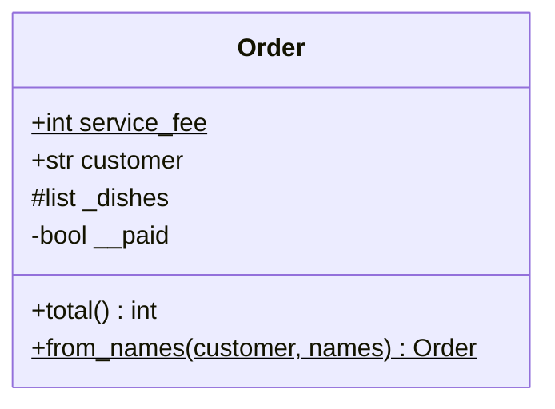

Прямокутник має три частини: **назва**, **атрибути**, **операції**. Перед кожним членом — **видимість**:

| Символ UML | Видимість | У Python |
|---|---|---|
| `+` | public — публічний | `customer` |
| `#` | protected — для нащадків | `_dishes` (домовленість: «не чіпай ззовні») |
| `-` | private — лише цей клас | `__paid` (name mangling → `_Order__paid`, урок 22) |
| `~` | package — у межах пакета | у Python немає; на практиці — модуль з `_` |

Інші позначки:

- **підкреслення** (у Mermaid — `$` після члена) — статичний член: атрибут класу чи `@classmethod`/`@staticmethod`;
- **курсив** (у Mermaid — `*` після методу) — абстрактний метод (`@abstractmethod`);
- `«interface»`, `«abstract»` над назвою — **стереотип**: роль класу;
- `: int` після операції — тип повернення; у Python це анотація `-> int`.

### 2.2. Шість зв'язків між класами

Найважливіше на діаграмі класів — **лінії**. Кожна лінія — одне речення про код. Шість видів, від найслабшого до найсильнішого:

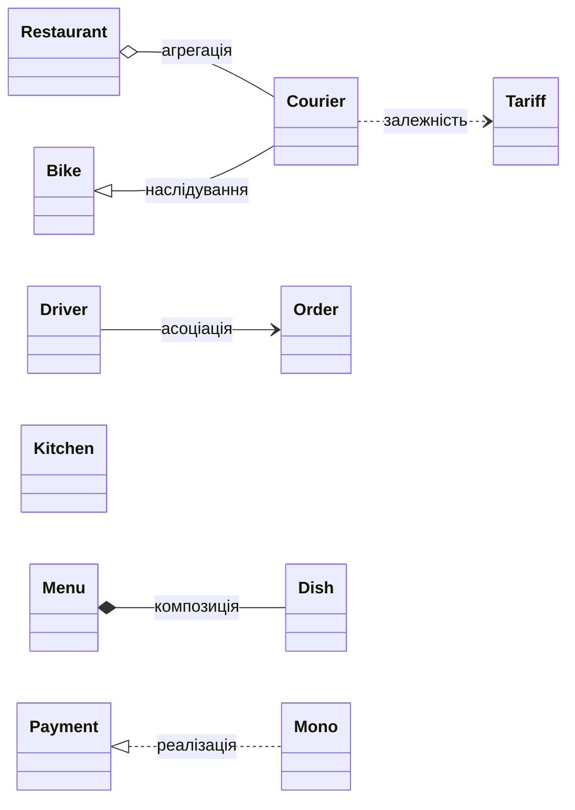

| Зв'язок | Стрілка UML | Mermaid | Речення | Як виглядає в Python |
|---|---|---|---|---|
| **Залежність** (dependency) | пунктир, відкрита стрілка | `A ..> B` | A *використовує* B на мить | B — параметр методу чи локальна змінна |
| **Асоціація** (association) | суцільна лінія, стрілка | `A --> B` | A *знає про* B довго | B збережено в атрибуті: `self.order = order` |
| **Агрегація** (aggregation) | порожній ромб біля цілого | `A o-- B` | A *має* B, але B живе й без A | список об'єктів, створених ззовні |
| **Композиція** (composition) | зафарбований ромб біля цілого | `A *-- B` | A *складається з* B; B без A не існує | A сам створює B у `__init__` |
| **Наслідування** (generalization) | суцільна лінія, порожній трикутник | `A <\|-- B` | B *є* A | `class B(A)` |
| **Реалізація** (realization) | пунктир, порожній трикутник | `A <\|.. B` | B *виконує контракт* A | `class B(A)` для ABC або відповідність `Protocol` |

> [!WARNING]
> **Стрілка в Mermaid стоїть біля «головного» класу**
>
> `Bike <|-- Courier` читається «Courier наслідує Bike» — трикутник біля батька. `Menu *-- Dish` — ромб біля цілого, тобто біля меню.

Ті самі шість зв'язків у коді — щоб кожну лінію можна було «прочитати» в Python:

```python
from abc import ABC, abstractmethod


class Tariff:                                  # для залежності
    per_km = 12


class Payment(ABC):                            # «interface» для реалізації
    @abstractmethod
    def pay(self, amount): ...


class Mono(Payment):                           # Payment <|.. Mono — реалізація
    def pay(self, amount):
        return f"mono: списано {amount} грн"


class Bike:                                    # Bike <|-- Courier — наслідування
    wheels = 2


class Courier(Bike):
    def __init__(self, name):
        self.name = name

    def price(self, km, tariff):               # Courier ..> Tariff — лише параметр
        return km * tariff.per_km


class Dish:
    def __init__(self, title):
        self.title = title


class Menu:                                    # Menu *-- Dish — композиція
    def __init__(self, *titles):
        self.dishes = [Dish(t) for t in titles]  # меню САМЕ створює страви


class Restaurant:                              # Restaurant o-- Courier — агрегація
    def __init__(self, couriers):
        self.couriers = couriers               # кур'єрів передали ззовні


class Order:
    pass


class Driver:                                  # Driver --> Order — асоціація
    def __init__(self):
        self.current_order = None              # знає про замовлення довго

    def take(self, order):
        self.current_order = order


taras = Courier("Тарас")
cafe = Restaurant([taras])
del cafe                                       # ресторан зник — кур'єр живий
print(taras.name, taras.wheels, taras.price(5, Tariff()))

menu = Menu("борщ", "вареники")
print([d.title for d in menu.dishes])          # страви живуть усередині меню
print(Mono().pay(175))
```

```text
Тарас 2 60
['борщ', 'вареники']
mono: списано 175 грн
```

**Кратність** (multiplicity) пишуть біля кінців лінії: скільки об'єктів з кожного боку.

| Запис | Значення |
|---|---|
| `1` | рівно один |
| `0..1` | нуль або один (у Python — `None` або об'єкт) |
| `*` або `0..*` | скільки завгодно (список, може бути порожній) |
| `1..*` | щонайменше один |

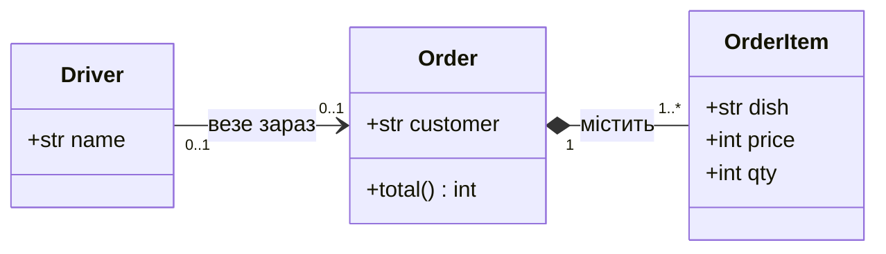

Читається так: у замовленні — одна чи більше позицій, і кожна позиція належить рівно одному замовленню; водій везе щонайбільше одне замовлення, а замовлення може ще не мати водія.

### 2.3. Інтерфейси й абстрактні класи

У Python контракт задають двома способами — і UML малює їх однаково, стереотипом:

```python
from abc import ABC, abstractmethod
from typing import Protocol


class Notifier(ABC):                     # явний контракт: наслідуй і реалізуй
    @abstractmethod
    def send(self, text): ...


class Payable(Protocol):                 # структурний контракт: просто май метод
    def pay(self, amount) -> str: ...


class Telegram(Notifier):
    def send(self, text):
        return f"telegram: {text}"


class Cash:                              # ні від чого не наслідує
    def pay(self, amount):
        return f"готівка: {amount} грн"


def checkout(method: Payable, amount):  # приймає будь-що з методом pay
    return method.pay(amount)


print(Telegram().send("Замовлення готове"))
print(checkout(Cash(), 175))
try:
    Notifier()
except TypeError as error:
    print("TypeError:", error)
```

```text
telegram: Замовлення готове
готівка: 175 грн
TypeError: Can't instantiate abstract class Notifier without an implementation for abstract method 'send'
```

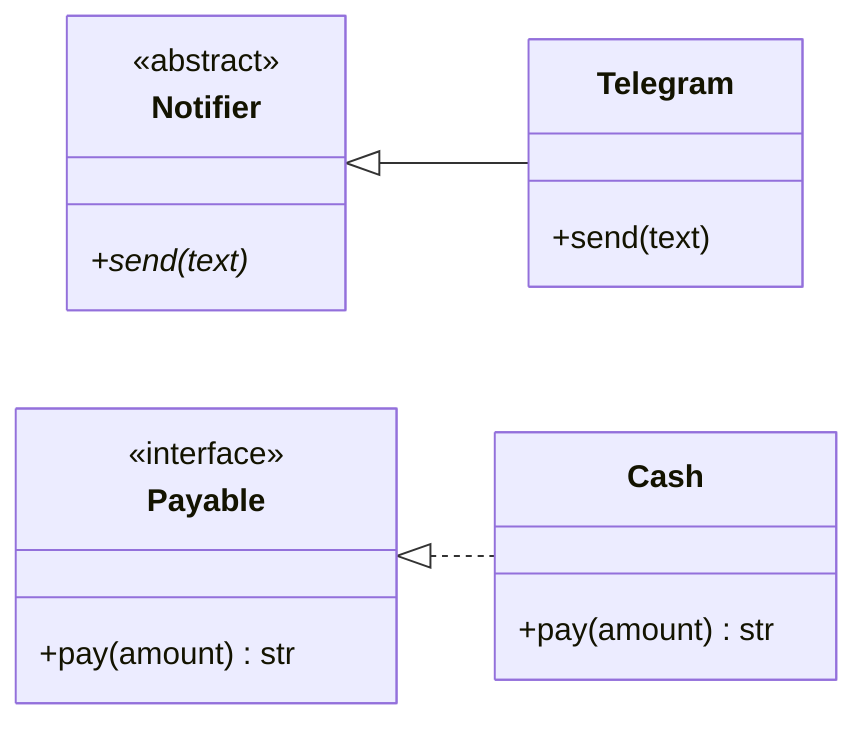

- **ABC** (`abc.ABC`) — номінальний контракт: клас мусить явно наслідувати й реалізувати всі `@abstractmethod`, інакше об'єкт не створиться. На діаграмі — `«abstract»` і наслідування.
- **`Protocol`** (`typing`) — структурний контракт, «duck typing з перевіркою»: підходить будь-який клас із потрібними методами, наслідувати не треба. Перевіряє його mypy чи IDE, а не Python під час запуску. На діаграмі — `«interface»` і реалізація (пунктир).

У діаграмах патернів нижче «інтерфейс» означає будь-який із цих способів.

### 2.4. Діаграма послідовності: хто кого викликає

Діаграма класів показує **структуру** — що існує. **Діаграма послідовності** (sequence diagram) показує **поведінку в часі** — хто кого викликає під час однієї операції. Час іде згори вниз.

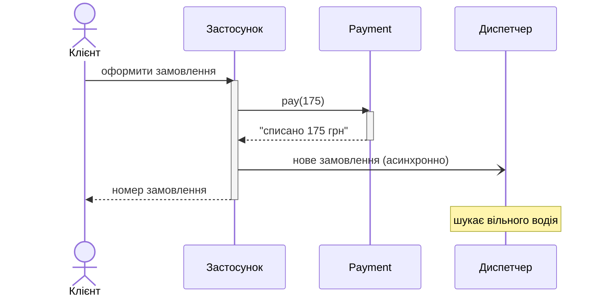

| Елемент | Позначка | Зміст |
|---|---|---|
| **Лінія життя** (lifeline) | прямокутник + вертикальний пунктир | об'єкт чи учасник |
| **Актор** | чоловічок | людина чи зовнішня система |
| **Синхронне повідомлення** | суцільна стрілка `->>` | виклик методу: чекаємо відповіді |
| **Відповідь** | пунктирна стрілка `-->>` | `return` |
| **Асинхронне повідомлення** | стрілка `-)` | надіслали й не чекаємо (черга, подія, `create_task`) |
| **Активація** | вузький прямокутник на лінії | метод зараз виконується |
| **Фрагменти** | рамки `alt` / `opt` / `loop` / `par` | `if/else`, `if`, цикл, паралельно |

### 2.5. Діаграма станів: життя одного об'єкта

Замовлення проходить стани: нове → готується → в дорозі → доставлено, а з перших двох його можна скасувати. **Діаграма станів** (state machine diagram) показує, які переходи дозволені й що їх викликає. Вона знадобиться для патерну State.

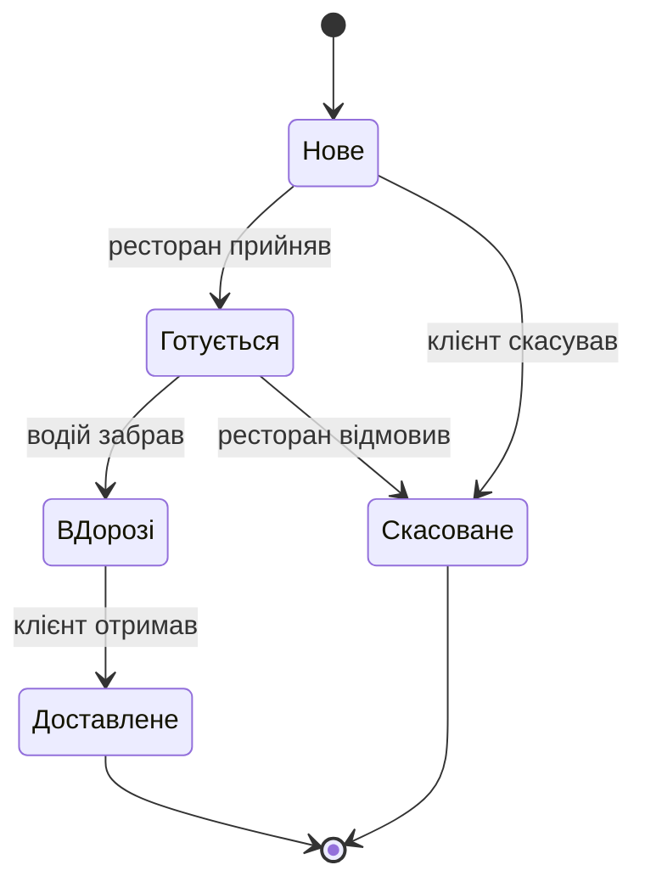

`[*]` — початок і кінець; стрілка з підписом — **перехід** з **подією**, що його викликає. Чого на діаграмі немає (наприклад, `Доставлене → Готується`), того не має дозволяти й код.

### 2.6. Діаграма активностей: алгоритм процесу

**Діаграма активностей** (activity diagram) — блок-схема процесу з розгалуженнями. Mermaid малює її як `flowchart`; саме такі схеми ти бачив у всіх уроках курсу.

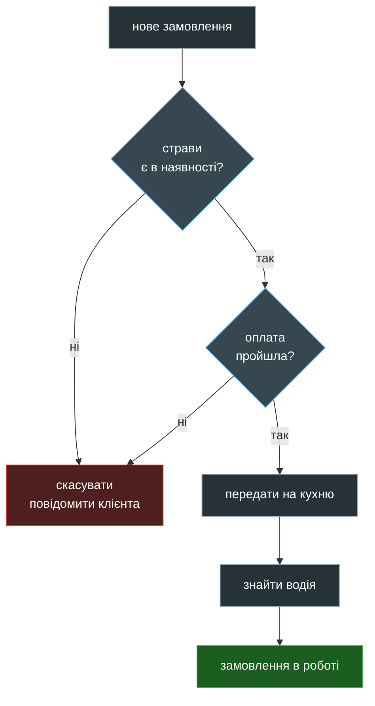

### 2.7. Усі 14 діаграм UML 2

| Група | Діаграма | Що показує | Mermaid | У цьому уроці |
|---|---|---|---|---|
| Структурні | **Класів** (class) | класи, атрибути, зв'язки | `classDiagram` | так, у кожному патерні |
| Структурні | **Об'єктів** (object) | конкретні об'єкти в момент часу | через `classDiagram` або `flowchart` | Composite, Flyweight |
| Структурні | Компонентів (component) | модулі системи та їхні інтерфейси | через `flowchart` | розділ 7 |
| Структурні | Пакетів (package) | групування класів у пакети | через `flowchart` з `subgraph` | розділ 7 |
| Структурні | Розгортання (deployment) | сервери, контейнери, вузли | через `flowchart` | — (модуль 5) |
| Структурні | Композитної структури | внутрішня будова класу | — | — |
| Структурні | Профілів (profile) | розширення самого UML | — | — |
| Поведінкові | **Послідовності** (sequence) | виклики між об'єктами в часі | `sequenceDiagram` | так, більшість поведінкових |
| Поведінкові | **Станів** (state machine) | стани об'єкта й переходи | `stateDiagram-v2` | State, Memento |
| Поведінкові | **Активностей** (activity) | алгоритм процесу | `flowchart` | Chain, Template Method, розділ 9 |
| Поведінкові | Варіантів використання (use case) | хто що робить із системою | через `flowchart` | розділ 7 |
| Поведінкові | Комунікації (communication) | ті самі виклики, що sequence, але як граф | через `flowchart` | Mediator |
| Поведінкові | Огляду взаємодії (interaction overview) | sequence-фрагменти, з'єднані активністю | — | — |
| Поведінкові | Часова (timing) | зміна стану на шкалі часу | — | — |

Головне правило UML на практиці: **малюй рівно стільки, скільки потрібно, щоб пояснити рішення**. Діаграма, яка повторює кожне поле коду, застаріває за тиждень; діаграма з п'ятьма класами й трьома лініями пояснює архітектуру роками.

---

## 3. ООП і принципи, на яких стоять патерни

Патерни — не набір окремих фокусів. Майже кожен із них — застосування кількох принципів. Знаючи принципи, патерн можна «вивести» самому.

### 3.1. Чотири стовпи ООП

Усі патерни побудовані з чотирьох базових ідей ООП (уроки 20–24). Кожну — одним прикладом зі «Смачно + Таксі».

| Стовп | Суть | У «Смачно + Таксі» | Урок |
|---|---|---|---|
| **Абстракція** | модель тримає лише те, що важливо *в цьому контексті* | для диспетчерської авто — це місткість і район; для СТО те саме авто — пробіг і дата ТО | 20 |
| **Інкапсуляція** | об'єкт сам контролює свій стан і **ніколи не стає невалідним**; ззовні — лише публічний інтерфейс | `Money` не може бути від'ємним; змінити суму можна тільки методами | 22, 24 |
| **Наслідування** | новий клас отримує інтерфейс і реалізацію батька | `TaxiDelivery(Delivery)` | 21 |
| **Поліморфізм** | один виклик — різна поведінка залежно від класу об'єкта | `delivery.fare()` для таксі, кур'єра й самовивозу | 21 |

Інкапсуляція — це не «геттер і сеттер на кожне поле». Її мета — **інваріант**: правило, яке завжди правдиве для об'єкта.

```python
class Wallet:
    def __init__(self, balance=0):
        self._balance = balance

    @property
    def balance(self):                       # читати можна
        return self._balance

    def pay(self, amount):                   # змінювати — лише через правило
        if amount > self._balance:
            raise ValueError(f"недостатньо коштів: {self._balance} < {amount}")
        self._balance -= amount


wallet = Wallet(100)
wallet.pay(70)
try:
    wallet.pay(70)
except ValueError as error:
    print("ValueError:", error)
try:
    wallet.balance = 10**6                   # обійти правило не вийде
except AttributeError:
    print("AttributeError: баланс не можна присвоїти напряму")
print(wallet.balance)
```

```text
ValueError: недостатньо коштів: 30 < 70
AttributeError: баланс не можна присвоїти напряму
30
```

Наслідування — найсильніший зв'язок між класами: нащадок бачить усі деталі батька і ламається від їхніх змін. Тому наступні принципи частіше радять **композицію**, а поліморфізм отримують через спільний інтерфейс (ABC, `Protocol`, duck typing), а не через довгі ієрархії.

### 3.2. Інкапсулюй те, що змінюється

Знайди в коді місце, яке змінюється найчастіше (тарифи, способи оплати, канали сповіщень), і відокрем його за стабільним інтерфейсом. Решта коду перестане змінюватися разом із ним. Це суть Strategy, State, Bridge, Factory.

### 3.3. Програмуй на рівні інтерфейсу, а не реалізації

Код диспетчерської має знати «є щось із методом `send(text)`», а не «є клас `TelegramBot`». Тоді Telegram можна замінити на SMS чи на фейк у тестах (урок 26), не чіпаючи диспетчерську.

### 3.4. Композиція замість наслідування

Наслідування — найміцніший зв'язок між класами: нащадок залежить від усіх деталей батька, і поведінку не можна змінити під час роботи. Композиція — «має» замість «є» — дає гнучкість.

```python
class Car:
    def move(self):
        return "їде дорогою"


class Bike:
    def move(self):
        return "їде велодоріжкою"


class Courier:                       # має транспорт, а не є транспортом
    def __init__(self, name, transport):
        self.name = name
        self.transport = transport

    def deliver(self):
        return f"{self.name} {self.transport.move()}"


maria = Courier("Марія", Bike())
print(maria.deliver())
maria.transport = Car()              # пересіла на авто — без нового класу
print(maria.deliver())
```

```text
Марія їде велодоріжкою
Марія їде дорогою
```

З наслідуванням знадобилися б класи `BikeCourier`, `CarCourier`, а пересісти з одного на інший об'єкт не зміг би.

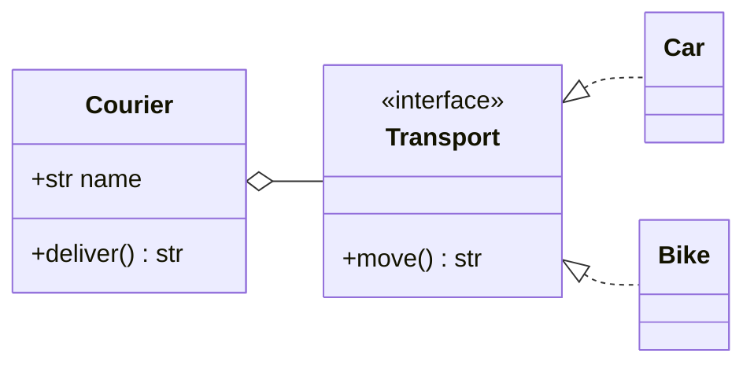

### 3.5. SOLID

П'ять принципів Роберта Мартіна. Кожен — короткою фразою і ознакою порушення в коді:

| Принцип | Суть | Ознака порушення | Патерни, що допомагають |
|---|---|---|---|
| **S** — Single Responsibility | у класу одна причина змінюватися | клас `OrderManager` рахує ціну, пише в базу й шле SMS | Facade, Command, Service Layer |
| **O** — Open/Closed | відкритий для розширення, закритий для зміни | новий тариф = новий `elif` у старій функції | Strategy, Decorator, Observer, Template Method |
| **L** — Liskov Substitution | нащадок можна підставити замість батька | нащадок кидає `NotImplementedError` чи змінює зміст методу | правильні ієрархії, композиція |
| **I** — Interface Segregation | багато вузьких інтерфейсів краще за один широкий | клас реалізує 10 методів, з яких потрібні 2 | Adapter, `Protocol` з 1–2 методами |
| **D** — Dependency Inversion | залежи від абстракцій, а не від конкретики | `OrderService` сам створює `PostgresRepository()` | Factory, Dependency Injection, Repository |

Тепер кожен принцип — порушення і виправлення в коді.

#### S — одна причина змінюватися

```python
class OrderManagerBad:                         # ❌ три причини змінюватися
    def place(self, customer, total):
        price = round(total * 1.2)             # 1) бізнес-правило ціни
        saved = f"INSERT {customer} {price}"   # 2) формат збереження
        sms = f"SMS {customer}: {price} грн"   # 3) текст сповіщення
        return price, saved, sms


def night_price(total):                        # ✅ кожна відповідальність окремо
    return round(total * 1.2)


class OrderRepository:
    def save(self, customer, price):
        return f"INSERT {customer} {price}"


class Notifier:
    def text(self, customer, price):
        return f"SMS {customer}: {price} грн"


price = night_price(300)
print(OrderManagerBad().place("Олена", 300) ==
      (price, OrderRepository().save("Олена", price), Notifier().text("Олена", price)))
```

```text
True
```

Поведінка та сама — але зміна тексту SMS більше не зачіпає клас, який рахує гроші.

#### O — розширюй, не змінюючи

```python
def fare_bad(kind, km):                        # ❌ новий спосіб = правка тут
    if kind == "taxi":
        return km * 12
    elif kind == "courier":
        return 40
    raise ValueError(kind)


FARES = {                                      # ✅ новий спосіб = новий рядок
    "taxi": lambda km: km * 12,
    "courier": lambda km: 40,
}
FARES["drone"] = lambda km: 25 + km * 5        # розширили, старий код не чіпали

print(fare_bad("taxi", 5), FARES["taxi"](5), FARES["drone"](5))
```

```text
60 60 50
```

#### L — нащадок має виконувати контракт батька

Барбара Лісков (1987): якщо `S` — підтип `T`, то об'єкт `T` у програмі можна замінити об'єктом `S`, і програма лишиться коректною. Простіше: **код, що працює з батьком, не повинен здогадуватися, що йому підсунули нащадка.**

Чотири правила для методів нащадка:

| Правило | Означає | Порушення в «Смачно + Таксі» |
|---|---|---|
| **Передумови не посилювати** | нащадок не вимагає від клієнта більше, ніж батько | `Delivery(order_id, district)` приймає будь-який район, а `CourierDelivery` — лише Поділ |
| **Післяумови не послаблювати** | нащадок гарантує не менше, ніж батько | батько обіцяє `fare() >= 0`, нащадок повертає `None` |
| **Інваріанти зберігати** | правила цілісності батька діють і в нащадку | нащадок дозволяє від'ємний баланс |
| **Не кидати нових винятків** | лише ті, до яких готовий клієнт батька | `save()` у нащадку кидає `NotImplementedError` |

Класичне порушення — документ «лише для читання», що успадковує документ:

```python
class Receipt:
    def __init__(self, text):
        self.text = text

    def save(self, storage):
        storage.append(self.text)


class ArchivedReceipt(Receipt):                # ❌ «є чеком», але не вміє save
    def save(self, storage):
        raise PermissionError("архівний чек змінювати не можна")


def save_all(receipts, storage):               # клієнт написаний для Receipt
    for receipt in receipts:
        receipt.save(storage)


storage = []
try:
    save_all([Receipt("№1"), ArchivedReceipt("№0")], storage)
except PermissionError as error:
    print("зламалось:", error)
```

```text
зламалось: архівний чек змінювати не можна
```

Клієнту тепер доведеться писати `if not isinstance(r, ArchivedReceipt)` — поліморфізм зламано. Виправлення — **розділити контракт**: «читати» мають усі, «зберігати» — лише ті, хто справді вміє:

```python
class ReadableReceipt:
    def __init__(self, text):
        self.text = text

    def show(self):
        return f"чек {self.text}"


class Receipt(ReadableReceipt):                # ✅ уміє більше, контракт батька цілий
    def save(self, storage):
        storage.append(self.text)


class ArchivedReceipt(ReadableReceipt):        # ✅ не обіцяє save — і не мусить
    pass


def show_all(receipts):                        # для всіх
    return [r.show() for r in receipts]


def save_all(receipts: list[Receipt], storage):  # лише для тих, хто вміє
    for receipt in receipts:
        receipt.save(storage)


storage = []
save_all([Receipt("№1"), Receipt("№2")], storage)
print(show_all([Receipt("№1"), ArchivedReceipt("№0")]), storage)
```

```text
['чек №1', 'чек №0'] ['№1', '№2']
```

У курсі ти вже бачив порушення LSP: `FriendlyPickup` в уроці 21 («Нащадок, що ламає батька»).

#### LSP на практиці: п'ять правил для Python

Python не перевіряє контракти під час визначення класу, тому порушити LSP тут особливо легко. Ось що саме треба перевіряти в нащадку.

**1. Конструктор не вимагає більше, ніж батько.** Якщо клієнт створює об'єкти через сам клас (фабрика, реєстр, `cls(...)`), нащадок з новим обов'язковим аргументом ламає створення. Це реальний випадок з уроку 21: `TaxiDelivery` додав обов'язковий `driver`.

```python
class Delivery:
    def __init__(self, order_id, district):
        self.order_id, self.district = order_id, district


class Pickup(Delivery):
    pass


class TaxiDelivery(Delivery):                       # ❌ обов'язковий driver
    def __init__(self, order_id, district, driver):
        super().__init__(order_id, district)
        self.driver = driver


class TaxiDeliveryFixed(Delivery):                  # ✅ водія призначать пізніше
    def __init__(self, order_id, district, driver=None):
        super().__init__(order_id, district)
        self.driver = driver


def create_all(classes, order_id, district):        # клієнт знає лише контракт Delivery
    for cls in classes:
        try:
            print(cls.__name__, "→", type(cls(order_id, district)).__name__)
        except TypeError as error:
            print(cls.__name__, "→ TypeError:", error)


create_all([Pickup, TaxiDelivery, TaxiDeliveryFixed], 1, "Оболонь")
```

```text
Pickup → Pickup
TaxiDelivery → TypeError: TaxiDelivery.__init__() missing 1 required positional argument: 'driver'
TaxiDeliveryFixed → TaxiDeliveryFixed
```

Якщо додаткова річ справді обов'язкова — це сигнал, що «є Delivery» тут не підходить: краще композиція (доставка **має** водія, розділ 3.4) або окремий альтернативний конструктор `@classmethod`.

**2. Аргументи — не вужчі, результат — не ширший.** Метод нащадка може приймати **ширші** типи, ніж батько (контраваріантність аргументів), і повертати **вужчі** (коваріантність результату) — але не навпаки:

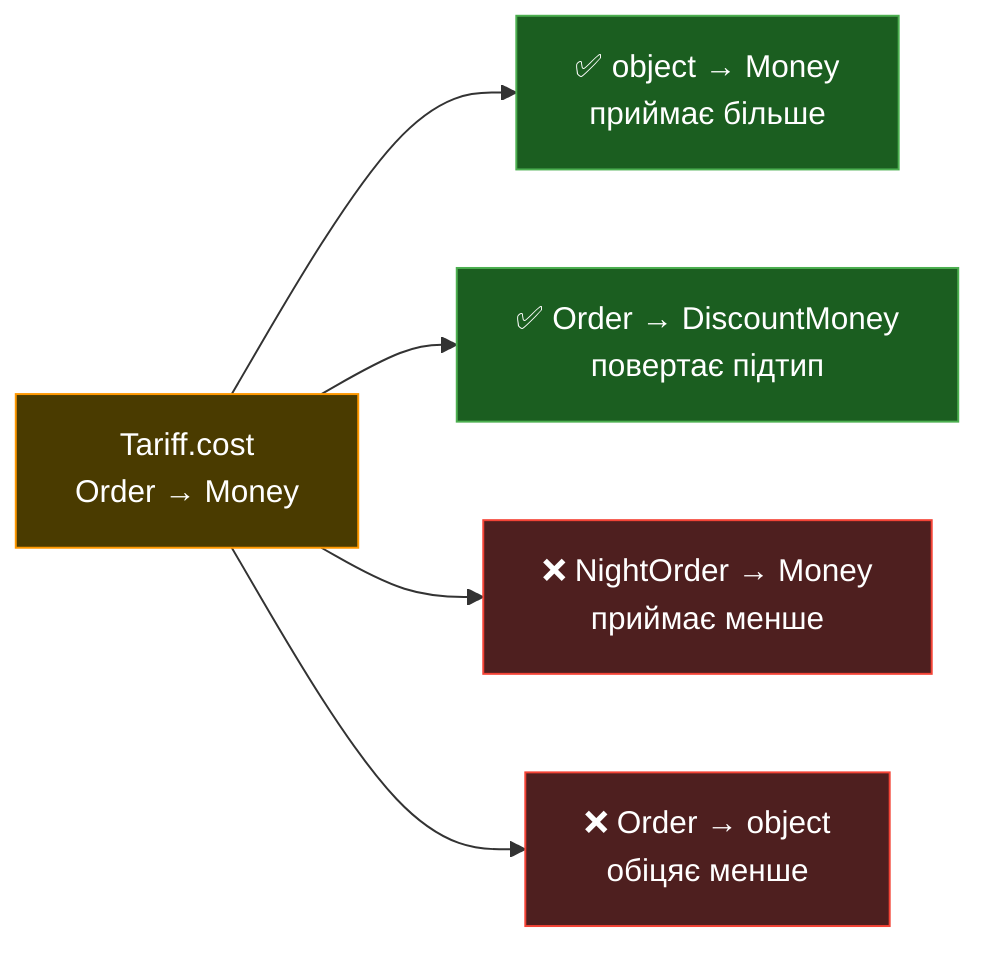

Логіка проста: клієнт, що працює з `Tariff`, передає будь-яке `Order` — нащадок мусить його прийняти; і чекає `Money` — нащадок мусить її повернути.

```python
class Order:
    def __init__(self, km):
        self.km = km


class NightOrder(Order):
    def __init__(self, km, hour):
        super().__init__(km)
        self.hour = hour


class Money(int):
    pass


class Tariff:
    def cost(self, order: Order) -> Money:
        return Money(order.km * 12)


class NightTariffBad(Tariff):
    def cost(self, order: NightOrder) -> object:        # ❌ вужчий аргумент, ширший результат
        return Money(order.km * 18) if order.hour >= 23 else None


class NightTariff(Tariff):
    def cost(self, order: Order) -> Money:              # ✅ контракт батька
        hour = getattr(order, "hour", 12)               # звичайне замовлення — денне
        return Money(order.km * (18 if hour >= 23 else 12))


def total(tariff: Tariff, orders):                      # клієнт знає лише Tariff
    return sum(tariff.cost(order) for order in orders)


orders = [Order(5), NightOrder(5, 23)]
print(total(NightTariff(), orders))
try:
    total(NightTariffBad(), orders)
except AttributeError as error:
    print("AttributeError:", error)
```

```text
150
AttributeError: 'Order' object has no attribute 'hour'
```

Python запустив `NightTariffBad` без жодного попередження — помилка вилізла лише на звичайному замовленні. Статичний аналізатор знаходить її **до запуску**. Ось що каже `mypy` про клас `NightTariffBad`:

```text
error: Return type "object" of "cost" incompatible with return type "Money" in supertype "Tariff"  [override]
error: Argument 1 of "cost" is incompatible with supertype "Tariff"; supertype defines the argument type as "Order"  [override]
note: This violates the Liskov substitution principle
```

Тому анотації типів (урок 37) і `mypy`/`pyright` у CI — головний практичний захист LSP у Python.

**3. Жодних «обнулених» методів і нових винятків.** Нащадок, що перевизначає робочий метод на `raise NotImplementedError` / `PermissionError` / `pass`, ламає клієнтів — приклад з `ArchivedReceipt` вище. Різниця важлива: `NotImplementedError` у **абстрактному батьку** (як `Delivery.fare()` в уроці 21) — нормальна заглушка «нащадок, визнач мене»; надійніше оформити її через `ABC` і `@abstractmethod`. Порушення — коли **нащадок** відбирає поведінку, яку батько вже обіцяв.

**4. Передумови не посилювати.** Батько працює одразу, а нащадок вимагає «спершу виклич `connect()`» — клієнт, написаний для батька, цього не знає.

**5. Післяумови не послаблювати.** Батько обіцяє «список водіїв, відсортований за відстанню», нащадок повертає `None` для порожнього результату чи несортований список.

Обидва правила найзручніше ловити **контрактним тестом**: одна перевірка контракту батька, яку проганяють для кожної реалізації (у pytest — `@pytest.mark.parametrize` по класах):

```python
class DriverFinder:
    DRIVERS = {"Тарас": 3.1, "Марія": 1.2, "Олексій": 6.0}

    def nearest(self, max_km):
        """Контракт: список імен, відсортований за відстанню; порожній, якщо нікого."""
        found = [(km, name) for name, km in self.DRIVERS.items() if km <= max_km]
        return [name for km, name in sorted(found)]


class CachedFinder(DriverFinder):                   # ❌ посилена передумова
    def __init__(self):
        self.ready = False

    def connect(self):
        self.ready = True

    def nearest(self, max_km):
        if not self.ready:
            raise RuntimeError("спершу викличте connect()")
        return super().nearest(max_km)


class FastFinder(DriverFinder):                     # ❌ послаблена післяумова
    def nearest(self, max_km):
        found = [name for name, km in self.DRIVERS.items() if km <= max_km]
        return found or None                        # несортовано і None замість []


class LazyFinder(DriverFinder):                     # ✅ підключається сам
    def __init__(self):
        self.ready = False

    def nearest(self, max_km):
        self.ready = True                           # передумову виконує сам
        return super().nearest(max_km)


def check_contract(finder):                         # контрактний тест
    try:
        assert finder.nearest(5) == ["Марія", "Тарас"], "не відсортовано"
        assert finder.nearest(0.5) == [], "порожній результат має бути []"
        return "✅ контракт виконано"
    except (AssertionError, RuntimeError) as error:
        return f"❌ {type(error).__name__}: {error}"


for cls in (DriverFinder, CachedFinder, FastFinder, LazyFinder):
    print(f"{cls.__name__:12}", check_contract(cls()))
```

```text
DriverFinder ✅ контракт виконано
CachedFinder ❌ RuntimeError: спершу викличте connect()
FastFinder   ❌ AssertionError: не відсортовано
LazyFinder   ✅ контракт виконано
```

Контрактний тест — те, що перетворює LSP з поради на перевірку: нова реалізація (`PostgresFinder`, `FakeFinder` для тестів) додається до списку класів і автоматично проходить ту саму перевірку. Саме так тестують адаптери портів у чистій архітектурі (розділ 1.5).

**Чеклист LSP для Python:**

| Перевір | Ознака порушення | Інструмент |
|---|---|---|
| конструктор | новий обов'язковий аргумент у нащадка | значення за замовчуванням, композиція, `@classmethod` |
| типи аргументів і результату | нащадок звужує аргумент або розширює результат | анотації + `mypy`/`pyright` у CI (`[override]`) |
| винятки | нащадок кидає те, чого не кидав батько; `pass` замість дії | розділити інтерфейс (ISP), як `ReadableReceipt` |
| передумови | «спершу виклич X», вужчий діапазон значень | нащадок виконує передумову сам |
| післяумови й інваріанти | `None` замість `[]`, втрачене сортування, від'ємний баланс | контрактний тест для всіх реалізацій |
| клієнтський код | `if isinstance(obj, ChildClass)` у бізнес-логіці | будь-яке з вищезгаданого — шукай, який контракт зламано |
| глибока ієрархія | 3+ рівні наслідування заради повторного використання | `typing.Protocol` — контракт поведінки без ієрархії |

#### I — вузькі інтерфейси

```python
from typing import Protocol


class Payable(Protocol):                       # ✅ кожному клієнту — свій контракт
    def pay(self, amount: int) -> str: ...


class Refundable(Protocol):
    def refund(self, amount: int) -> str: ...


class Card:                                    # уміє обидва
    def pay(self, amount):
        return f"картка −{amount}"

    def refund(self, amount):
        return f"картка +{amount}"


class Cash:                                    # уміє лише платити — і не мусить
    def pay(self, amount):                     # писати порожній refund()
        return f"готівка −{amount}"


def checkout(method: Payable, amount):
    return method.pay(amount)


def cancel(method: Refundable, amount):
    return method.refund(amount)


print(checkout(Cash(), 120), "|", checkout(Card(), 120), "|", cancel(Card(), 120))
```

```text
готівка −120 | картка −120 | картка +120
```

Один «жирний» інтерфейс `PaymentMethod` з `pay`, `refund`, `split`, `installments` змусив би `Cash` реалізувати три заглушки, що кидають винятки, — а це вже порушення L.

#### D — залежи від абстракцій

Модулі високого рівня (правила бізнесу) не залежать від модулів низького рівня (база, SMS). Обидва залежать від абстракції, яку **визначає високий рівень**. Це рівно те, що зроблено в чистій архітектурі (розділ 1.4): `PlaceOrder` оголошує порт `OrderRepository`, а `SqliteOrderRepository` його реалізує.

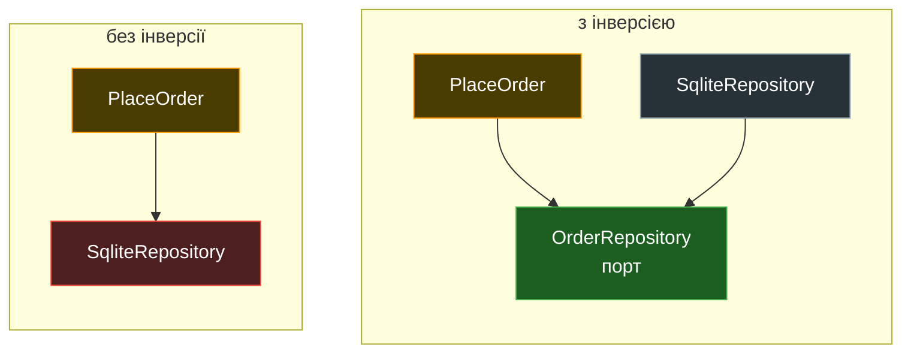

Стрілка від `SqliteRepository` тепер іде **до** абстракції — залежність «інвертовано».


### 3.6. Що в Python «з коробки»

| Можливість Python | Урок курсу | Який патерн вона спрощує |
|---|---|---|
| функції — об'єкти, замикання | 19 | Strategy, Command, Observer, Factory |
| декоратори `@` | 10 | Decorator, Proxy |
| генератори, `__iter__` / `__next__` | 11, 25 | Iterator |
| модулі (імпортуються один раз) | 13 | Singleton |
| `copy.copy` / `copy.deepcopy` | 21 | Prototype |
| `abc.ABC`, `typing.Protocol`, duck typing | 21, 37 | усі патерни з «інтерфейсом» |
| `@dataclass`, аргументи за замовчуванням | 24, 37 | Builder |
| `functools.singledispatch`, `match` | — | Visitor |
| контекстні менеджери `with` | бонус М2 | Template Method, Unit of Work |

### 3.7. Функціональні інтерфейси: коли клас з одним методом — зайвий

У Java **функціональний інтерфейс** — інтерфейс з одним абстрактним методом: `Runnable.run()`, `Comparator.compare()`, `Command.execute()`. Щоб передати поведінку, там пишуть клас, який його реалізує.

У Python функції — об'єкти першого класу (урок 19): їх кладуть у змінні, передають, повертають і створюють на льоту. Тому «інтерфейс з одним методом» — це просто **щось, що можна викликати**. Описати такий контракт можна трьома способами:

```python
from typing import Callable, Protocol

PriceRule = Callable[[int], int]                # 1. Callable: «функція int → int»


class Discount(Protocol):                       # 2. Protocol з __call__
    def __call__(self, amount: int) -> int: ...


class Percent:                                  # 3. функтор: об'єкт з __call__
    def __init__(self, percent):
        self.percent = percent                  # має стан, як звичайний об'єкт

    def __call__(self, amount):
        return amount * self.percent // 100


def checkout(amount: int, discount: Discount) -> int:
    return amount - discount(amount)


def student(amount):                            # звичайна функція
    return 30


print(checkout(500, student))                   # функція
print(checkout(500, Percent(10)))               # об'єкт-функтор
print(checkout(500, lambda amount: 0))          # анонімна функція
print(callable(student), callable(Percent(10)), callable(500))
```

```text
470
450
500
True True False
```

`checkout` не цікавить, *що* їй передали — функцію, `lambda` чи об'єкт з `__call__`. Важливо лише, що його можна викликати з одним аргументом. Це той самий duck typing, а `Protocol` чи `Callable` лише записують контракт для mypy й IDE.

Два інструменти, що «вшивають» дані у функцію, — замикання і `functools.partial`:

```python
from functools import partial


def notify(channel, text):
    return f"[{channel}] {text}"


def make_notifier(channel):              # замикання: channel «запам'ятовується»
    def send(text):
        return notify(channel, text)
    return send


sms = make_notifier("sms")
telegram = partial(notify, "telegram")  # те саме одним рядком
print(sms("водій прибув"))
print(telegram("замовлення готове"))
```

```text
[sms] водій прибув
[telegram] замовлення готове
```

Саме тому частина патернів у Python стискається до функцій:

| Патерн GoF | Класична форма (Java, C++) | Функціональний еквівалент у Python | Де в уроці |
|---|---|---|---|
| **Strategy** | інтерфейс + клас на кожну стратегію | функція як аргумент: `Callable`, `key=` у `sorted` | 6.9 |
| **Command** | інтерфейс `Command.execute()` | замикання, `functools.partial`, `lambda` | 6.2 |
| **Decorator** | клас-обгортка з тим самим інтерфейсом | функція вищого порядку і синтаксис `@` | 5.4 |
| **Observer** | інтерфейс `Observer.update()` | список функцій зворотного виклику (callbacks) | 6.7 |
| **Factory Method** | абстрактний `Creator` і підкласи | клас чи функція, передані як фабрика | 4.1 |
| **Template Method** | абстрактний клас з кроками | функція-каркас, що приймає кроки-функції | 6.10 |
| **Dependency Injection** | контейнер залежностей | функція-залежність як параметр, `partial` під час старту | 4.5, 7 |

Класи потрібні, коли в «стратегії» є **стан** і **кілька пов'язаних методів** (наприклад, `pay()` і `refund()` одного провайдера) або коли важливо, щоб контракт перевірявся під час створення (ABC). Одна дія без стану — функція.

---

## 4. Породжувальні патерни (Creational)

**Спільна ідея:** код, що *використовує* об'єкт, не має знати, *як* і *якого саме класу* цей об'єкт створюється. Тоді новий клас додається в одному місці, а не в кожному `if` по всьому проєкту.

Почнімо з проблеми, яку розв'язують усі п'ять. Диспетчерська обирає транспорт для доставки:

```python
def deliver(order_km):
    if order_km <= 3:
        transport = "велосипед"
    elif order_km <= 15:
        transport = "авто"
    else:
        transport = "вантажівка"
    return f"{order_km} км: {transport}"


print(deliver(2), "|", deliver(9))
```

```text
2 км: велосипед | 9 км: авто
```

Поки такий `if` один, усе гаразд. Коли той самий вибір повторюється в розрахунку ціни, у звіті, у сповіщенні — кожен новий вид транспорту вимагає правок у всіх цих місцях. Породжувальні патерни збирають створення в одне місце.

### Ідіома: проста фабрика (Simple Factory)

Це не патерн GoF, а найпоширеніший перший крок: **одна функція, яка знає, що створити**. Head First починає саме з неї.

```python
class Bike:
    speed = 15

    def describe(self):
        return f"велосипед, {self.speed} км/год"


class Car:
    speed = 40

    def describe(self):
        return f"авто, {self.speed} км/год"


TRANSPORTS = {"bike": Bike, "car": Car}       # реєстр: назва → клас


def make_transport(kind):                     # проста фабрика
    try:
        return TRANSPORTS[kind]()
    except KeyError:
        raise ValueError(f"невідомий транспорт: {kind}") from None


print(make_transport("bike").describe())
print(make_transport("car").describe())
```

```text
велосипед, 15 км/год
авто, 40 км/год
```

Новий транспорт — один рядок у словнику. У Python проста фабрика зі словником-реєстром закриває більшість задач, для яких у Java пишуть Factory Method.

### 4.1. Фабричний метод (Factory Method)

| Картка | |
|---|---|
| **Намір** | Батьківський клас задає *коли* створити об'єкт, а підкласи вирішують *який* |
| **Задача в «Смачно + Таксі»** | Служби доставки однаково приймають замовлення (знайти транспорт → розрахувати час), але Велодоставка використовує велосипед, а Міська — авто |
| **Учасники** | `Creator` (служба: загальний алгоритм + абстрактний `create_transport`); `ConcreteCreator` (конкретна служба); `Product` (інтерфейс транспорту); `ConcreteProduct` (велосипед, авто) |
| **Коли брати** | загальний алгоритм однаковий, а різниться лише клас одного об'єкта всередині; бібліотека дає базовий клас, а користувач підставляє свої продукти |
| **Коли не брати** | вибір класу — це просто «назва → клас»: проста фабрика з реєстром коротша |
| **Пітонічно** | передати клас чи функцію-фабрику параметром: `Delivery(transport_factory=Bike)` |

**Канонічна структура GoF** — ролі, як їх називають у книгах:

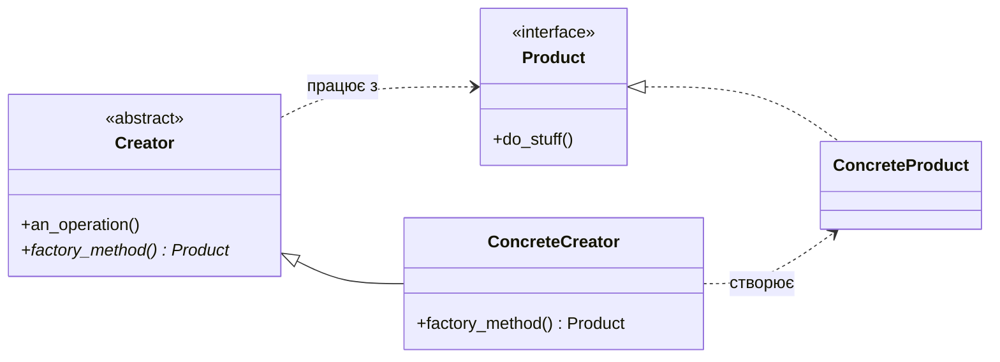

**У «Смачно + Таксі»:**

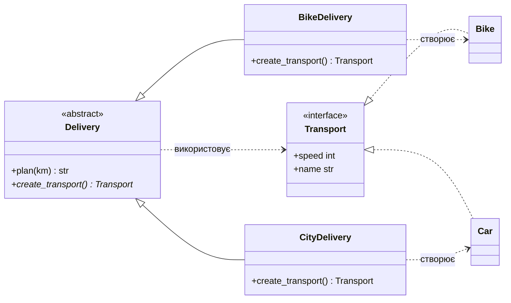

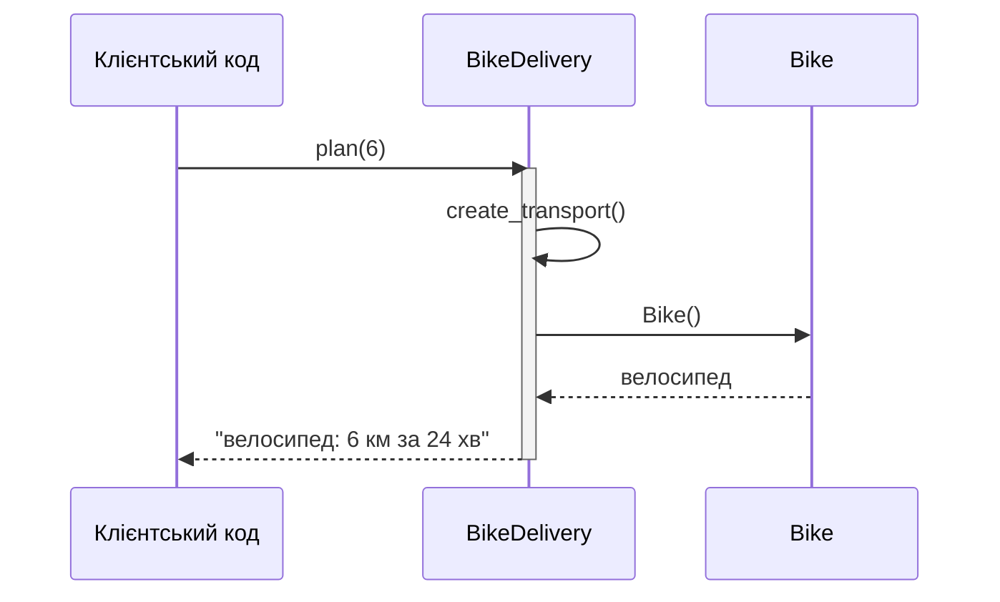

```python
from abc import ABC, abstractmethod


class Bike:
    name, speed = "велосипед", 15


class Car:
    name, speed = "авто", 40


class Delivery(ABC):
    def plan(self, km):                       # загальний алгоритм — однаковий
        transport = self.create_transport()   # фабричний метод
        minutes = round(km / transport.speed * 60)
        return f"{transport.name}: {km} км за {minutes} хв"

    @abstractmethod
    def create_transport(self): ...


class BikeDelivery(Delivery):
    def create_transport(self):
        return Bike()


class CityDelivery(Delivery):
    def create_transport(self):
        return Car()


for service in (BikeDelivery(), CityDelivery()):
    print(service.plan(6))
```

```text
велосипед: 6 км за 24 хв
авто: 6 км за 9 хв
```

`plan` не знає жодного конкретного класу транспорту. Додати самокат — новий підклас `ScooterDelivery`, без правок у `Delivery`.

**Пітонічно** — та сама гнучкість без ієрархії служб:

```python
class Bike:
    name, speed = "велосипед", 15


class Delivery:
    def __init__(self, transport_factory):    # клас — теж «фабрика»
        self.transport_factory = transport_factory

    def plan(self, km):
        transport = self.transport_factory()
        return f"{transport.name}: {round(km / transport.speed * 60)} хв"


print(Delivery(Bike).plan(6))
```

```text
велосипед: 24 хв
```

### 4.2. Абстрактна фабрика (Abstract Factory)

| Картка | |
|---|---|
| **Намір** | Створювати **родини** пов'язаних об'єктів, які мають підходити один до одного |
| **Задача в «Смачно + Таксі»** | Платіжні провайдери: для monobank потрібні *і* платіж, *і* чек саме monobank; змішати платіж mono з чеком Приват — помилка |
| **Учасники** | `AbstractFactory` (інтерфейс: `create_payment`, `create_receipt`); `ConcreteFactory` (MonoFactory, PrivatFactory); `AbstractProduct` ×2; `ConcreteProduct` для кожної родини |
| **Коли брати** | є кілька «наборів», і об'єкти з різних наборів не можна змішувати (провайдери, теми UI, бази даних) |
| **Коли не брати** | продукт один — це Factory Method або проста фабрика |
| **Пітонічно** | фабрика може бути модулем чи словником функцій: `PROVIDERS["mono"]["payment"]()` |

**Канонічна структура GoF** — ролі, як їх називають у книгах:

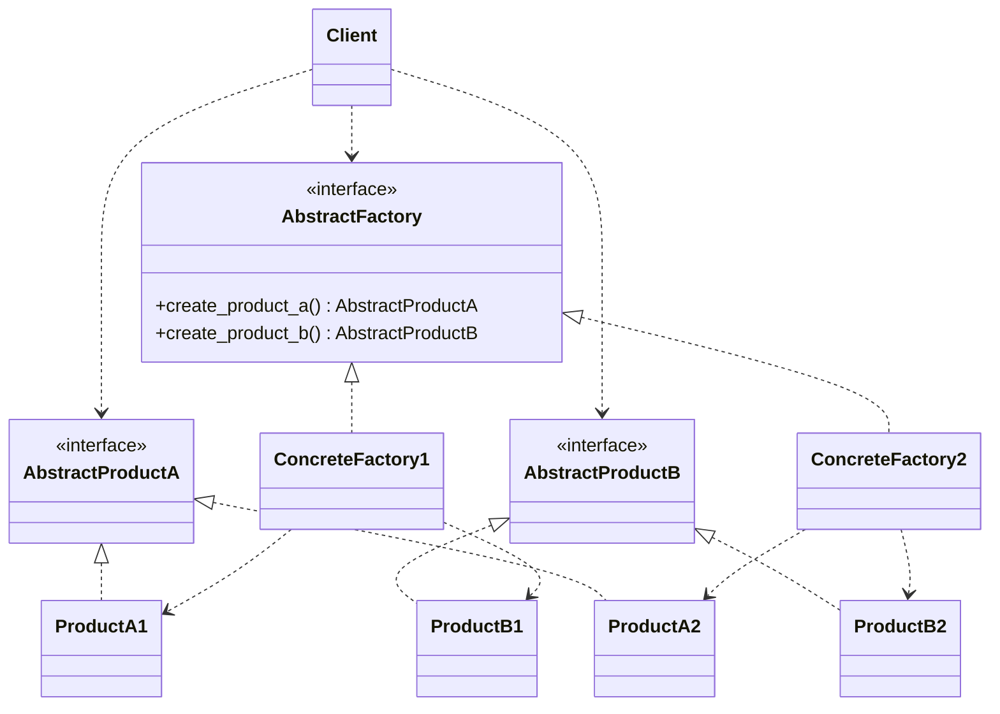

**У «Смачно + Таксі»:**

```mermaid
classDiagram
    class ProviderFactory {
        <<interface>>
        +create_payment() Payment
        +create_receipt() Receipt
    }
    class MonoFactory
    class PrivatFactory
    class Payment {
        <<interface>>
        +charge(amount) str
    }
    class Receipt {
        <<interface>>
        +render(amount) str
    }
    ProviderFactory <|.. MonoFactory
    ProviderFactory <|.. PrivatFactory
    Payment <|.. MonoPayment
    Payment <|.. PrivatPayment
    Receipt <|.. MonoReceipt
    Receipt <|.. PrivatReceipt
    MonoFactory ..> MonoPayment
    MonoFactory ..> MonoReceipt
    PrivatFactory ..> PrivatPayment
    PrivatFactory ..> PrivatReceipt
```

```python
class MonoPayment:
    def charge(self, amount):
        return f"mono: списано {amount} грн"


class MonoReceipt:
    def render(self, amount):
        return f"🐈 чек monobank на {amount} грн"


class PrivatPayment:
    def charge(self, amount):
        return f"privat24: списано {amount} грн"


class PrivatReceipt:
    def render(self, amount):
        return f"чек ПриватБанку на {amount} грн"


class MonoFactory:
    def create_payment(self):
        return MonoPayment()

    def create_receipt(self):
        return MonoReceipt()


class PrivatFactory:
    def create_payment(self):
        return PrivatPayment()

    def create_receipt(self):
        return PrivatReceipt()


def checkout(factory, amount):            # не знає жодного банку
    payment = factory.create_payment()
    receipt = factory.create_receipt()    # гарантовано з тієї самої родини
    return f"{payment.charge(amount)} | {receipt.render(amount)}"


print(checkout(MonoFactory(), 175))
print(checkout(PrivatFactory(), 320))
```

```text
mono: списано 175 грн | 🐈 чек monobank на 175 грн
privat24: списано 320 грн | чек ПриватБанку на 320 грн
```

### 4.3. Будівельник (Builder)

| Картка | |
|---|---|
| **Намір** | Будувати складний об'єкт **покроково** і отримати його лише в кінці, коли він цілісний |
| **Задача в «Смачно + Таксі»** | Замовлення: ресторан, страви (від однієї до багатьох), адреса, необов'язкові промокод, коментар, «без контакту». Конструктор з 9 параметрами нечитабельний, а замовлення без адреси не має з'явитися взагалі |
| **Учасники** | `Builder` (методи-кроки, що повертають `self`, і `build()`); `Product` (готове незмінне замовлення); `Director` (необов'язково: готовий рецепт кроків, наприклад «повторити вчорашнє») |
| **Коли брати** | багато необов'язкових частин; правила цілісності, які можна перевірити лише в кінці; кілька представлень з одного процесу (замовлення → JSON, → чек) |
| **Коли не брати** | 3–5 полів без складних правил: `@dataclass` з аргументами за замовчуванням і keyword-аргументами вже читабельний |
| **Пітонічно** | `@dataclass(frozen=True)` + `__post_init__` для перевірок; Builder — коли кроки справді покрокові |

**Канонічна структура GoF** — ролі, як їх називають у книгах:

```mermaid
classDiagram
    direction LR
    class Director {
        -Builder builder
        +construct()
    }
    class Builder {
        <<interface>>
        +reset()
        +build_part_a()
        +build_part_b()
    }
    class ConcreteBuilder {
        +build_part_a()
        +build_part_b()
        +get_result() Product
    }
    Director o-- Builder : керує кроками
    Builder <|.. ConcreteBuilder
    ConcreteBuilder ..> Product : конструює
    Client ..> Director
    Client ..> ConcreteBuilder : get_result()
```

**У «Смачно + Таксі»:**

```mermaid
classDiagram
    direction LR
    class OrderBuilder {
        -str _restaurant
        -list _items
        -str _address
        -str _promo
        +from_restaurant(name) OrderBuilder
        +add(dish, price) OrderBuilder
        +deliver_to(address) OrderBuilder
        +with_promo(code) OrderBuilder
        +build() Order
    }
    class Order {
        <<dataclass frozen>>
        +str restaurant
        +tuple items
        +str address
        +int discount
        +total() int
    }
    OrderBuilder ..> Order : build()
```

```mermaid
sequenceDiagram
    participant C as Клієнт
    participant B as OrderBuilder
    participant O as Order
    C->>B: from_restaurant("Піца Поділ")
    B-->>C: self
    C->>B: add("Маргарита", 210)
    B-->>C: self
    C->>B: deliver_to("Хорива, 5")
    B-->>C: self
    C->>B: build()
    activate B
    B->>B: перевірити цілісність
    B->>O: Order(...)
    O-->>B: замовлення
    B-->>C: готове замовлення
    deactivate B
```

```python
from dataclasses import dataclass


@dataclass(frozen=True)
class Order:
    restaurant: str
    items: tuple
    address: str
    discount: int = 0

    def total(self):
        return sum(price for _, price in self.items) - self.discount


class OrderBuilder:
    PROMOS = {"SMACHNO50": 50}

    def __init__(self):
        self._restaurant = None
        self._items = []
        self._address = None
        self._promo = None

    def from_restaurant(self, name):
        self._restaurant = name
        return self                       # повертаємо self → ланцюжок викликів

    def add(self, dish, price):
        self._items.append((dish, price))
        return self

    def deliver_to(self, address):
        self._address = address
        return self

    def with_promo(self, code):
        self._promo = code
        return self

    def build(self):
        missing = [name for name, value in [("ресторан", self._restaurant),
                   ("страви", self._items), ("адреса", self._address)] if not value]
        if missing:
            raise ValueError("бракує: " + ", ".join(missing))
        discount = self.PROMOS.get(self._promo, 0)
        return Order(self._restaurant, tuple(self._items), self._address, discount)


order = (OrderBuilder()
         .from_restaurant("Піца Поділ")
         .add("Маргарита", 210)
         .add("Лимонад", 60)
         .deliver_to("Хорива, 5")
         .with_promo("SMACHNO50")
         .build())
print(order.restaurant, order.total())

def repeat_yesterday(builder):            # Director: готовий рецепт кроків
    return (builder.from_restaurant("Борщ і Ко")
            .add("Борщ", 120).add("Узвар", 35)
            .deliver_to("Січових Стрільців, 12")
            .build())


print(repeat_yesterday(OrderBuilder()).total())

try:
    OrderBuilder().add("Борщ", 120).build()
except ValueError as error:
    print("ValueError:", error)
```

```text
Піца Поділ 220
155
ValueError: бракує: ресторан, адреса
```

Неповне замовлення не може існувати: до `build()` є лише будівельник, після — цілісний незмінний `Order`. `repeat_yesterday` — роль **Director**: він знає *порядок* кроків, але не знає, як будівельник їх виконує. Метод `build()` тут — це `get_result()` з канонічної схеми.

### 4.4. Прототип (Prototype)

| Картка | |
|---|---|
| **Намір** | Створювати нові об'єкти **копіюванням** готового зразка, а не з нуля |
| **Задача в «Смачно + Таксі»** | Кнопка «Повторити замовлення»: взяти вчорашнє замовлення, змінити дату й, можливо, одну страву. Збирати заново — довго; копіювати поле за полем вручну — легко забути вкладені списки |
| **Учасники** | `Prototype` (метод `clone()`); `ConcretePrototype` (замовлення); клієнт, що клонує й змінює копію |
| **Коли брати** | об'єкт дорого створювати (запит до бази, складне налаштування), а потрібні схожі копії; набір «шаблонів» замовлень |
| **Коли не брати** | об'єкт простий — простіше викликати конструктор |
| **Пітонічно** | `copy.deepcopy(obj)` або `dataclasses.replace(obj, поле=...)`; власний `__deepcopy__`, якщо щось не можна копіювати |

**Канонічна структура GoF** — ролі, як їх називають у книгах:

```mermaid
classDiagram
    direction LR
    class Client {
        +operation()
    }
    class Prototype {
        <<interface>>
        +clone() Prototype
    }
    Client --> Prototype : clone()
    Prototype <|.. ConcretePrototype1
    Prototype <|.. ConcretePrototype2
```

**У «Смачно + Таксі»:**

```mermaid
classDiagram
    direction LR
    class Prototype {
        <<interface>>
        +clone() Prototype
    }
    class Order {
        +str customer
        +list items
        +str day
        +clone() Order
    }
    Prototype <|.. Order
    Order ..> Order : clone() створює копію
```

Головна пастка прототипу — **поверхнева копія** (урок 21): вкладений список спільний для оригіналу й копії.

```python
import copy


class Order:
    def __init__(self, customer, items, day):
        self.customer = customer
        self.items = items                 # вкладений список
        self.day = day

    def clone(self):
        return copy.deepcopy(self)         # глибока копія — свої списки


yesterday = Order("Олена", ["борщ", "узвар"], "пн")

shallow = copy.copy(yesterday)             # ❌ поверхнева
shallow.items.append("пампушки")
print("оригінал після shallow:", yesterday.items)

today = yesterday.clone()                  # ✅ глибока
today.day = "вт"
today.items.append("вареники")
print("оригінал:", yesterday.items, yesterday.day)
print("копія:   ", today.items, today.day)
```

```text
оригінал після shallow: ['борщ', 'узвар', 'пампушки']
оригінал: ['борщ', 'узвар', 'пампушки'] пн
копія:    ['борщ', 'узвар', 'пампушки', 'вареники'] вт
```

```mermaid
flowchart TD
    classDef step     fill:#263238,stroke:#90a4ae,color:#ffffff;
    classDef decision fill:#37474f,stroke:#64b5f6,color:#ffffff;
    classDef success  fill:#1b5e20,stroke:#4CAF50,color:#ffffff;
    classDef error    fill:#4e1f1f,stroke:#f44336,color:#ffffff;
    classDef warning  fill:#4a3b00,stroke:#ff9800,color:#ffffff;

    subgraph SH ["copy.copy — поверхнева"]
        direction LR
        Y1["yesterday"] --> L1["список страв"]
        S1["shallow"] --> L1
    end
    subgraph DP ["copy.deepcopy — глибока"]
        direction LR
        Y2["yesterday"] --> L2["список страв"]
        T2["today"] --> L3["власний список"]
    end
    SH ~~~ DP

    class Y1,S1 step
    class L1 error
    class Y2,T2,L2 step
    class L3 success
```

### 4.5. Одинак (Singleton)

| Картка | |
|---|---|
| **Намір** | У класу рівно **один** екземпляр і глобальна точка доступу до нього |
| **Задача в «Смачно + Таксі»** | Налаштування сервісу (тарифи, ключі API) читаються з файлу один раз; усі частини програми мають бачити ті самі значення |
| **Учасники** | `Singleton` (зберігає єдиний екземпляр і віддає його замість створення нового) |
| **Коли брати** | ресурс справді один на процес: налаштування, пул з'єднань, логер |
| **Коли не брати** | майже завжди, коли хочеться «зручно дістати звідусіль»: це глобальна змінна, яка ховає залежності й ламає тести (стан переживає між тестами) |
| **Пітонічно** | **модуль** — уже одинак: Python імпортує його один раз і кешує в `sys.modules`. Або `functools.cache` на функції-фабриці |

**Канонічна структура GoF** — ролі, як їх називають у книгах:

```mermaid
classDiagram
    class Singleton {
        -Singleton unique_instance$
        -singleton_data
        -Singleton()
        +get_instance()$ Singleton
        +singleton_operation()
    }
    Singleton --> Singleton : unique_instance
```

**У «Смачно + Таксі»:**

```mermaid
classDiagram
    class Settings {
        -Settings _instance$
        +dict tariffs
        +__new__(cls) Settings
    }
    Settings --> Settings : _instance
```

Класична форма через `__new__` — щоб упізнавати її в чужому коді:

```python
class Settings:
    _instance = None

    def __new__(cls):
        if cls._instance is None:                 # створюємо лише раз
            cls._instance = super().__new__(cls)
            cls._instance.tariffs = {"km": 12, "night": 1.5}
        return cls._instance


a = Settings()
b = Settings()
a.tariffs["km"] = 14
print(a is b, b.tariffs["km"])
```

```text
True 14
```

> [!WARNING]
> **Пастка: `__init__` викликається щоразу**
>
> `__new__` повертає той самий об'єкт, але Python після нього **щоразу** викликає `__init__`. Якщо ініціалізація стоїть в `__init__`, другий виклик перезапише стан першого:

```python
class Settings:
    _instance = None

    def __new__(cls, *args, **kwargs):
        if cls._instance is None:
            cls._instance = super().__new__(cls)
        return cls._instance

    def __init__(self, city="Київ"):
        print(f"__init__({city!r})")
        self.city = city                          # ❌ перезапис при кожному виклику


a = Settings("Київ")
b = Settings("Львів")
print(a is b, a.city)
```

```text
__init__('Київ')
__init__('Львів')
True Львів
```

Тому ініціалізацію роблять лише в `__new__` (як вище) або ставлять прапорець `if getattr(self, "_initialized", False): return`. Обидва варіанти — ще одна причина віддати перевагу модулю чи `@cache`.

Пітонічна форма — модуль (файл `settings.py`) або кешована функція:

```python
from functools import cache


@cache
def get_settings():                       # тіло виконається один раз
    print("читаю налаштування з файлу…")
    return {"km": 12, "night": 1.5}


get_settings()["km"] = 14
print(get_settings()["km"], get_settings() is get_settings())
```

```text
читаю налаштування з файлу…
14 True
```

#### Пастка спадкування

`_instance` — атрибут **батьківського** класу. Нащадок його успадковує, тож може отримати екземпляр батька:

```python
class Settings:
    _instance = None

    def __new__(cls):
        if cls._instance is None:
            cls._instance = super().__new__(cls)
        return cls._instance


class TestSettings(Settings):
    pass


prod = Settings()
test = TestSettings()                 # очікуємо TestSettings…
print(type(test).__name__, test is prod)
```

```text
Settings True
```

`TestSettings._instance` знайшовся в батька — і нащадок повернув чужий об'єкт. Ліки — зберігати екземпляри окремо для кожного класу, як у метакласі нижче.

#### Одинак через метаклас

Клас — теж об'єкт, екземпляр свого метакласу `type` (урок 20, рівень 🔴). Вираз `Settings()` — це виклик `type.__call__`, який уже сам викликає `__new__` і `__init__`. Перехопивши `__call__`, керуємо створенням ззовні класу, а сам клас лишається звичайним:

```python
class SingletonMeta(type):
    _instances = {}                               # окремо для кожного класу

    def __call__(cls, *args, **kwargs):
        if cls not in cls._instances:
            cls._instances[cls] = super().__call__(*args, **kwargs)
        return cls._instances[cls]


class Settings(metaclass=SingletonMeta):
    def __init__(self, city="Київ"):
        print(f"__init__({city!r})")              # виконається один раз
        self.city = city


class TestSettings(Settings):
    pass


a, b = Settings("Київ"), Settings("Львів")
t = TestSettings("тест")
print(a is b, a.city, type(t).__name__, t is a)
```

```text
__init__('Київ')
__init__('тест')
True Київ TestSettings False
```

Обидві пастки зникли: `__init__` не повторюється, а нащадок має власний екземпляр. Логіка «один екземпляр» живе в метакласі, окремо від бізнес-логіки класу.

#### Borg (Monostate): різні об'єкти, спільний стан

Альтернатива від Алекса Мартеллі: нехай об'єктів буде скільки завгодно, але всі вони ділять **один словник атрибутів** `__dict__`. Важливо не те, що об'єкт один (`is`), а те, що стан один.

```python
class Borg:
    _shared_state = {}

    def __new__(cls, *args, **kwargs):
        obj = super().__new__(cls)            # без *args: object.__new__ їх не приймає
        obj.__dict__ = cls._shared_state      # усі екземпляри — один словник
        return obj


class Dispatcher(Borg):
    pass


b1, b2 = Borg(), Dispatcher()
b1.shift = "нічна"
print(b2.shift, b1 is b2)
```

```text
нічна False
```

#### Потокобезпечний одинак

Перевірка `if cls._instance is None` і створення — це **check-then-act**, та сама гонитва, що зі списком `imported` в уроці 28. Два потоки можуть одночасно побачити `None`, і кожен створить свій «єдиний» екземпляр:

```python
import threading
import time


class Pool:
    _instance = None
    _lock = threading.Lock()

    def __new__(cls):
        if cls._instance is None:
            time.sleep(0.05)                  # відкриваємо з'єднання з базою
            cls._instance = super().__new__(cls)
        return cls._instance


class SafePool:
    _instance = None
    _lock = threading.Lock()

    def __new__(cls):
        if cls._instance is None:             # швидка перевірка без замка
            with cls._lock:
                if cls._instance is None:     # повторна — вже під замком
                    time.sleep(0.05)
                    cls._instance = super().__new__(cls)
        return cls._instance


for cls in (Pool, SafePool):
    ids = set()
    threads = [threading.Thread(target=lambda: ids.add(id(cls()))) for _ in range(5)]
    for thread in threads:
        thread.start()
    for thread in threads:
        thread.join()
    print(f"{cls.__name__}: {'один екземпляр' if len(ids) == 1 else 'КІЛЬКА екземплярів'}")
```

```text
Pool: КІЛЬКА екземплярів
SafePool: один екземпляр
```

Повторна перевірка під замком (**double-checked locking**) потрібна, бо поки потік чекав на замок, інший міг уже створити екземпляр. Модуль і `@cache` тут простіші: імпорт модуля Python захищає своїм замком сам. Для `@cache` це не гарантовано — при гонитві функція може виконатися двічі, тому важку ініціалізацію з потоків теж беруть під `Lock`.

#### Чотири способи в Python — що обрати

| Спосіб | Як | Переваги | Мінуси |
|---|---|---|---|
| **Модуль** | об'єкт на рівні файлу `settings.py` | найпростіше, ідіоматично, імпорт потокобезпечний | створюється під час імпорту, навіть якщо не потрібен |
| **`@cache` на функції** | `get_settings()` | ліниво; легко підмінити в тестах (`get_settings.cache_clear()`, DI) | функція, а не клас |
| **`__new__`** | `_instance` у класі | класична форма, впізнавана | пастки `__init__` і спадкування, гонитва потоків |
| **Метаклас** | `metaclass=SingletonMeta` | чисте розділення; окремий екземпляр для кожного класу | метакласи складні для читання |
| **Borg** | спільний `__dict__` | можна наслідувати й створювати скільки завгодно | `is` повертає `False` — дивує читача |

> [!WARNING]
> **Одинак і тести**
>
> Одинак тягне стан між тестами: тест А змінив тариф — тест Б падає «сам по собі». Тому в FastAPI налаштування дістають через `Depends(get_settings)` (урок 38): у тесті залежність можна підмінити. Це **Dependency Injection** — найкращі ліки від зайвих одинаків.

Рефакторинг від одинака до передачі залежності — одна зміна сигнатури:

```python
from functools import cache


@cache
def get_settings():
    return {"km": 12}


def delivery_price_hidden(km):                # ❌ залежність схована всередині
    return km * get_settings()["km"]


def delivery_price(km, settings):             # ✅ залежність — параметр
    return km * settings["km"]


print(delivery_price_hidden(5))
print(delivery_price(5, get_settings()))      # у продакшені
print(delivery_price(5, {"km": 20}))          # у тесті — без жодних моків
```

```text
60
60
100
```

### 4.6. Порівняння породжувальних патернів

| | Що створює | Хто вирішує, який клас | Коли повертає результат |
|---|---|---|---|
| **Проста фабрика** | один продукт | одна функція за параметром | одразу |
| **Factory Method** | один продукт | підклас творця | одразу, всередині алгоритму творця |
| **Abstract Factory** | родину сумісних продуктів | обрана фабрика | одразу, кожен продукт окремим методом |
| **Builder** | один складний продукт | клієнт покроково | **лише в кінці** — `build()` |
| **Prototype** | копію зразка | зразок сам себе копіює | одразу |
| **Singleton** | той самий єдиний об'єкт | сам клас | одразу, завжди той самий |

#### Factory Method чи Abstract Factory?

Найчастіше плутають саме ці два. Різниця — у фокусі й механізмі:

| Критерій | Factory Method | Abstract Factory |
|---|---|---|
| **Що створює** | **один** продукт | **родину** сумісних продуктів |
| **Механізм** | **наслідування**: підклас творця перевизначає метод | **композиція**: об'єкт-фабрику передають клієнту |
| **Класифікація GoF** | патерн рівня **класів** | патерн рівня **об'єктів** |
| **Інтерфейс фабрики** | один метод створення | по методу на кожен вид продукту |
| **Де ще живе логіка** | творець містить бізнес-алгоритм (`plan()`), що використовує продукт | фабрика лише створює; логіка — у клієнті (`checkout()`) |
| **Легко додати** | новий продукт — новий підклас творця | нову **родину** — нову фабрику |
| **Важко додати** | — | новий **вид** продукту: змінюються інтерфейс і всі фабрики |

```mermaid
flowchart LR
    classDef step     fill:#263238,stroke:#90a4ae,color:#ffffff;
    classDef decision fill:#37474f,stroke:#64b5f6,color:#ffffff;
    classDef success  fill:#1b5e20,stroke:#4CAF50,color:#ffffff;
    classDef error    fill:#4e1f1f,stroke:#f44336,color:#ffffff;
    classDef warning  fill:#4a3b00,stroke:#ff9800,color:#ffffff;

    subgraph FM ["Factory Method — наслідування"]
        direction TB
        D["Delivery.plan()"] -- "self.create_transport()" --> BD["BikeDelivery<br>перевизначив метод"]
    end
    subgraph AF ["Abstract Factory — композиція"]
        direction TB
        CH["checkout(factory)"] -- "factory.create_payment()<br>factory.create_receipt()" --> MF["MonoFactory<br>переданий об'єкт"]
    end
    FM ~~~ AF

    class D,CH step
    class BD,MF success
```

Патерни не виключають один одного: методи абстрактної фабрики найчастіше **і є** фабричними методами в її підкласах (рідше — клонують прототипи).

Еволюція в реальних проєктах часто така: **проста фабрика → Factory Method** (коли з'являється спільний алгоритм) **→ Abstract Factory** (коли продуктів стає кілька й вони мусять пасувати один одному). Abstract Factory часто реалізують через фабричні методи, а самі фабрики — як одинаки.

---

## 5. Структурні патерни (Structural)

**Спільна ідея:** як скласти класи й об'єкти у більшу структуру так, щоб її частини можна було замінювати й комбінувати. Майже всі структурні патерни — це **обгортка** чи **композиція**: один об'єкт тримає інший і перенаправляє йому виклики. Різниця — *навіщо* обгортати.

### 5.1. Адаптер (Adapter)

| Картка | |
|---|---|
| **Намір** | Перетворити інтерфейс чужого класу на той, якого чекає наш код |
| **Задача в «Смачно + Таксі»** | Наш код рахує відстань через `distance_km(a, b)`. Новий картографічний сервіс має лише `route(origin, destination)` і повертає **метри** в словнику. Чужий код змінити не можна |
| **Учасники** | `Target` (інтерфейс, якого чекає клієнт); `Adaptee` (чужий клас з незручним інтерфейсом); `Adapter` (реалізує `Target`, усередині викликає `Adaptee` і перекладає дані) |
| **Коли брати** | стороння бібліотека, старий код, зовнішній API з іншими назвами чи одиницями; заміна постачальника без змін у решті коду |
| **Коли не брати** | інтерфейс можна змінити самому — просто зміни його |
| **Пітонічно** | для однієї функції — функція-обгортка чи `lambda`; для класу — композиція, як нижче |

**Канонічна структура GoF:**

```mermaid
classDiagram
    direction LR
    class Client
    class Target {
        <<interface>>
        +request()
    }
    class Adapter {
        -Adaptee adaptee
        +request()
    }
    class Adaptee {
        +specific_request()
    }
    Client --> Target
    Target <|.. Adapter
    Adapter o-- Adaptee : делегує
```

**У «Смачно + Таксі»:**

```mermaid
classDiagram
    direction LR
    class RouteService {
        <<interface>>
        +distance_km(a, b) float
    }
    class GeoMapsAdapter {
        -GeoMapsAPI api
        +distance_km(a, b) float
    }
    class GeoMapsAPI {
        +route(origin, destination) dict
    }
    class PriceCalculator {
        +price(a, b) int
    }
    PriceCalculator --> RouteService
    RouteService <|.. GeoMapsAdapter
    GeoMapsAdapter o-- GeoMapsAPI
```

```mermaid
sequenceDiagram
    participant P as PriceCalculator
    participant A as GeoMapsAdapter
    participant G as GeoMapsAPI
    P->>A: distance_km("Поділ", "Оболонь")
    A->>G: route(origin="Поділ", destination="Оболонь")
    G-->>A: {"meters": 7400, "seconds": 900}
    A-->>P: 7.4
```

```python
class GeoMapsAPI:                                   # чужий код — не чіпаємо
    ROUTES = {("Поділ", "Оболонь"): 7400, ("Поділ", "Центр"): 2100}

    def route(self, origin, destination):
        return {"meters": self.ROUTES[(origin, destination)], "seconds": 900}


class GeoMapsAdapter:                               # наш інтерфейс поверх чужого
    def __init__(self, api):
        self.api = api

    def distance_km(self, a, b):
        return self.api.route(origin=a, destination=b)["meters"] / 1000


class PriceCalculator:
    PER_KM = 12

    def __init__(self, routes):                     # чекає будь-що з distance_km
        self.routes = routes

    def price(self, a, b):
        return round(self.routes.distance_km(a, b) * self.PER_KM)


calc = PriceCalculator(GeoMapsAdapter(GeoMapsAPI()))
print(calc.price("Поділ", "Оболонь"), calc.price("Поділ", "Центр"))
```

```text
89 25
```

`PriceCalculator` нічого не знає про метри й словники. Завтра постачальник зміниться — з'явиться новий адаптер, а калькулятор лишиться тим самим.

### 5.2. Міст (Bridge)

| Картка | |
|---|---|
| **Намір** | Розділити дві незалежні осі змін на дві ієрархії й з'єднати їх композицією |
| **Задача в «Смачно + Таксі»** | Сповіщення бувають різних видів (замовлення готове, промо, водій прибув) і йдуть різними каналами (Telegram, SMS, e-mail). Через наслідування треба 3 × 3 = 9 класів, а кожен новий канал додає ще 3 |
| **Учасники** | `Abstraction` (вид сповіщення; тримає посилання на реалізацію); `RefinedAbstraction` (конкретний вид); `Implementor` (інтерфейс каналу); `ConcreteImplementor` (Telegram, SMS) |
| **Коли брати** | класи множаться по двох осях («вид × платформа», «фігура × рендерер»); реалізацію треба перемикати під час роботи |
| **Коли не брати** | вісь змін лише одна |
| **Пітонічно** | та сама композиція; канал може бути навіть функцією `send(text)` |

```mermaid
flowchart TD
    classDef step     fill:#263238,stroke:#90a4ae,color:#ffffff;
    classDef decision fill:#37474f,stroke:#64b5f6,color:#ffffff;
    classDef success  fill:#1b5e20,stroke:#4CAF50,color:#ffffff;
    classDef error    fill:#4e1f1f,stroke:#f44336,color:#ffffff;
    classDef warning  fill:#4a3b00,stroke:#ff9800,color:#ffffff;

    subgraph BAD ["наслідування: 3 × 3 = 9 класів"]
        direction LR
        A1["ReadyTelegram"] ~~~ A2["ReadySMS"] ~~~ A3["ReadyEmail"]
        B1["PromoTelegram"] ~~~ B2["PromoSMS"] ~~~ B3["PromoEmail"]
    end
    subgraph GOOD ["міст: 3 + 3 = 6 класів"]
        direction LR
        N["види сповіщень<br>Ready · Promo · Arrived"] -- "має канал" --> C["канали<br>Telegram · SMS · Email"]
    end
    BAD ~~~ GOOD

    class A1,A2,A3,B1,B2,B3 error
    class N,C success
```

**Канонічна структура GoF:**

```mermaid
classDiagram
    direction LR
    class Abstraction {
        -Implementor impl
        +operation()
    }
    class Implementor {
        <<interface>>
        +operation_impl()
    }
    Abstraction <|-- RefinedAbstraction
    Abstraction o-- Implementor : міст
    Implementor <|.. ConcreteImplementorA
    Implementor <|.. ConcreteImplementorB
```

**У «Смачно + Таксі»:**

```mermaid
classDiagram
    direction LR
    class Notification {
        -Channel channel
        +send(customer)
        +text(customer)* str
    }
    class OrderReady
    class Promo
    class Channel {
        <<interface>>
        +deliver(customer, text) str
    }
    Notification <|-- OrderReady
    Notification <|-- Promo
    Notification o-- Channel
    Channel <|.. Telegram
    Channel <|.. SMS
```

```python
class Telegram:
    def deliver(self, customer, text):
        return f"telegram @{customer}: {text}"


class SMS:
    def deliver(self, customer, text):
        return f"sms {customer}: {text[:20]}…"      # SMS коротші


class Notification:
    def __init__(self, channel):
        self.channel = channel                      # міст до другої ієрархії

    def send(self, customer):
        return self.channel.deliver(customer, self.text(customer))


class OrderReady(Notification):
    def text(self, customer):
        return f"{customer}, ваше замовлення вже їде до вас!"


class Promo(Notification):
    def text(self, customer):
        return "−20% на піцу до неділі"


print(OrderReady(Telegram()).send("olena"))
print(OrderReady(SMS()).send("олена"))
print(Promo(Telegram()).send("taras"))
```

```text
telegram @olena: olena, ваше замовлення вже їде до вас!
sms олена: олена, ваше замовлен…
telegram @taras: −20% на піцу до неділі
```

### 5.3. Компонувальник (Composite)

| Картка | |
|---|---|
| **Намір** | Працювати з деревом «частина — ціле» так, ніби кожен вузол — один об'єкт |
| **Задача в «Смачно + Таксі»** | Меню ресторану (урок 23): категорії містять страви й підкатегорії. Потрібно порахувати ціну й кількість страв будь-якої гілки — однаково для страви й для категорії |
| **Учасники** | `Component` (спільний інтерфейс: `price()`, `count()`); `Leaf` (страва); `Composite` (категорія: тримає дітей і делегує їм, складаючи результат) |
| **Коли брати** | дані — дерево: меню, файлова система, організаційна структура, вкладені знижки, HTML |
| **Коли не брати** | структура плоска |
| **Пітонічно** | рекурсивна функція над вкладеними `dict`/`list` (урок 23) — якщо поведінки мало; класи — коли у вузлів багато операцій |

**Канонічна структура GoF:**

```mermaid
classDiagram
    direction LR
    class Component {
        <<interface>>
        +operation()
    }
    class Leaf {
        +operation()
    }
    class Composite {
        -list children
        +operation()
        +add(component)
    }
    Component <|.. Leaf
    Component <|.. Composite
    Composite o-- "0..*" Component : children
```

**У «Смачно + Таксі»** — те саме, плюс **діаграма об'єктів** конкретного меню (UML object diagram: підкреслені «ім'я : Клас»):

```mermaid
flowchart TD
    classDef step     fill:#263238,stroke:#90a4ae,color:#ffffff;
    classDef decision fill:#37474f,stroke:#64b5f6,color:#ffffff;
    classDef success  fill:#1b5e20,stroke:#4CAF50,color:#ffffff;
    classDef error    fill:#4e1f1f,stroke:#f44336,color:#ffffff;
    classDef warning  fill:#4a3b00,stroke:#ff9800,color:#ffffff;

    M["menu : Category<br>Борщ і Ко"]
    F["first : Category<br>Перші страви"]
    D["drinks : Category<br>Напої"]
    B["borsch : Dish<br>Борщ, 120"]
    S["soup : Dish<br>Юшка, 90"]
    U["uzvar : Dish<br>Узвар, 35"]
    H["hot : Category<br>Гарячі напої"]
    T["tea : Dish<br>Чай, 40"]
    M --> F
    M --> D
    F --> B
    F --> S
    D --> U
    D --> H
    H --> T

    class M,F,D,H decision
    class B,S,U,T success
```

```python
class Dish:                                     # Leaf
    def __init__(self, name, price):
        self.name, self._price = name, price

    def price(self):
        return self._price

    def count(self):
        return 1


class Category:                                 # Composite
    def __init__(self, name, *children):
        self.name = name
        self.children = list(children)

    def price(self):
        return sum(child.price() for child in self.children)

    def count(self):
        return sum(child.count() for child in self.children)


hot = Category("Гарячі напої", Dish("Чай", 40))
drinks = Category("Напої", Dish("Узвар", 35), hot)
first = Category("Перші страви", Dish("Борщ", 120), Dish("Юшка", 90))
menu = Category("Борщ і Ко", first, drinks)

for node in (menu, drinks, Dish("Борщ", 120)):  # однаковий виклик для всіх
    print(f"{node.name}: {node.count()} страв, {node.price()} грн")
```

```text
Борщ і Ко: 4 страв, 285 грн
Напої: 2 страв, 75 грн
Борщ: 1 страв, 120 грн
```

Клієнтський цикл не перевіряє `isinstance`: і страва, і категорія відповідають на `price()` і `count()`. Рекурсія ховається всередині `Category`.

### 5.4. Декоратор (Decorator)

| Картка | |
|---|---|
| **Намір** | Динамічно додати об'єкту обов'язки, загорнувши його в обгортку з **тим самим інтерфейсом** |
| **Задача в «Смачно + Таксі»** | Ціна поїздки: базовий тариф, а поверх — нічна надбавка, дитяче крісло, «тварина в салоні». Комбінацій десятки; класу на кожну не напишеш |
| **Учасники** | `Component` (інтерфейс: `cost()`, `describe()`); `ConcreteComponent` (базова поїздка); `Decorator` (тримає інший `Component` і має той самий інтерфейс); `ConcreteDecorator` (надбавка) |
| **Коли брати** | поведінку треба додавати й комбінувати під час роботи; наслідування дало б вибух класів |
| **Коли не брати** | добавка одна й постійна — додай її в клас |
| **Пітонічно** | для **функцій** — декоратори `@` (урок 10): логування, кеш, повтори, перевірка доступу |

> [!NOTE]
> **Два «декоратори»**
>
> Патерн Decorator загортає **об'єкт** в об'єкт з тим самим інтерфейсом. Синтаксис `@decorator` у Python загортає **функцію** у функцію. Ідея одна — обгортка, що додає поведінку й делегує решту, — але це різні механізми. `@` можна застосувати й до класу, а патерн реалізувати й без `@`.

**Канонічна структура GoF:**

```mermaid
classDiagram
    direction LR
    class Component {
        <<interface>>
        +operation()
    }
    class Decorator {
        -Component wrapped
        +operation()
    }
    Component <|.. ConcreteComponent
    Component <|.. Decorator
    Decorator o-- Component : загортає
    Decorator <|-- ConcreteDecoratorA
    Decorator <|-- ConcreteDecoratorB
```

**У «Смачно + Таксі»:**

```mermaid
classDiagram
    direction LR
    class Ride {
        <<interface>>
        +cost() int
        +describe() str
    }
    class BaseRide {
        +int km
    }
    class Extra {
        -Ride ride
    }
    Ride <|.. BaseRide
    Ride <|.. Extra
    Extra o-- Ride
    Extra <|-- Night
    Extra <|-- ChildSeat
    Extra <|-- Pet
```

```mermaid
sequenceDiagram
    participant C as Клієнт
    participant P as Pet
    participant N as Night
    participant B as BaseRide
    C->>P: cost()
    P->>N: cost()
    N->>B: cost()
    B-->>N: 120
    N-->>P: 180 (×1.5)
    P-->>C: 230 (+50)
```

```python
class BaseRide:
    def __init__(self, km):
        self.km = km

    def cost(self):
        return self.km * 12

    def describe(self):
        return f"поїздка {self.km} км"


class Extra:                                    # базовий декоратор
    def __init__(self, ride):
        self.ride = ride                        # той самий інтерфейс усередині


class Night(Extra):
    def cost(self):
        return round(self.ride.cost() * 1.5)

    def describe(self):
        return self.ride.describe() + " + ніч"


class ChildSeat(Extra):
    def cost(self):
        return self.ride.cost() + 30

    def describe(self):
        return self.ride.describe() + " + крісло"


class Pet(Extra):
    def cost(self):
        return self.ride.cost() + 50

    def describe(self):
        return self.ride.describe() + " + тварина"


ride = Pet(Night(BaseRide(10)))                 # обгортки в будь-якому порядку
print(ride.describe(), "=", ride.cost())
print(ChildSeat(BaseRide(10)).cost())
```

```text
поїздка 10 км + ніч + тварина = 230
150
```

**Пітонічно:** декоратор-функція додає поведінку **функції** — тут повтори при збої зовнішнього API:

```python
from functools import wraps


def retry(times):
    def decorator(func):
        @wraps(func)                            # зберегти ім'я і docstring
        def wrapper(*args, **kwargs):
            for attempt in range(1, times + 1):
                try:
                    return func(*args, **kwargs)
                except ConnectionError as error:
                    print(f"спроба {attempt}: {error}")
            raise RuntimeError("спроби вичерпано")
        return wrapper
    return decorator


calls = iter([ConnectionError("таймаут"), ConnectionError("таймаут"), "7 водіїв поруч"])


@retry(times=3)
def free_drivers():
    result = next(calls)
    if isinstance(result, Exception):
        raise result
    return result


print(free_drivers(), "|", free_drivers.__name__)
```

```text
спроба 1: таймаут
спроба 2: таймаут
7 водіїв поруч | free_drivers
```

### 5.5. Фасад (Facade)

| Картка | |
|---|---|
| **Намір** | Дати один простий вхід у складну підсистему |
| **Задача в «Смачно + Таксі»** | Оформлення замовлення торкається складу ресторану, оплати, кухні, пошуку водія й сповіщень. Кнопка «Замовити», бот і API мають робити це однаково й не знати про п'ять підсистем |
| **Учасники** | `Facade` (знає, кого й у якому порядку викликати); класи підсистеми (працюють і без фасаду); клієнт (знає лише фасад) |
| **Коли брати** | кілька клієнтів повторюють ту саму послідовність викликів; треба сховати складність бібліотеки |
| **Коли не брати** | фасад перетворюється на «божественний об'єкт», який робить усе й знає все — розділи на кілька |
| **Пітонічно** | модуль або функція сервісного шару: `place_order(...)` (розділ 7, Service Layer) |

**Канонічна структура GoF:**

```mermaid
classDiagram
    direction LR
    class Client
    class Facade {
        +operation()
    }
    Client --> Facade
    Facade --> SubsystemA
    Facade --> SubsystemB
    Facade --> SubsystemC
```

**У «Смачно + Таксі»:**

```mermaid
sequenceDiagram
    actor К as Клієнт
    participant F as OrderFacade
    participant S as Stock
    participant P as Payments
    participant K as Kitchen
    participant D as Drivers
    К->>F: place_order("Олена", ["борщ"], 120)
    activate F
    F->>S: reserve(["борщ"])
    F->>P: charge("Олена", 120)
    F->>K: cook(["борщ"])
    F->>D: assign()
    D-->>F: "Тарас"
    F-->>К: "замовлення прийнято, везе Тарас"
    deactivate F
```

```python
class Stock:
    def reserve(self, dishes):
        print("склад: зарезервовано", ", ".join(dishes))


class Payments:
    def charge(self, customer, amount):
        print(f"оплата: {customer} −{amount} грн")


class Kitchen:
    def cook(self, dishes):
        print("кухня: готуємо", len(dishes), "страв")


class Drivers:
    def assign(self):
        return "Тарас"


class OrderFacade:
    def __init__(self):
        self.stock, self.payments = Stock(), Payments()
        self.kitchen, self.drivers = Kitchen(), Drivers()

    def place_order(self, customer, dishes, amount):   # один вхід
        self.stock.reserve(dishes)
        self.payments.charge(customer, amount)
        self.kitchen.cook(dishes)
        driver = self.drivers.assign()
        return f"замовлення прийнято, везе {driver}"


print(OrderFacade().place_order("Олена", ["борщ", "узвар"], 155))
```

```text
склад: зарезервовано борщ, узвар
оплата: Олена −155 грн
кухня: готуємо 2 страв
замовлення прийнято, везе Тарас
```

### 5.6. Легковаговик (Flyweight)

| Картка | |
|---|---|
| **Намір** | Тримати мільйони дрібних об'єктів, ділячи між ними **спільний незмінний стан** |
| **Задача в «Смачно + Таксі»** | Карта міста показує 100 000 точок поїздок за день. Кожна точка має координати (унікальні) і «тип маркера» — іконку, колір, підпис (їх лише 3 види). Зберігати іконку в кожній точці — марнувати пам'ять |
| **Учасники** | `Flyweight` (внутрішній, спільний, **незмінний** стан: тип маркера); `FlyweightFactory` (віддає вже створений легковаговик за ключем); `Context` (зовнішній, унікальний стан: координати + посилання на легковаговик) |
| **Коли брати** | об'єктів дуже багато, а більша частина їхнього стану повторюється |
| **Коли не брати** | об'єктів сотні — економія не варта складності |
| **Пітонічно** | кеш-фабрика (`functools.cache`), `__slots__`, кортежі; так само Python ділить малі цілі й інтерновані рядки |

**Канонічна структура GoF:**

```mermaid
classDiagram
    direction LR
    class FlyweightFactory {
        -dict cache
        +get(key) Flyweight
    }
    class Flyweight {
        -intrinsic_state
        +operation(extrinsic_state)
    }
    class Context {
        -extrinsic_state
        -Flyweight flyweight
    }
    FlyweightFactory o-- Flyweight
    Context --> Flyweight : спільний
```

**У «Смачно + Таксі»** — діаграма об'єктів: багато точок, три маркери:

```mermaid
flowchart LR
    classDef step     fill:#263238,stroke:#90a4ae,color:#ffffff;
    classDef decision fill:#37474f,stroke:#64b5f6,color:#ffffff;
    classDef success  fill:#1b5e20,stroke:#4CAF50,color:#ffffff;
    classDef error    fill:#4e1f1f,stroke:#f44336,color:#ffffff;
    classDef warning  fill:#4a3b00,stroke:#ff9800,color:#ffffff;

    P1["point 1<br>50.46, 30.51"] --> T["taxi : MarkerType<br>🚕 жовтий"]
    P2["point 2<br>50.45, 30.52"] --> T
    P3["point 3<br>50.44, 30.50"] --> F["food : MarkerType<br>🍲 зелений"]
    P4["… ще 99 997 точок"] --> T
    P4 --> F

    class P1,P2,P3,P4 step
    class T,F success
```

```python
from dataclasses import dataclass
from functools import cache


@dataclass(frozen=True)                       # незмінний — можна ділити
class MarkerType:
    icon: str
    color: str


@cache                                        # FlyweightFactory
def marker(icon, color):
    return MarkerType(icon, color)


class Point:
    __slots__ = ("lat", "lon", "kind")        # без __dict__ — менше пам'яті

    def __init__(self, lat, lon, kind):
        self.lat, self.lon, self.kind = lat, lon, kind


points = [Point(50 + i / 1e5, 30.5, marker("🚕", "жовтий") if i % 3 else marker("🍲", "зелений"))
          for i in range(100_000)]
kinds = {id(p.kind) for p in points}
print(len(points), "точок,", len(kinds), "об'єкти маркерів")
print(marker("🚕", "жовтий") is points[1].kind)
```

```text
100000 точок, 2 об'єкти маркерів
True
```

### 5.7. Заступник (Proxy)

| Картка | |
|---|---|
| **Намір** | Поставити перед об'єктом замінника з тим самим інтерфейсом, щоб **контролювати доступ** до нього |
| **Задача в «Смачно + Таксі»** | Меню ресторанів приходить із повільного API партнерів (секунда на запит). Сторінка запитує те саме меню десятки разів за хвилину |
| **Учасники** | `Subject` (спільний інтерфейс); `RealSubject` (справжній повільний сервіс); `Proxy` (той самий інтерфейс; вирішує, чи й коли кликати справжній) |
| **Види** | **кешуючий** (запам'ятати відповідь); **віртуальний** (лінива ініціалізація: створити важкий об'єкт при першому зверненні); **захисний** (перевірити права); **віддалений** (локальний об'єкт, що ходить по мережі); **логуючий** |
| **Коли брати** | доступ до об'єкта треба обмежити, відкласти, закешувати чи порахувати, а клієнт не має про це знати |
| **Коли не брати** | `functools.cache` на функції вже робить те саме |
| **Пітонічно** | `@cache` / `@lru_cache`, `@property` з лінивим обчисленням (`functools.cached_property`), `__getattr__` для делегування всього інтерфейсу |

**Канонічна структура GoF:**

```mermaid
classDiagram
    direction LR
    class Subject {
        <<interface>>
        +request()
    }
    class RealSubject {
        +request()
    }
    class Proxy {
        -RealSubject real
        +request()
    }
    Client --> Subject
    Subject <|.. RealSubject
    Subject <|.. Proxy
    Proxy --> RealSubject : контролює доступ
```

**У «Смачно + Таксі»:**

```mermaid
sequenceDiagram
    participant C as Сторінка
    participant P as CachedMenu
    participant R as PartnerMenuAPI
    C->>P: menu("Піца Поділ")
    alt немає в кеші
        P->>R: menu("Піца Поділ")
        R-->>P: ["Маргарита", ...]
        P->>P: зберегти в кеш
    else є в кеші
        P->>P: взяти з кешу
    end
    P-->>C: ["Маргарита", ...]
```

```python
class PartnerMenuAPI:                            # RealSubject — повільний
    def __init__(self):
        self.requests = 0

    def menu(self, restaurant):
        self.requests += 1                       # уявімо секунду мережі
        return {"Піца Поділ": ["Маргарита", "Пепероні"]}[restaurant]


class CachedMenu:                                # Proxy — той самий інтерфейс
    def __init__(self, real):
        self.real = real
        self.cache = {}

    def menu(self, restaurant):
        if restaurant not in self.cache:
            self.cache[restaurant] = self.real.menu(restaurant)
        return self.cache[restaurant]


class GuardedMenu:                               # захисний проксі
    def __init__(self, real, allowed):
        self.real, self.allowed = real, allowed

    def menu(self, restaurant):
        if restaurant not in self.allowed:
            raise PermissionError(f"{restaurant}: немає договору")
        return self.real.menu(restaurant)


api = PartnerMenuAPI()
menu = CachedMenu(api)
for _ in range(50):
    menu.menu("Піца Поділ")
print("запитів до API:", api.requests)

try:
    GuardedMenu(menu, allowed={"Борщ і Ко"}).menu("Піца Поділ")
except PermissionError as error:
    print("PermissionError:", error)
```

```text
запитів до API: 1
PermissionError: Піца Поділ: немає договору
```

Проксі можна складати: `GuardedMenu(CachedMenu(PartnerMenuAPI()))` — спершу перевірка прав, потім кеш, потім мережа.

### 5.8. Порівняння: обгортки, що схожі на вигляд

Adapter, Decorator, Proxy і Facade мають однакову форму — об'єкт тримає інший і перенаправляє виклики. Відрізняє їх **мета**:

| Патерн | Інтерфейс обгортки | Навіщо обгортка | Скільки об'єктів усередині | Хто створює внутрішній об'єкт |
|---|---|---|---|---|
| **Adapter** | **інший**, ніж у загорнутого | узгодити несумісні інтерфейси | один | зазвичай передають ззовні |
| **Decorator** | **той самий** | **додати** поведінку; обгортки складаються в ланцюжок | один (у ланцюжку — по одному) | клієнт, під час роботи |
| **Proxy** | **той самий** | **контролювати доступ**: кеш, права, лінивість | один | часто сам проксі |
| **Facade** | **новий, простіший** | сховати складність | **багато** (підсистема) | сам фасад |
| **Bridge** | — | розділити дві осі змін | один (реалізація) | передають ззовні |
| **Composite** | той самий, що в дітей | однаково працювати з деревом | багато (діти) | клієнт будує дерево |

```mermaid
flowchart TD
    classDef step     fill:#263238,stroke:#90a4ae,color:#ffffff;
    classDef decision fill:#37474f,stroke:#64b5f6,color:#ffffff;
    classDef success  fill:#1b5e20,stroke:#4CAF50,color:#ffffff;
    classDef error    fill:#4e1f1f,stroke:#f44336,color:#ffffff;
    classDef warning  fill:#4a3b00,stroke:#ff9800,color:#ffffff;

    Q1{"обгортаєш<br>кілька класів?"}
    Q2{"інтерфейс<br>змінюється?"}
    Q3{"додаєш поведінку<br>чи контролюєш доступ?"}
    FA["Facade"]
    AD["Adapter"]
    DE["Decorator"]
    PR["Proxy"]
    Q1 -- так --> FA
    Q1 -- ні --> Q2
    Q2 -- так --> AD
    Q2 -- ні --> Q3
    Q3 -- додаю --> DE
    Q3 -- контролюю --> PR

    class Q1,Q2,Q3 decision
    class FA,AD,DE,PR success
```

---

## 6. Поведінкові патерни (Behavioral)

**Спільна ідея:** розподілити **обов'язки** між об'єктами та організувати їхнє **спілкування** так, щоб учасники знали одне про одного якомога менше. Тут найбільше діаграм послідовності й станів: поведінку видно в часі, а не в структурі.

### 6.1. Ланцюжок обов'язків (Chain of Responsibility)

| Картка | |
|---|---|
| **Намір** | Передати запит по ланцюжку обробників; кожен сам вирішує — обробити, відхилити чи передати далі |
| **Задача в «Смачно + Таксі»** | Перед прийняттям замовлення: ресторан відкритий? адреса в зоні доставки? оплата пройшла? Перевірки додаються й міняються місцями |
| **Учасники** | `Handler` (інтерфейс `handle(request)` + посилання на наступного); `ConcreteHandler` (одна перевірка); клієнт (знає лише перший обробник) |
| **Коли брати** | кілька незалежних кроків обробки, порядок і склад яких змінюється: валідація, middleware у Django/FastAPI, фільтри логування |
| **Коли не брати** | кроків два і вони не змінюються — звичайні `if` |
| **Пітонічно** | список функцій і цикл; перша, що повернула помилку, зупиняє ланцюжок |
| **Шар** | адаптери (middleware) і сценарії (валідація) |

**Канонічна структура GoF:**

```mermaid
classDiagram
    direction LR
    class Handler {
        <<abstract>>
        -Handler next
        +set_next(handler) Handler
        +handle(request)
    }
    Client --> Handler
    Handler --> Handler : next
    Handler <|-- ConcreteHandlerA
    Handler <|-- ConcreteHandlerB
```

**У «Смачно + Таксі»:**

```mermaid
flowchart LR
    classDef step     fill:#263238,stroke:#90a4ae,color:#ffffff;
    classDef decision fill:#37474f,stroke:#64b5f6,color:#ffffff;
    classDef success  fill:#1b5e20,stroke:#4CAF50,color:#ffffff;
    classDef error    fill:#4e1f1f,stroke:#f44336,color:#ffffff;
    classDef warning  fill:#4a3b00,stroke:#ff9800,color:#ffffff;

    R["замовлення"] --> H1{"ресторан<br>відкритий?"}
    H1 -- так --> H2{"адреса<br>в зоні?"}
    H2 -- так --> H3{"оплата<br>пройшла?"}
    H3 -- так --> OK["прийнято"]
    H1 -- ні --> X["відмова"]
    H2 -- ні --> X
    H3 -- ні --> X

    class R step
    class H1,H2,H3 decision
    class OK success
    class X error
```

```python
class Check:
    def __init__(self):
        self.next = None

    def then(self, handler):                  # будуємо ланцюжок: a.then(b).then(c)
        self.next = handler
        return handler

    def handle(self, order):
        problem = self.check(order)
        if problem:
            return f"відмова: {problem}"
        return self.next.handle(order) if self.next else "прийнято"


class RestaurantOpen(Check):
    def check(self, order):
        return None if 10 <= order["hour"] < 22 else "ресторан зачинено"


class InZone(Check):
    def check(self, order):
        return None if order["km"] <= 15 else "адреса поза зоною"


class Paid(Check):
    def check(self, order):
        return None if order["paid"] else "оплата не пройшла"


chain = RestaurantOpen()
chain.then(InZone()).then(Paid())

print(chain.handle({"hour": 13, "km": 4, "paid": True}))
print(chain.handle({"hour": 23, "km": 4, "paid": True}))
print(chain.handle({"hour": 13, "km": 30, "paid": False}))
```

```text
прийнято
відмова: ресторан зачинено
відмова: адреса поза зоною
```

**Пітонічно** — список функцій:

```python
CHECKS = [
    lambda o: None if 10 <= o["hour"] < 22 else "ресторан зачинено",
    lambda o: None if o["km"] <= 15 else "адреса поза зоною",
]


def accept(order):
    for check in CHECKS:
        if problem := check(order):
            return f"відмова: {problem}"
    return "прийнято"


print(accept({"hour": 13, "km": 30}))
```

```text
відмова: адреса поза зоною
```

### 6.2. Команда (Command)

| Картка | |
|---|---|
| **Намір** | Перетворити дію на об'єкт: її можна зберегти, поставити в чергу, записати в журнал, скасувати |
| **Задача в «Смачно + Таксі»** | Диспетчер змінює замовлення (додати страву, змінити адресу) і хоче кнопку «Скасувати останню дію»; всі дії мають потрапити в журнал |
| **Учасники** | `Command` (`execute()`, `undo()`); `ConcreteCommand` (знає одержувача й параметри); `Receiver` (замовлення — той, хто справді змінюється); `Invoker` (історія: виконує й пам'ятає команди) |
| **Коли брати** | undo/redo; черги задач (Celery-задача — це команда); журнал операцій; макроси; кнопки й пункти меню з однаковою дією |
| **Коли не брати** | дію просто викликають одразу й ніде не зберігають |
| **Пітонічно** | `functools.partial` чи замикання — це вже команда без `undo`; для undo — клас чи пара функцій |
| **Шар** | сценарії (команда = «що хоче користувач»), черги в адаптерах |

**Канонічна структура GoF:**

```mermaid
classDiagram
    direction LR
    class Command {
        <<interface>>
        +execute()
        +undo()
    }
    class ConcreteCommand {
        -Receiver receiver
        -params
        +execute()
        +undo()
    }
    class Invoker {
        -list history
        +run(command)
        +undo_last()
    }
    Client ..> ConcreteCommand : створює
    Invoker o-- Command
    Command <|.. ConcreteCommand
    ConcreteCommand --> Receiver
```

**У «Смачно + Таксі»:**

```mermaid
sequenceDiagram
    actor Д as Диспетчер
    participant H as History
    participant C as AddDish
    participant O as Order
    Д->>H: run(AddDish(order, "узвар"))
    H->>C: execute()
    C->>O: items.append("узвар")
    H->>H: history.append(command)
    Д->>H: undo_last()
    H->>C: undo()
    C->>O: items.remove("узвар")
```

```python
class Order:                                       # Receiver
    def __init__(self):
        self.items, self.address = ["борщ"], "Хорива, 5"


class AddDish:
    def __init__(self, order, dish):
        self.order, self.dish = order, dish

    def execute(self):
        self.order.items.append(self.dish)

    def undo(self):
        self.order.items.remove(self.dish)

    def __str__(self):
        return f"додати {self.dish}"


class ChangeAddress:
    def __init__(self, order, address):
        self.order, self.address, self.old = order, address, None

    def execute(self):
        self.old, self.order.address = self.order.address, self.address

    def undo(self):
        self.order.address = self.old

    def __str__(self):
        return f"адреса → {self.address}"


class History:                                     # Invoker
    def __init__(self):
        self.done = []

    def run(self, command):
        command.execute()
        self.done.append(command)
        print("журнал:", command)

    def undo_last(self):
        command = self.done.pop()
        command.undo()
        print("скасовано:", command)


order, history = Order(), History()
history.run(AddDish(order, "узвар"))
history.run(ChangeAddress(order, "Оболонська, 12"))
print(order.items, order.address)
history.undo_last()
history.undo_last()
print(order.items, order.address)
```

```text
журнал: додати узвар
журнал: адреса → Оболонська, 12
['борщ', 'узвар'] Оболонська, 12
скасовано: адреса → Оболонська, 12
скасовано: додати узвар
['борщ'] Хорива, 5
```

**Пітонічно** — команда без undo це просто об'єкт, який можна викликати. Черга задач зберігає «відкладені дії»:

```python
from functools import partial


def notify(customer, text):
    print(f"{customer}: {text}")


queue = [partial(notify, "Олена", "кур'єр виїхав"),
         lambda: notify("Тарас", "нове замовлення")]
for command in queue:                     # виконавець не знає, що всередині
    command()
```

```text
Олена: кур'єр виїхав
Тарас: нове замовлення
```

### 6.3. Інтерпретатор (Interpreter)

| Картка | |
|---|---|
| **Намір** | Описати граматику маленької мови класами й обчислювати речення цієї мови, обходячи дерево |
| **Задача в «Смачно + Таксі»** | Маркетологи пишуть умови промоакцій самі: `ніч і (сума > 500 або vip)`. Не хочемо міняти код на кожну акцію |
| **Учасники** | `Expression` (інтерфейс `evaluate(context)`); `TerminalExpression` (лист: змінна чи число); `NonterminalExpression` (`And`, `Or`, `Greater` — містять інші вирази); `Context` (значення змінних) |
| **Коли брати** | маленька стабільна мова: правила знижок, фільтри пошуку, формули в таблицях, запити |
| **Коли не брати** | граматика велика — бери парсер-генератор (`lark`) чи готову мову (JSON-правила, SQL) |
| **Пітонічно** | модуль `ast` уже робить це для Python; дерево виразів — це Composite з методом `evaluate` |
| **Шар** | сутності (правила) |

**Канонічна структура GoF:**

```mermaid
classDiagram
    direction LR
    class Expression {
        <<interface>>
        +evaluate(context)
    }
    class TerminalExpression {
        +evaluate(context)
    }
    class NonterminalExpression {
        -list~Expression~ parts
        +evaluate(context)
    }
    Client ..> Context
    Client --> Expression
    Expression <|.. TerminalExpression
    Expression <|.. NonterminalExpression
    NonterminalExpression o-- Expression
```

Дерево виразу `ніч і (сума > 500 або vip)`:

```mermaid
flowchart TD
    classDef step     fill:#263238,stroke:#90a4ae,color:#ffffff;
    classDef decision fill:#37474f,stroke:#64b5f6,color:#ffffff;
    classDef success  fill:#1b5e20,stroke:#4CAF50,color:#ffffff;
    classDef error    fill:#4e1f1f,stroke:#f44336,color:#ffffff;
    classDef warning  fill:#4a3b00,stroke:#ff9800,color:#ffffff;

    A["And"] --> N["Var ніч"]
    A --> O["Or"]
    O --> G["Greater"]
    O --> V["Var vip"]
    G --> S["Var сума"]
    G --> C["Const 500"]

    class A,O,G decision
    class N,V,S,C success
```

```python
class Var:
    def __init__(self, name):
        self.name = name

    def evaluate(self, ctx):
        return ctx[self.name]


class Const:
    def __init__(self, value):
        self.value = value

    def evaluate(self, ctx):
        return self.value


class Greater:
    def __init__(self, left, right):
        self.left, self.right = left, right

    def evaluate(self, ctx):
        return self.left.evaluate(ctx) > self.right.evaluate(ctx)


class And:
    def __init__(self, *parts):
        self.parts = parts

    def evaluate(self, ctx):
        return all(p.evaluate(ctx) for p in self.parts)


class Or:
    def __init__(self, *parts):
        self.parts = parts

    def evaluate(self, ctx):
        return any(p.evaluate(ctx) for p in self.parts)


def parse(text):                          # крихітний парсер: «a і b», «a або b», «x > n»
    if " і " in text:
        return And(*(parse(p) for p in text.split(" і ")))
    if " або " in text:
        return Or(*(parse(p) for p in text.split(" або ")))
    if " > " in text:
        left, right = text.split(" > ")
        return Greater(Var(left), Const(int(right)))
    return Var(text)


rule = parse("ніч і сума > 500 або vip")  # і зв'язує сильніше: ніч і (сума>500 або vip)
for ctx in ({"ніч": True, "сума": 620, "vip": False},
            {"ніч": True, "сума": 200, "vip": True},
            {"ніч": False, "сума": 900, "vip": True}):
    print(ctx, "→", rule.evaluate(ctx))
```

```text
{'ніч': True, 'сума': 620, 'vip': False} → True
{'ніч': True, 'сума': 200, 'vip': True} → True
{'ніч': False, 'сума': 900, 'vip': True} → False
```

### 6.4. Ітератор (Iterator)

| Картка | |
|---|---|
| **Намір** | Дати послідовний доступ до елементів колекції, не розкриваючи, як вона влаштована всередині |
| **Задача в «Смачно + Таксі»** | Черга водіїв зберігається як словник «район → список». Диспетчерській потрібно просто «перебрати всіх вільних водіїв по черзі» |
| **Учасники** | `Aggregate` (колекція, `__iter__`); `Iterator` (`__next__`, пам'ятає позицію); клієнт (цикл `for`) |
| **Коли брати** | своя колекція зі складною будовою; ліниве читання великих даних (файли, сторінки API) |
| **Коли не брати** | вбудовані `list`, `dict`, `set` уже ітеровані |
| **Пітонічно** | **вбудовано в мову**: `for`, `__iter__`/`__next__` (урок 25), генератори з `yield` (урок 11) |
| **Шар** | будь-який |

```mermaid
classDiagram
    direction LR
    class Iterable {
        <<interface>>
        +__iter__() Iterator
    }
    class Iterator {
        <<interface>>
        +__next__()
        +__iter__() Iterator
    }
    class DriverPool {
        -dict by_district
        +__iter__() Iterator
    }
    class DriverIterator {
        -list queue
        -int position
        +__next__() str
    }
    Iterable <|.. DriverPool
    Iterator <|.. DriverIterator
    DriverPool ..> DriverIterator : створює
```

```python
class DriverIterator:                          # класична форма
    def __init__(self, drivers):
        self.drivers, self.position = drivers, 0

    def __iter__(self):
        return self

    def __next__(self):
        if self.position >= len(self.drivers):
            raise StopIteration
        driver = self.drivers[self.position]
        self.position += 1
        return driver


class DriverPool:
    def __init__(self):
        self.by_district = {"Поділ": ["Тарас"], "Оболонь": ["Марія", "Олексій"]}

    def __iter__(self):
        return DriverIterator([d for ds in self.by_district.values() for d in ds])


class LazyDriverPool(DriverPool):              # пітонічна форма — генератор
    def __iter__(self):
        for district, drivers in self.by_district.items():
            for driver in drivers:
                yield f"{driver} ({district})"


print(list(DriverPool()))
for driver in LazyDriverPool():
    print(driver)
```

```text
['Тарас', 'Марія', 'Олексій']
Тарас (Поділ)
Марія (Оболонь)
Олексій (Оболонь)
```

### 6.5. Посередник (Mediator)

| Картка | |
|---|---|
| **Намір** | Замість того щоб об'єкти кликали один одного напряму («кожен з кожним»), вони спілкуються через одного координатора |
| **Задача в «Смачно + Таксі»** | Клієнт, ресторан, водій і служба підтримки мають реагувати на дії одне одного. Якщо кожен знає кожного — 4 учасники дають 12 зв'язків, і новий учасник ламає всіх |
| **Учасники** | `Mediator` (диспетчерська: знає всіх, вирішує, кому що передати); `Colleague` (учасник: знає лише посередника) |
| **Коли брати** | багато об'єктів зі заплутаними взаємними викликами: форма з полями, що залежать одне від одного; чат-кімната; диспетчерська |
| **Коли не брати** | посередник розростається в «божественний об'єкт» — розбий його або перейди на події (Observer, Message Bus) |
| **Пітонічно** | так само; часто посередник — це сценарій використання чи шина повідомлень |
| **Шар** | сценарії |

Діаграма **комунікації** (UML communication diagram) показує, як зменшується кількість зв'язків:

```mermaid
flowchart LR
    classDef step     fill:#263238,stroke:#90a4ae,color:#ffffff;
    classDef decision fill:#37474f,stroke:#64b5f6,color:#ffffff;
    classDef success  fill:#1b5e20,stroke:#4CAF50,color:#ffffff;
    classDef error    fill:#4e1f1f,stroke:#f44336,color:#ffffff;
    classDef warning  fill:#4a3b00,stroke:#ff9800,color:#ffffff;

    subgraph BEFORE ["без посередника"]
        K1["Клієнт"] <--> R1["Ресторан"]
        K1 <--> D1["Водій"]
        R1 <--> D1
        K1 <--> S1["Підтримка"]
        R1 <--> S1
        D1 <--> S1
    end
    subgraph AFTER ["з посередником"]
        M["Диспетчерська"]
        K2["Клієнт"] <--> M
        R2["Ресторан"] <--> M
        D2["Водій"] <--> M
        S2["Підтримка"] <--> M
    end
    BEFORE ~~~ AFTER

    class K1,R1,D1,S1 error
    class M warning
    class K2,R2,D2,S2 success
```

```mermaid
classDiagram
    direction LR
    class Dispatch {
        +register(participant)
        +notify(sender, event)
    }
    class Participant {
        +str name
        -Dispatch dispatch
        +receive(event)
    }
    Dispatch o-- "1..*" Participant
    Participant --> Dispatch
    Participant <|-- Restaurant
    Participant <|-- Driver
    Participant <|-- Customer
```

```python
class Dispatch:                                   # Mediator
    def __init__(self):
        self.parties = {}

    def register(self, party):
        self.parties[party.role] = party
        party.dispatch = self

    def notify(self, sender, event):              # уся логіка зв'язків — тут
        if event == "замовлення":
            self.parties["ресторан"].receive("готувати")
        elif event == "готово":
            self.parties["водій"].receive("забрати з ресторану")
        elif event == "доставлено":
            self.parties["клієнт"].receive("оцініть поїздку")


class Party:                                      # Colleague
    def __init__(self, role):
        self.role, self.dispatch = role, None

    def send(self, event):
        print(f"{self.role} → диспетчерська: {event}")
        self.dispatch.notify(self, event)

    def receive(self, event):
        print(f"   диспетчерська → {self.role}: {event}")


dispatch = Dispatch()
customer, restaurant, driver = Party("клієнт"), Party("ресторан"), Party("водій")
for party in (customer, restaurant, driver):
    dispatch.register(party)

customer.send("замовлення")
restaurant.send("готово")
driver.send("доставлено")
```

```text
клієнт → диспетчерська: замовлення
   диспетчерська → ресторан: готувати
ресторан → диспетчерська: готово
   диспетчерська → водій: забрати з ресторану
водій → диспетчерська: доставлено
   диспетчерська → клієнт: оцініть поїздку
```

Учасники не знають один про одного — лише про диспетчерську. Новий учасник (служба підтримки) змінює тільки `Dispatch`.

### 6.6. Знімок (Memento)

| Картка | |
|---|---|
| **Намір** | Зберегти стан об'єкта, щоб пізніше відновити його, не розкриваючи внутрішніх полів назовні |
| **Задача в «Смачно + Таксі»** | Клієнт збирає кошик, потім «натискає назад» — кошик має повернутися до попереднього вигляду. Код історії не повинен знати, як влаштований кошик |
| **Учасники** | `Originator` (кошик: створює знімок і відновлюється з нього); `Memento` (незмінний знімок стану); `Caretaker` (історія: зберігає знімки, але не заглядає всередину) |
| **Коли брати** | undo без команд; «чернетки»; відкат при помилці (транзакція в пам'яті); точки збереження |
| **Коли не брати** | стан величезний — зберігай зміни (Command), а не повні копії |
| **Пітонічно** | знімок — `@dataclass(frozen=True)` чи кортеж; `copy.deepcopy` для складного стану |
| **Шар** | сутності |

```mermaid
classDiagram
    direction LR
    class Cart {
        -list _items
        +add(dish)
        +save() Snapshot
        +restore(snapshot)
    }
    class Snapshot {
        <<frozen>>
        +tuple items
    }
    class CartHistory {
        -list~Snapshot~ stack
        +backup()
        +undo()
    }
    Cart ..> Snapshot : створює
    CartHistory o-- Snapshot : зберігає, не читає
    CartHistory --> Cart
```

```mermaid
stateDiagram-v2
    direction LR
    s0: [] порожній
    s1: [борщ]
    s2: [борщ, узвар]
    s0 --> s1 : backup, add борщ
    s1 --> s2 : backup, add узвар
    s2 --> s1 : undo
    s1 --> s0 : undo
```

```python
from dataclasses import dataclass


@dataclass(frozen=True)
class Snapshot:                              # Memento — незмінний
    items: tuple


class Cart:                                  # Originator
    def __init__(self):
        self._items = []

    def add(self, dish):
        self._items.append(dish)

    def save(self):
        return Snapshot(tuple(self._items))

    def restore(self, snapshot):
        self._items = list(snapshot.items)

    def __str__(self):
        return str(self._items)


class CartHistory:                           # Caretaker — не знає, що в знімку
    def __init__(self, cart):
        self.cart, self.stack = cart, []

    def backup(self):
        self.stack.append(self.cart.save())

    def undo(self):
        if self.stack:
            self.cart.restore(self.stack.pop())


cart = Cart()
history = CartHistory(cart)
for dish in ("борщ", "узвар", "пампушки"):
    history.backup()
    cart.add(dish)
print(cart)
history.undo()
history.undo()
print(cart)
```

```text
['борщ', 'узвар', 'пампушки']
['борщ']
```

**Command чи Memento для undo?** Command пам'ятає *дію* і вміє її відмінити — економно, але кожна команда мусить знати свій `undo`. Memento пам'ятає *весь стан* — просто й надійно, але дорожче за пам'яттю.

### 6.7. Спостерігач (Observer)

| Картка | |
|---|---|
| **Намір** | Зв'язок «один до багатьох»: коли змінюється один об'єкт (видавець), усі підписники отримують сповіщення автоматично |
| **Задача в «Смачно + Таксі»** | Статус замовлення змінився на «в дорозі». Треба: показати клієнту в застосунку, надіслати SMS, оновити табло ресторану, записати в аналітику. Замовлення не має знати про жодного з них |
| **Учасники** | `Subject` / видавець (список підписників, `attach`, `detach`, `notify`); `Observer` / підписник (`update`); конкретні видавці й підписники |
| **Коли брати** | одна подія — багато незалежних реакцій, і список реакцій змінюється; UI, що оновлюється при зміні моделі; доменні події |
| **Коли не брати** | реакція одна й постійна — просто виклич її; ланцюжки сповіщень, у яких важко зрозуміти, хто що змінив |
| **Пітонічно** | список функцій зворотного виклику (callbacks); сигнали Django (`post_save`); Message Bus (розділ 7) |
| **Шар** | сутності генерують події, адаптери підписуються |

**Канонічна структура GoF:**

```mermaid
classDiagram
    direction LR
    class Subject {
        -list~Observer~ observers
        +attach(observer)
        +detach(observer)
        +notify()
    }
    class Observer {
        <<interface>>
        +update(subject)
    }
    class ConcreteSubject {
        -state
        +get_state()
    }
    Subject <|-- ConcreteSubject
    Subject o-- "0..*" Observer
    Observer <|.. ConcreteObserverA
    Observer <|.. ConcreteObserverB
    ConcreteObserverA ..> ConcreteSubject : читає стан
```

**У «Смачно + Таксі»:**

```mermaid
sequenceDiagram
    participant O as Order
    participant A as AppScreen
    participant S as SmsAlert
    participant B as Analytics
    Note over O: status = "в дорозі"
    O->>O: notify()
    loop кожен підписник
        O->>A: update(order)
        A->>O: order.status
        O->>S: update(order)
        O->>B: update(order)
    end
```

**Класична ООП-форма** — з інтерфейсом і **pull-моделлю** (підписник отримує посилання на видавця й сам читає, що йому потрібно):

```python
from abc import ABC, abstractmethod


class Observer(ABC):
    @abstractmethod
    def update(self, order): ...


class Subject:
    def __init__(self):
        self._observers = []

    def attach(self, observer):
        if observer not in self._observers:
            self._observers.append(observer)

    def detach(self, observer):
        if observer in self._observers:
            self._observers.remove(observer)

    def notify(self):
        for observer in self._observers:
            observer.update(self)


class Order(Subject):
    def __init__(self, customer):
        super().__init__()
        self.customer, self._status = customer, "нове"

    @property
    def status(self):
        return self._status

    def set_status(self, status):
        self._status = status                # спершу оновити стан…
        self.notify()                        # …потім сповістити


class AppScreen(Observer):
    def update(self, order):
        print(f"[застосунок] {order.customer}: {order.status}")


class SmsAlert(Observer):
    def update(self, order):
        if order.status == "в дорозі":       # реагує лише на свій випадок
            print(f"[sms] {order.customer}, кур'єр уже їде!")


order = Order("Олена")
screen, sms = AppScreen(), SmsAlert()
order.attach(screen)
order.attach(sms)
order.set_status("готується")
order.set_status("в дорозі")
order.detach(sms)
order.set_status("доставлено")
```

```text
[застосунок] Олена: готується
[застосунок] Олена: в дорозі
[sms] Олена, кур'єр уже їде!
[застосунок] Олена: доставлено
```

**Пітонічна форма** — підписники є просто функціями, події мають назви, а дані передаються аргументами (**push-модель**):

```python
from collections import defaultdict
from typing import Callable

Handler = Callable[..., None]


class Events:
    def __init__(self):
        self._handlers: dict[str, list[Handler]] = defaultdict(list)

    def on(self, event, handler=None):
        if handler is None:                      # дозволяє писати @events.on("...")
            return lambda func: self.on(event, func)
        self._handlers[event].append(handler)
        return handler

    def off(self, event, handler):
        self._handlers[event].remove(handler)

    def emit(self, event, **data):
        for handler in self._handlers[event]:
            handler(**data)


events = Events()


@events.on("order_shipped")
def to_app(customer, driver):
    print(f"[застосунок] {customer}: везе {driver}")


@events.on("order_shipped")
def to_analytics(customer, driver):
    print(f"[аналітика] +1 поїздка водія {driver}")


events.emit("order_shipped", customer="Олена", driver="Тарас")
events.off("order_shipped", to_analytics)
events.emit("order_shipped", customer="Марко", driver="Марія")
```

```text
[застосунок] Олена: везе Тарас
[аналітика] +1 поїздка водія Тарас
[застосунок] Марко: везе Марія
```

#### Три важливі нюанси

**1. Push чи pull.**

| Модель | Що передає видавець | Плюс | Мінус |
|---|---|---|---|
| **Push** | усі дані події аргументами: `emit("shipped", customer=..., driver=...)` | підписник не знає видавця | нове поле → зміна сигнатури всіх підписників |
| **Pull** | лише посилання на себе: `update(self)` | підписник бере тільки те, що йому треба | підписник залежить від інтерфейсу видавця |

**2. Висячі посилання.** Видавець тримає підписників у списку, тож збирач сміття їх не видалить, навіть коли решта програми про них забула, — витік пам'яті. Модуль `weakref` тримає **слабкі посилання**, які не заважають видаленню:

```python
import gc
import weakref


class Screen:
    def update(self, status):
        print("екран:", status)


strong, weak = [], weakref.WeakSet()
screen1, screen2 = Screen(), Screen()
strong.append(screen1)
weak.add(screen2)

del screen1, screen2                       # екрани закрили
gc.collect()
print("звичайний список тримає:", len(strong))
print("WeakSet тримає:", len(weak))
```

```text
звичайний список тримає: 1
WeakSet тримає: 0
```

**3. Цілісність стану.** Викликай `notify()` **після** того, як стан повністю оновлено (як у `set_status` вище). Якщо сповістити посередині зміни, підписник прочитає наполовину оновлений об'єкт.

### 6.8. Стан (State)

| Картка | |
|---|---|
| **Намір** | Об'єкт змінює поведінку разом зі станом — ніби змінюється його клас |
| **Задача в «Смачно + Таксі»** | Замовлення (діаграма станів з розділу 2.5): `cancel()` у стані «нове» — безкоштовно, у «готується» — зі штрафом, у «в дорозі» — заборонено. У кожному методі `if status == ...` на п'ять гілок |
| **Учасники** | `Context` (замовлення: тримає поточний стан і делегує йому); `State` (інтерфейс дій); `ConcreteState` (поведінка в одному стані + рішення, куди перейти) |
| **Коли брати** | багато методів з однаковим `if/elif` по статусу; життєвий цикл із чіткими переходами |
| **Коли не брати** | станів 2–3 і поведінка майже не відрізняється — словник дозволених переходів простіший |
| **Пітонічно** | словник `{(стан, подія): новий_стан}` або `Enum`; бібліотека `transitions` |
| **Шар** | сутності |

**Канонічна структура GoF:**

```mermaid
classDiagram
    direction LR
    class Context {
        -State state
        +request()
        +transition_to(state)
    }
    class State {
        <<interface>>
        +handle(context)
    }
    Context o-- State
    State <|.. ConcreteStateA
    State <|.. ConcreteStateB
    ConcreteStateA ..> ConcreteStateB : перехід
```

**У «Смачно + Таксі»:**

```mermaid
stateDiagram-v2
    [*] --> New
    New --> Cooking : next()
    New --> Cancelled : cancel() безкоштовно
    Cooking --> OnTheWay : next()
    Cooking --> Cancelled : cancel() штраф 50%
    OnTheWay --> Delivered : next()
    OnTheWay --> OnTheWay : cancel() заборонено
    Delivered --> [*]
    Cancelled --> [*]
```

```python
class State:
    name = "?"

    def next(self, order):
        raise ValueError(f"із «{self.name}» далі нікуди")

    def cancel(self, order):
        raise ValueError(f"у стані «{self.name}» скасувати не можна")


class New(State):
    name = "нове"

    def next(self, order):
        order.state = Cooking()

    def cancel(self, order):
        order.state = Cancelled()
        return 0


class Cooking(State):
    name = "готується"

    def next(self, order):
        order.state = OnTheWay()

    def cancel(self, order):
        order.state = Cancelled()
        return order.total // 2


class OnTheWay(State):
    name = "в дорозі"

    def next(self, order):
        order.state = Delivered()


class Delivered(State):
    name = "доставлене"


class Cancelled(State):
    name = "скасоване"


class Order:                                 # Context — жодного if по статусу
    def __init__(self, total):
        self.total, self.state = total, New()

    def next(self):
        self.state.next(self)

    def cancel(self):
        fee = self.state.cancel(self)
        return f"скасовано, штраф {fee} грн"


a = Order(300)
a.next()
print(a.state.name, "|", a.cancel())

b = Order(300)
b.next()
b.next()
try:
    b.cancel()
except ValueError as error:
    print("ValueError:", error)
```

```text
готується | скасовано, штраф 150 грн
ValueError: у стані «в дорозі» скасувати не можна
```

**Пітонічно** — для простих правил достатньо таблиці переходів:

```python
TRANSITIONS = {("нове", "next"): "готується", ("нове", "cancel"): "скасоване",
               ("готується", "next"): "в дорозі", ("готується", "cancel"): "скасоване",
               ("в дорозі", "next"): "доставлене"}


def move(status, event):
    try:
        return TRANSITIONS[(status, event)]
    except KeyError:
        raise ValueError(f"{event} у стані «{status}» заборонено") from None


print(move("нове", "next"))
try:
    move("в дорозі", "cancel")
except ValueError as error:
    print("ValueError:", error)
```

```text
готується
ValueError: cancel у стані «в дорозі» заборонено
```

### 6.9. Стратегія (Strategy)

| Картка | |
|---|---|
| **Намір** | Родина взаємозамінних алгоритмів за одним інтерфейсом; алгоритм обирають і міняють під час роботи |
| **Задача в «Смачно + Таксі»** | Та сама задача з розділу 0: вартість доставки за відстанню, фіксована для партнерів, з нічною надбавкою. Новий тариф не повинен чіпати код замовлення |
| **Учасники** | `Context` (замовлення: тримає стратегію і делегує їй розрахунок); `Strategy` (інтерфейс `cost(km)`); `ConcreteStrategy` (тариф) |
| **Коли брати** | кілька варіантів одного алгоритму, обраних за налаштуванням чи даними; `if/elif`, що обирає формулу |
| **Коли не брати** | варіант один — не вигадуй інтерфейс заздалегідь |
| **Пітонічно** | **функція як аргумент**: `key=` у `sorted`, `min`, `max` — це Strategy |
| **Шар** | сутності (правила) |

**State чи Strategy?** Структура однакова: контекст делегує об'єкту. Але **Strategy обирає клієнт** і вона не знає про інші стратегії, а **стан змінює себе сам** (`order.state = Cooking()`) і знає, куди переходити.

**Канонічна структура GoF:**

```mermaid
classDiagram
    direction LR
    class Context {
        -Strategy strategy
        +set_strategy(strategy)
        +do_work()
    }
    class Strategy {
        <<interface>>
        +execute(data)
    }
    Client ..> Context
    Client ..> ConcreteStrategyA : обирає
    Context o-- Strategy
    Strategy <|.. ConcreteStrategyA
    Strategy <|.. ConcreteStrategyB
```

**У «Смачно + Таксі»** — класи і функції поруч:

```python
from typing import Protocol, Callable


class Tariff(Protocol):
    def cost(self, km: float) -> int: ...


class PerKm:
    def cost(self, km):
        return round(km * 12)


class Partner:
    def cost(self, km):
        return 40


class Night:
    def __init__(self, base: Tariff):         # стратегія може загортати іншу
        self.base = base

    def cost(self, km):
        return round(self.base.cost(km) * 1.5)


class Delivery:
    def __init__(self, km, tariff: Tariff):
        self.km, self.tariff = km, tariff

    def price(self):
        return self.tariff.cost(self.km)


for tariff in (PerKm(), Partner(), Night(PerKm())):
    print(type(tariff).__name__, Delivery(7.5, tariff).price())

# пітонічно: стратегія = функція
Rule = Callable[[float], int]
weekend: Rule = lambda km: round(km * 10)
print("weekend", weekend(7.5))

drivers = [("Тарас", 4.9, 3.1), ("Марія", 4.7, 1.2), ("Олексій", 5.0, 6.0)]
print(min(drivers, key=lambda d: d[2])[0])      # стратегія «найближчий»
print(max(drivers, key=lambda d: d[1])[0])      # стратегія «найкращий рейтинг»
```

```text
PerKm 90
Partner 40
Night 135
weekend 75
Марія
Олексій
```

### 6.10. Шаблонний метод (Template Method)

| Картка | |
|---|---|
| **Намір** | Базовий клас задає **кістяк алгоритму**, а підкласи перевизначають окремі кроки, не змінюючи порядку |
| **Задача в «Смачно + Таксі»** | Щоденні звіти для ресторанів і для водіїв: однаково «завантажити → порахувати → оформити → надіслати», різняться лише дані й формат |
| **Учасники** | `AbstractClass` (шаблонний метод з порядком кроків; абстрактні кроки; необов'язкові «гачки» з поведінкою за замовчуванням); `ConcreteClass` (реалізує кроки) |
| **Коли брати** | кілька алгоритмів з однаковою послідовністю і різними деталями; фреймворки (Django `View.dispatch` → `get`/`post`, `unittest.TestCase` → `setUp`/`test_*`/`tearDown`) |
| **Коли не брати** | кроки різняться сильно — композиція стратегій гнучкіша |
| **Пітонічно** | функція-каркас, що приймає кроки-функції; контекстні менеджери (`with`) — шаблон «підготувати → дія → прибрати» |
| **Шар** | сценарії, фреймворки |

Принцип Голлівуду: **«не дзвоніть нам — ми вам подзвонимо»**. Не підклас викликає базовий клас, а базовий викликає кроки підкласу.

```mermaid
classDiagram
    direction LR
    class DailyReport {
        <<abstract>>
        +run() str
        +load()* list
        +summarize(rows)* str
        +header() str
    }
    class RestaurantReport {
        +load() list
        +summarize(rows) str
    }
    class DriverReport {
        +load() list
        +summarize(rows) str
        +header() str
    }
    DailyReport <|-- RestaurantReport
    DailyReport <|-- DriverReport
```

```mermaid
flowchart LR
    classDef step     fill:#263238,stroke:#90a4ae,color:#ffffff;
    classDef decision fill:#37474f,stroke:#64b5f6,color:#ffffff;
    classDef success  fill:#1b5e20,stroke:#4CAF50,color:#ffffff;
    classDef error    fill:#4e1f1f,stroke:#f44336,color:#ffffff;
    classDef warning  fill:#4a3b00,stroke:#ff9800,color:#ffffff;

    R["run()<br>незмінний порядок"] --> L["load()<br>підклас"]
    L --> S["summarize()<br>підклас"]
    S --> H["header()<br>гачок"]
    H --> OUT["звіт"]

    class R warning
    class L,S step
    class H decision
    class OUT success
```

```python
from abc import ABC, abstractmethod


class DailyReport(ABC):
    def run(self):                               # шаблонний метод — не перевизначають
        rows = self.load()
        return f"{self.header()}\n{self.summarize(rows)}"

    @abstractmethod
    def load(self): ...

    @abstractmethod
    def summarize(self, rows): ...

    def header(self):                            # гачок: є поведінка за замовчуванням
        return "=== Звіт за день ==="


class RestaurantReport(DailyReport):
    def load(self):
        return [("борщ", 14), ("вареники", 9)]

    def summarize(self, rows):
        return ", ".join(f"{dish}: {n}" for dish, n in rows)


class DriverReport(DailyReport):
    def load(self):
        return [("Тарас", 11), ("Марія", 15)]

    def summarize(self, rows):
        best = max(rows, key=lambda r: r[1])
        return f"найбільше поїздок: {best[0]} ({best[1]})"

    def header(self):
        return "=== Водії ==="


print(RestaurantReport().run())
print(DriverReport().run())
```

```text
=== Звіт за день ===
борщ: 14, вареники: 9
=== Водії ===
найбільше поїздок: Марія (15)
```

### 6.11. Відвідувач (Visitor)

| Картка | |
|---|---|
| **Намір** | Додавати нові **операції** над структурою об'єктів, не змінюючи класів цих об'єктів |
| **Задача в «Смачно + Таксі»** | Позиції замовлення бувають трьох видів: страва, напій, доставка. Бухгалтерії потрібен податок, кухні — час приготування, аналітиці — калорії. Кожна нова операція — новий метод у всіх трьох класах |
| **Учасники** | `Visitor` (метод на кожен вид елемента: `visit_dish`, `visit_drink`…); `ConcreteVisitor` (одна операція); `Element` (`accept(visitor)` → викликає «свій» метод відвідувача — **подвійна диспетчеризація**) |
| **Коли брати** | ієрархія елементів стабільна, а операцій над нею багато й вони додаються: компілятори (обхід AST), експорт у різні формати, звіти |
| **Коли не брати** | нові види елементів з'являються часто — кожен змусить змінити всіх відвідувачів (це обернена сторона Visitor) |
| **Пітонічно** | `functools.singledispatch` або `match`/`case` за типом — без `accept` у класах |
| **Шар** | сутності, адаптери (експорт) |

```mermaid
classDiagram
    direction LR
    class Visitor {
        <<interface>>
        +visit_dish(dish)
        +visit_drink(drink)
    }
    class Element {
        <<interface>>
        +accept(visitor)
    }
    Visitor <|.. TaxVisitor
    Visitor <|.. CookTimeVisitor
    Element <|.. Dish
    Element <|.. Drink
    Dish ..> Visitor : visitor.visit_dish(self)
    Drink ..> Visitor : visitor.visit_drink(self)
```

```mermaid
sequenceDiagram
    participant C as Клієнт
    participant D as Dish
    participant V as TaxVisitor
    C->>D: accept(tax)
    D->>V: visit_dish(self)
    V-->>D: 24
    D-->>C: 24
```

```python
from dataclasses import dataclass
from functools import singledispatch


@dataclass
class Dish:
    name: str
    price: int

    def accept(self, visitor):
        return visitor.visit_dish(self)


@dataclass
class Drink:
    name: str
    price: int
    alcohol: bool = False

    def accept(self, visitor):
        return visitor.visit_drink(self)


class TaxVisitor:                              # операція 1 — окремий клас
    def visit_dish(self, dish):
        return round(dish.price * 0.2)

    def visit_drink(self, drink):
        return round(drink.price * (0.5 if drink.alcohol else 0.2))


class CookTimeVisitor:                         # операція 2 — без змін у Dish/Drink
    def visit_dish(self, dish):
        return 15

    def visit_drink(self, drink):
        return 2


items = [Dish("борщ", 120), Drink("узвар", 35), Drink("пиво", 80, alcohol=True)]
print("податок:", sum(i.accept(TaxVisitor()) for i in items))
print("кухня, хв:", max(i.accept(CookTimeVisitor()) for i in items))


@singledispatch                                # пітонічно: операція-функція
def label(item):
    raise TypeError(type(item).__name__)


@label.register
def _(item: Dish):
    return f"🍲 {item.name}"


@label.register
def _(item: Drink):
    return f"{'🍺' if item.alcohol else '🥤'} {item.name}"


print([label(i) for i in items])
```

```text
податок: 71
кухня, хв: 15
['🍲 борщ', '🥤 узвар', '🍺 пиво']
```

### 6.12. Поведінкові патерни поруч

| Патерн | Одним реченням | Схожий на | Відмінність |
|---|---|---|---|
| **Chain of Responsibility** | передай далі, якщо не твоє | Decorator | ланцюжок може зупинитись; декоратор завжди передає |
| **Command** | дія як об'єкт | Strategy | команда — *що* зробити (і відмінити); стратегія — *як* обчислити |
| **Interpreter** | граматика як дерево класів | Composite | той самий Composite, але з метою обчислювати мову |
| **Iterator** | перебір без знання будови | — | вбудований у Python |
| **Mediator** | усі говорять через одного | Observer, Facade | посередник *координує* двосторонньо; фасад лише спрощує вхід |
| **Memento** | знімок стану для відкату | Command | зберігає стан, а не дію |
| **Observer** | сповісти всіх підписників | Mediator | видавець не знає, хто й що зробить |
| **State** | поведінка залежить від стану | Strategy | стан змінює себе сам |
| **Strategy** | взаємозамінний алгоритм | State, Template Method | композиція замість наслідування (Template) |
| **Template Method** | кістяк у батька, кроки в дітей | Strategy | наслідування; змінюються кроки, а не весь алгоритм |
| **Visitor** | нова операція без зміни класів | — | легко додати операцію, важко — новий вид елемента |

---

## 7. Архітектурні патерни: як чиста архітектура виглядає в Python-коді

Розділ 1 намалював кола. Тут — патерни, якими ці кола заповнюють у Python. Головне джерело — книга Гаррі Персіваля та Боба Грегорі *Architecture Patterns with Python* (2020, відома як «Cosmic Python»), що переносить ідеї DDD і чистої архітектури в Python з Flask, SQLAlchemy і pytest.

> **У курсі:** урок 45 модуля 4 («Каталог патернів») показує Layers, Service Layer, Repository, Unit of Work і DI на двох справжніх проєктах — Django-нотатках і FastAPI-сервісі новин. Тут — та сама система ідей на «Смачно + Таксі», у мінімальному коді, який можна запустити.

Патерни поділено на п'ять груп:

```mermaid
flowchart TD
    classDef step     fill:#263238,stroke:#90a4ae,color:#ffffff;
    classDef decision fill:#37474f,stroke:#64b5f6,color:#ffffff;
    classDef success  fill:#1b5e20,stroke:#4CAF50,color:#ffffff;
    classDef error    fill:#4e1f1f,stroke:#f44336,color:#ffffff;
    classDef warning  fill:#4a3b00,stroke:#ff9800,color:#ffffff;

    A["Архітектурні патерни Python"]
    G1["1 · Стиль та ізоляція<br>порти й адаптери, FCIS"]
    G2["2 · Модель предметної області<br>Entity, Value Object, Aggregate"]
    G3["3 · Доступ до даних<br>Repository, Unit of Work"]
    G4["4 · Рівень застосунку<br>Service Layer, CQRS"]
    G5["5 · Події<br>Domain Events, Message Bus, Handlers"]
    A --> G1
    A --> G2
    A --> G3
    A --> G4
    A --> G5

    class A warning
    class G1,G2,G3,G4,G5 step
```

### 7.1. Стиль та ізоляція

**Порти й адаптери** (гексагональна архітектура Алістера Кокберна, 2005) — те саме, що чиста архітектура з розділу 1: ядро оголошує **порти** (`abc.ABC` або `typing.Protocol`), зовнішній світ підключається **адаптерами** (репозиторій SQLAlchemy, маршрут FastAPI, клієнт черги).

**Функціональне ядро, імперативна оболонка** (Functional Core, Imperative Shell — Гері Бернгардт) — інший погляд на ту саму межу: у центрі **чисті функції** й незмінні дані (без `print`, без бази, без часу), а все введення-виведення — у тонкій оболонці навколо.

```python
from dataclasses import dataclass


@dataclass(frozen=True)
class Ride:
    km: float
    hour: int


def fare(ride: Ride) -> int:                    # ядро: чиста функція
    base = 30 + ride.km * 12
    night = ride.hour >= 23 or ride.hour < 6
    return round(base * 1.5 if night else base)


def main(rows):                                 # оболонка: читає, друкує
    for line in rows:                           # (у житті — файл, база, HTTP)
        km, hour = line.split(";")
        print(f"{line:>8} → {fare(Ride(float(km), int(hour)))} грн")


main(["5;14", "5;23", "12.5;9"])
assert fare(Ride(5, 14)) == 90                  # ядро тестується без жодних фейків
```

```text
    5;14 → 90 грн
    5;23 → 135 грн
  12.5;9 → 180 грн
```

### 7.2. Будівельні блоки DDD: Entity, Value Object, Aggregate

**DDD** (Domain-Driven Design, Ерік Еванс, 2003) — підхід, у якому код говорить мовою бізнесу. Три базові блоки:

| Блок | Тотожність визначає | Змінність | У Python | У «Смачно + Таксі» |
|---|---|---|---|---|
| **Entity** (сутність) | **ідентифікатор** — два замовлення з однаковими стравами різні | змінюється протягом життя | клас з `id`; `__eq__` за `id` | `Order`, `Driver` |
| **Value Object** (об'єкт-значення) | **усі атрибути** — дві суми «120 грн» однакові | незмінний; «зміна» = новий об'єкт | `@dataclass(frozen=True)` | `Money`, `Address`, `Item` |
| **Aggregate** (агрегат) | корінь-сутність | змінюється лише через корінь | клас-корінь, що тримає внутрішні об'єкти | `Order` з позиціями: додати позицію можна лише через `order.add(...)` |

**Агрегат** — межа узгодженості: усе всередині змінюється разом, в одній транзакції, і правила (наприклад, «не більше 20 позицій», «оплачене замовлення не змінюється») перевіряє корінь. Ззовні агрегат дістають і зберігають **цілим** через репозиторій.

```mermaid
classDiagram
    direction LR
    class Order {
        <<aggregate root>>
        +str ref
        +str status
        -list~Item~ _items
        +list events
        +add(item)
        +pay()
        +total() Money
    }
    class Item {
        <<value object>>
        +str dish
        +Money price
    }
    class Money {
        <<value object>>
        +int amount
        +__add__(other) Money
    }
    Order "1" *-- "1..20" Item
    Item --> Money
```

```python
from dataclasses import dataclass, field


@dataclass(frozen=True)
class Money:                                    # Value Object
    amount: int

    def __post_init__(self):
        if self.amount < 0:
            raise ValueError("сума не може бути від'ємною")

    def __add__(self, other):
        return Money(self.amount + other.amount)


@dataclass(frozen=True)
class Item:                                     # Value Object
    dish: str
    price: Money


@dataclass(eq=False)
class Order:                                    # Entity + корінь агрегату
    ref: str
    status: str = "new"
    _items: list = field(default_factory=list)

    MAX_ITEMS = 20

    def add(self, item):
        if self.status != "new":
            raise ValueError("оплачене замовлення не змінюють")
        if len(self._items) >= self.MAX_ITEMS:
            raise ValueError("забагато позицій")
        self._items.append(item)

    def pay(self):
        self.status = "paid"

    def total(self):
        return sum((i.price for i in self._items), Money(0))

    def __eq__(self, other):                    # тотожність — за ref
        return isinstance(other, Order) and self.ref == other.ref

    def __hash__(self):
        return hash(self.ref)


print(Money(120) == Money(120), Order("A-1") == Order("A-1"), Order("A-1") == Order("A-2"))
order = Order("A-1")
order.add(Item("борщ", Money(120)))
order.add(Item("узвар", Money(35)))
order.pay()
print(order.total())
try:
    order.add(Item("пампушки", Money(40)))
except ValueError as error:
    print("ValueError:", error)
```

```text
True True False
Money(amount=155)
ValueError: оплачене замовлення не змінюють
```

### 7.3. Репозиторій (Repository)

| Картка | |
|---|---|
| **Намір** | Ілюзія колекції об'єктів у пам'яті: `add()` і `get()`, а *як* вони зберігаються — сховано |
| **Задача** | Сценарії не мають знати про SQL, ORM чи файли; у тестах — швидкий фейк замість бази |
| **Інтерфейс** | мінімальний: `add(order)`, `get(ref)`, іноді `list()` |
| **Шар** | порт — у сценаріях, реалізації — в адаптерах |
| **Пітонічно** | `Protocol` + словник як фейк; у Django роль репозиторію частково грає менеджер `Order.objects` |

```mermaid
classDiagram
    direction LR
    class OrderRepository {
        <<interface>>
        +add(order)
        +get(ref) Order
    }
    class SqlOrderRepository {
        -session
        +add(order)
        +get(ref) Order
    }
    class FakeOrderRepository {
        -dict _orders
        +add(order)
        +get(ref) Order
    }
    OrderRepository <|.. SqlOrderRepository
    OrderRepository <|.. FakeOrderRepository
    PlaceOrder --> OrderRepository
```

### 7.4. Одиниця роботи (Unit of Work)

| Картка | |
|---|---|
| **Намір** | Об'єднати всі зміни одного сценарію в **атомарну операцію**: або все збережено (`commit`), або нічого (`rollback`) |
| **Задача** | Оплата замовлення змінює і замовлення, і баланс водія. Якщо друге впало — перше не має залишитися наполовину збереженим |
| **Учасники** | UoW (дає доступ до репозиторіїв; `commit()`, `rollback()`); сценарій (працює в межах `with uow:`) |
| **Пітонічно** | **контекстний менеджер** (бонус модуля 2): `__exit__` робить `rollback`, якщо не було `commit` чи стався виняток |
| **Шар** | порт — у сценаріях, реалізація (сесія SQLAlchemy, `transaction.atomic` у Django) — в адаптерах |

### 7.5. Сервісний шар (Service Layer)

**Сценарій використання** (use case) як функція або клас: отримати агрегат через UoW/репозиторій → перевірити → викликати метод моделі → `commit`. HTTP-маршрут лише перекладає запит у виклик сервісу і результат — у відповідь. Те саме, що коло 2 в розділі 1.

### 7.6. CQRS: команди окремо від запитів

**CQS** (Бертран Меєр): метод або **змінює** стан (команда), або **повертає** дані (запит) — але не обидва. **CQRS** (Command-Query Responsibility Segregation, Грег Янг) переносить цю ідею на архітектуру: шлях запису йде через агрегати, UoW і правила; шлях читання — прямий і швидкий (сирий SQL, готова проєкція, кеш), без завантаження важких об'єктів моделі.

```mermaid
flowchart LR
    classDef step     fill:#263238,stroke:#90a4ae,color:#ffffff;
    classDef decision fill:#37474f,stroke:#64b5f6,color:#ffffff;
    classDef success  fill:#1b5e20,stroke:#4CAF50,color:#ffffff;
    classDef error    fill:#4e1f1f,stroke:#f44336,color:#ffffff;
    classDef warning  fill:#4a3b00,stroke:#ff9800,color:#ffffff;

    UI["клієнт"] -- "команда<br>PlaceOrder" --> W["сервіс → агрегат<br>→ UoW.commit"]
    W --> DB[("сховище")]
    DB --> V["проєкція для читання<br>orders_view"]
    UI -- "запит<br>мої замовлення" --> V

    class UI step
    class W warning
    class DB decision
    class V success
```

### 7.7. Події предметної області і шина повідомлень

**Domain Event** — незмінний об'єкт, що фіксує **факт**, який уже стався: `OrderPaid`, `DriverAssigned`. Агрегат лише **записує** подію у свій список; він не знає, хто на неї реагуватиме.

**Message Bus** — диспетчер: отримує команду чи подію і викликає зареєстровані **обробники** (handlers) — функції, що працюють через UoW. Це Observer (розділ 6.7), піднятий до рівня архітектури: процеси «оплата» і «сповіщення» не знають один про одного.

```mermaid
sequenceDiagram
    participant API as FastAPI-маршрут
    participant B as MessageBus
    participant H1 as pay_order
    participant U as UnitOfWork
    participant O as Order
    participant H2 as notify_customer
    API->>B: handle(PayOrder("A-1"))
    B->>H1: pay_order(cmd, uow)
    H1->>U: with uow
    H1->>O: order.pay()
    O->>O: events.append(OrderPaid)
    H1->>U: commit()
    B->>U: зібрати нові події
    B->>H2: notify_customer(OrderPaid, uow)
```

### 7.8. Усе разом: сервіс + UoW + репозиторій + події + CQRS

Мінімальна, але повна версія — без бази даних, щоб її можна було запустити. У справжньому проєкті змінюються лише адаптери: `FakeRepository` → SQLAlchemy, `FakeUnitOfWork` → сесія з транзакцією, `print` → Telegram.

```python
from dataclasses import dataclass, field


# ── domain: агрегат і події ─────────────────────────────────────────
@dataclass(frozen=True)
class OrderPaid:                              # подія — факт у минулому часі
    ref: str
    customer: str
    total: int


@dataclass(frozen=True)
class PayOrder:                               # команда — намір у наказовому способі
    ref: str


@dataclass(eq=False)                          # сутність: тотожність за об'єктом, не за полями
class Order:
    ref: str
    customer: str
    total: int
    status: str = "new"
    events: list = field(default_factory=list)

    def pay(self):
        if self.status != "new":
            raise ValueError(f"{self.ref}: вже {self.status}")
        self.status = "paid"
        self.events.append(OrderPaid(self.ref, self.customer, self.total))


# ── adapters: репозиторій і UoW (фейки в пам'яті) ───────────────────
class FakeRepository:
    def __init__(self, orders):
        self._orders = {o.ref: o for o in orders}
        self.seen = set()

    def get(self, ref):
        order = self._orders[ref]
        self.seen.add(order)                  # запам'ятати, щоб зібрати події
        return order


class FakeUnitOfWork:
    def __init__(self, orders):
        self.orders = FakeRepository(orders)
        self.committed = False

    def __enter__(self):
        return self

    def __exit__(self, exc_type, exc, tb):
        if exc_type or not self.committed:
            self.rollback()

    def commit(self):
        self.committed = True

    def rollback(self):
        print("   ↩ rollback")

    def collect_events(self):
        for order in self.orders.seen:
            while order.events:
                yield order.events.pop(0)


# ── service layer: обробники ────────────────────────────────────────
def pay_order(cmd, uow):
    with uow:
        order = uow.orders.get(cmd.ref)
        order.pay()
        uow.commit()


def notify_customer(event, uow):
    print(f"   [telegram] {event.customer}, оплату {event.total} грн отримано")


def add_to_revenue(event, uow):
    REVENUE[event.customer] = REVENUE.get(event.customer, 0) + event.total


REVENUE = {}                                  # CQRS: проста модель для читання

HANDLERS = {PayOrder: [pay_order],
            OrderPaid: [notify_customer, add_to_revenue]}


# ── message bus ─────────────────────────────────────────────────────
def handle(message, uow):
    queue = [message]
    while queue:
        message = queue.pop(0)
        for handler in HANDLERS[type(message)]:
            handler(message, uow)
            queue.extend(uow.collect_events())


# ── entrypoint: те, що робив би маршрут FastAPI ─────────────────────
uow = FakeUnitOfWork([Order("A-1", "Олена", 155), Order("A-2", "Тарас", 320)])
for ref in ("A-1", "A-2", "A-1"):
    print(f"POST /orders/{ref}/pay")
    try:
        handle(PayOrder(ref), uow)
    except ValueError as error:
        print("   409:", error)

print("запит (читання без агрегатів):", REVENUE)
```

```text
POST /orders/A-1/pay
   [telegram] Олена, оплату 155 грн отримано
POST /orders/A-2/pay
   [telegram] Тарас, оплату 320 грн отримано
POST /orders/A-1/pay
   ↩ rollback
   409: A-1: вже paid
запит (читання без агрегатів): {'Олена': 155, 'Тарас': 320}
```

Що тут від якого патерну:

| Рядки | Патерн |
|---|---|
| `OrderPaid`, `PayOrder` — `frozen` dataclass | Domain Event, Command (Value Objects) |
| `Order.pay()` перевіряє статус і записує подію | Aggregate + Domain Event |
| `FakeRepository.get` | Repository |
| `with uow: … uow.commit()`; `__exit__` → `rollback` | Unit of Work (контекстний менеджер) |
| `pay_order`, `notify_customer` | Service Layer / Handlers |
| `HANDLERS` + `handle` | Message Bus (Observer + Command) |
| `REVENUE` оновлюється подією, читається напряму | CQRS: окрема модель читання |

Повторна оплата `A-1` впала в агрегаті — UoW зробив `rollback`, а обробники подій не викликались, бо подія не народилась.

### 7.9. Composition Root: `bootstrap.py` і поліморфізм на рівні архітектури

У великому проєкті поліморфізм — це вже не «`describe()` у трьох підкласах», а спосіб **підмінити цілу частину системи**. Таких рівнів чотири:

| Рівень | Механізм | Приклад |
|---|---|---|
| **Класи** | наслідування, перевизначення методів | `TaxiDelivery.fare()` (урок 21) |
| **Структурний** | `Protocol` — форма без наслідування, перевіряє mypy/pyright у CI | `Notifier` з методом `send` |
| **Функціональний** | `Callable`, `partial`, замикання | тариф як функція, `send_mail` як параметр |
| **Архітектурний** | порти й адаптери + збирання в одному місці | `SqlRepository` у продакшені, `FakeRepository` у тестах |

Останній рівень потребує місця, де деталі **з'єднуються**: **Composition Root**. У Cosmic Python це модуль `bootstrap.py`: його викликає точка входу (FastAPI, CLI, воркер Celery), він за налаштуваннями створює адаптери й «вшиває» їх у обробники через `partial`. Бізнес-код про це нічого не знає.

```python
from functools import partial
from typing import Protocol, runtime_checkable


@runtime_checkable
class Notifier(Protocol):                         # порт
    def send(self, recipient: str, message: str) -> bool: ...


class TelegramNotifier:                           # адаптер для продакшену
    def send(self, recipient, message):
        print(f"[telegram → {recipient}] {message}")
        return True


class FakeNotifier:                               # адаптер для тестів
    def __init__(self):
        self.sent = []

    def send(self, recipient, message):
        self.sent.append((recipient, message))
        return True


def driver_assigned(order_ref, driver, customer, notifier: Notifier):  # обробник
    notifier.send(customer, f"{order_ref}: вас везе {driver}")


def bootstrap(env="prod", notifier=None):         # Composition Root
    notifier = notifier or (TelegramNotifier() if env == "prod" else FakeNotifier())
    assert isinstance(notifier, Notifier)         # @runtime_checkable: перевірка форми
    return {"driver_assigned": partial(driver_assigned, notifier=notifier)}


handlers = bootstrap("prod")
handlers["driver_assigned"]("A-1", "Тарас", "Олена")

fake = FakeNotifier()
handlers = bootstrap("test", notifier=fake)       # той самий код, інший адаптер
handlers["driver_assigned"]("A-2", "Марія", "Ігор")
print(fake.sent)
```

```text
[telegram → Олена] A-1: вас везе Тарас
[('Ігор', 'A-2: вас везе Марія')]
```

`isinstance(x, Notifier)` з `@runtime_checkable` перевіряє лише **наявність** методів, а не їхні сигнатури — повну перевірку робить mypy. У FastAPI роль composition root грає `Depends(...)` з `app.dependency_overrides` у тестах, у Django — налаштування в `settings.py`.

### 7.10. Патерни розподілених систем і API (орієнтир)

Коли «Смачно + Таксі» виросте з одного застосунку в кілька сервісів, з'являться патерни іншого масштабу. Тут — лише карта, щоб упізнавати назви; детальніше — модуль 5 і книги з розділу «Джерела».

| Патерн | Проблема | Суть |
|---|---|---|
| **API Gateway** | клієнт мав би знати адреси десяти сервісів | один вхід: маршрутизація, автентифікація, обмеження частоти запитів |
| **Backend for Frontend (BFF)** | мобільному застосунку й адмінці потрібні різні дані | окремий тонкий бекенд під кожен тип клієнта |
| **Strangler Fig** | старий моноліт не переписати за раз | нові функції — у новому сервісі; запити поступово перемикаються, старе «засихає» |
| **Черга повідомлень** (Celery + Redis, RabbitMQ, Kafka) | важка робота блокує HTTP-відповідь; сервіси мають жити незалежно | продюсер кладе повідомлення, споживачі обробляють у своєму темпі (урок 28 — асинхронність) |
| **Transactional Outbox** | записали в базу, але подія в чергу не пішла | подія пишеться в таблицю `outbox` у тій самій транзакції, окремий процес відправляє |
| **Saga** | транзакція охоплює кілька сервісів | послідовність локальних транзакцій з компенсуючими діями при збої |
| **Circuit Breaker** | сервіс-партнер лежить, а ми далі шлемо запити й чекаємо таймаутів | після N помилок «розмикаємо» виклики на час, відповідаємо одразу |
| **Retry + Backoff** | мережа часом збоїть | повтор зі зростаючою паузою (Decorator з розділу 5.4) |
| **Idempotency Key** | клієнт повторив платіж через таймаут | ключ запиту: повторний запит з тим самим ключем не виконується вдруге |
| **Пагінація** (offset / cursor) | 100 000 замовлень в одній відповіді | `?limit=20&cursor=...` — порціями; курсор стабільніший за offset |
| **Версіонування API** | змінили відповідь — зламали старі клієнти | `/api/v1/…`, `/api/v2/…` або заголовок версії |

### 7.11. Патерни інтерфейсу (орієнтир)

Патерни є і в UI — повторювані рішення для екранів:

| Патерн | Коли | У «Смачно + Таксі» |
|---|---|---|
| **Dashboard** (панель) | багато показників, які треба охопити поглядом | панель диспетчера: активні замовлення, вільні водії, середній час |
| **Wizard** (покроковий майстер) | довга форма з залежними кроками | оформлення: ресторан → страви → адреса → оплата (на бекенді — Builder) |
| **Tabs** (вкладки модулів) | кілька незалежних розділів одного об'єкта | картка водія: профіль / поїздки / виплати |
| **Grid / таблиця** з фільтрами | перегляд і пошук великої кількості записів | список замовлень із сортуванням і пагінацією (CQRS-читання) |
| **Master–Detail** | список і деталі вибраного елемента поруч | ліворуч замовлення, праворуч маршрут |
| **MVC / MVT / MVVM** | відділити дані, логіку відображення й обробку дій | Django — MVT: модель, представлення (view), шаблон |

На бекенді за кожним UI-патерном стоять ті самі патерни коду: Wizard — Builder і State; Dashboard — CQRS-читання; Grid — пагінація й Specification/Interpreter для фільтрів.

---

## 8. Рефакторинг: патерни на коді з наших уроків

Патерни рідко пишуть «з нуля». Зазвичай є робочий код, у якому з'явився біль, — і патерн знімає саме цей біль. **Рефакторинг** — зміна внутрішньої структури коду **без зміни його поведінки**. Тому кожен крок нижче закінчується тією самою перевіркою: вивід до і після збігається.

Порядок роботи завжди однаковий:

```mermaid
flowchart LR
    classDef step     fill:#263238,stroke:#90a4ae,color:#ffffff;
    classDef decision fill:#37474f,stroke:#64b5f6,color:#ffffff;
    classDef success  fill:#1b5e20,stroke:#4CAF50,color:#ffffff;
    classDef error    fill:#4e1f1f,stroke:#f44336,color:#ffffff;
    classDef warning  fill:#4a3b00,stroke:#ff9800,color:#ffffff;

    T["1 · тест фіксує<br>поточну поведінку"] --> S["2 · знайти запах<br>і назвати біль"]
    S --> P["3 · обрати патерн<br>під цей біль"]
    P --> R["4 · маленький крок<br>рефакторингу"]
    R --> C{"тест<br>зелений?"}
    C -- так --> S
    C -- ні --> R

    class T,R step
    class S warning
    class P decision
    class C decision
```

### 8.1. Вихідний код: «Смачно + Таксі» з уроків 20–21

Ось як виглядала система наприкінці уроку 21 (скорочено): ієрархія доставок, нічний міксин і сервіс з уроку 20.

```python
class Delivery:
    kind = "Доставка"

    def __init__(self, order_id, district):
        self.order_id, self.district = order_id, district

    def fare(self):
        raise NotImplementedError

    def eta(self):
        return 30

    def describe(self):
        return f"{self.kind} №{self.order_id}: {self.district}, {self.fare()} грн, ~{self.eta()} хв"


class TaxiDelivery(Delivery):
    kind = "Таксі"
    FEES = {"Поділ": 60, "Оболонь": 80, "Печерськ": 90}

    def __init__(self, order_id, district, driver):
        super().__init__(order_id, district)
        self.driver = driver

    def fare(self):
        return self.FEES[self.district]

    def eta(self):
        return 25


class CourierDelivery(Delivery):
    kind = "Кур'єр"

    def __init__(self, order_id, district):
        if district != "Поділ":
            raise ValueError(f"кур'єр не ходить у район {district}")
        super().__init__(order_id, district)

    def fare(self):
        return 40

    def eta(self):
        return 45


class Pickup(Delivery):
    kind = "Самовивіз"

    def fare(self):
        return 0

    def eta(self):
        return 15


class NightMixin:
    def fare(self):
        return round(super().fare() * 1.3)

    def describe(self):
        return super().describe() + " (ніч)"


class NightTaxi(NightMixin, TaxiDelivery):
    pass


class DeliveryService:
    def __init__(self):
        self.deliveries = {}

    def add_delivery(self, kind, order_id, district, driver=None, night=False):
        if order_id in self.deliveries:
            raise ValueError(f"замовлення №{order_id} вже має доставку")
        if kind == "taxi":
            delivery = NightTaxi(order_id, district, driver) if night \
                else TaxiDelivery(order_id, district, driver)
        elif kind == "courier":
            delivery = CourierDelivery(order_id, district)
        elif kind == "pickup":
            delivery = Pickup(order_id, district)
        else:
            raise ValueError(kind)
        self.deliveries[order_id] = delivery
        print(f"SMS: доставку №{order_id} створено")          # сповіщення тут же
        return delivery

    def report(self):
        return sum(d.fare() for d in self.deliveries.values())


service = DeliveryService()
service.add_delivery("taxi", 1, "Оболонь", "D-3")
service.add_delivery("courier", 2, "Поділ")
service.add_delivery("taxi", 5, "Печерськ", "D-2", night=True)
for d in service.deliveries.values():
    print(d.describe())
print("Разом:", service.report(), "грн")
```

```text
SMS: доставку №1 створено
SMS: доставку №2 створено
SMS: доставку №5 створено
Таксі №1: Оболонь, 80 грн, ~25 хв
Кур'єр №2: Поділ, 40 грн, ~45 хв
Таксі №5: Печерськ, 117 грн, ~25 хв (ніч)
Разом: 237 грн
```

Для уроку 21 це хороший код — він показував наслідування, `super()` і MRO. Тепер прийшли нові вимоги від бізнесу:

1. промокод −20% на будь-яку доставку, і нічний тариф для кур'єра теж;
2. новий спосіб — дрон;
3. статуси доставки: створено → в дорозі → доставлено, скасувати можна лише до виїзду;
4. сповіщення не лише SMS, а й Telegram, і аналітика;
5. зберігати доставки в базу, а тести — без бази.

### 8.2. Діагноз: запахи коду

| Запах (Clean Code / Fowler) | Де | Біль при новій вимозі | Патерн-ліки |
|---|---|---|---|
| **Вибух класів** через комбінації ознак | `NightMixin` + `NightTaxi` | «нічний кур'єр з промокодом» = ще 3 класи | **Strategy** для ціни + **Decorator** для надбавок |
| **Switch на тип** (Clean Code G23) | `if kind == "taxi" … elif` у `add_delivery` | дрон = правка в сервісі | **Factory** з реєстром |
| **Магічні дані в класі** | `TaxiDelivery.FEES` | новий район = правка класу | дані → у тариф (Strategy з параметрами) |
| **Посилена передумова** (LSP) | `CourierDelivery.__init__` кидає `ValueError` на район, який `Delivery` приймає | клієнт `Delivery` мусить знати про кур'єра | перевірка зони — у тарифі/фабриці, а не в конструкторі нащадка |
| **Статус рядком без правил** | (з'явиться з вимогою 3) | `if status == …` у кожному методі | **State** |
| **Порушення SRP** | `DeliveryService` створює, зберігає, валідує й шле SMS | Telegram = правка сервісу | **Repository**, **Observer** / події, **Service Layer** |
| **Залежність від конкретики** (DIP) | `self.deliveries = {}` і `print` прямо в сервісі | тест без бази неможливий | порти + адаптери (розділ 1) |

### 8.3. Крок 1 — Strategy + Decorator замість міксинів

Ціна — це те, що **змінюється** (розділ 3.2). Виносимо її з ієрархії в **стратегію-функцію**, а надбавки робимо **декораторами** стратегій. Тепер доставка **має** тариф, а не **є** нічним таксі.

```python
from dataclasses import dataclass
from typing import Callable

Tariff = Callable[[str], int]                      # район → ціна


def zones(fees: dict) -> Tariff:                   # стратегія з параметрами
    def tariff(district):
        if district not in fees:
            raise ValueError(f"район {district} поза зоною")
        return fees[district]
    return tariff


def flat(price) -> Tariff:
    return lambda district: price


def night(tariff: Tariff) -> Tariff:               # декоратор стратегії
    return lambda district: round(tariff(district) * 1.3)


def promo(tariff: Tariff, percent=20) -> Tariff:   # ще один — комбінуються вільно
    return lambda district: round(tariff(district) * (100 - percent) / 100)


taxi = zones({"Поділ": 60, "Оболонь": 80, "Печерськ": 90})
courier = zones({"Поділ": 40})


@dataclass
class Delivery:                                    # один клас замість п'яти
    kind: str
    order_id: int
    district: str
    tariff: Tariff
    eta: int
    note: str = ""

    def fare(self):
        return self.tariff(self.district)

    def describe(self):
        return (f"{self.kind} №{self.order_id}: {self.district}, "
                f"{self.fare()} грн, ~{self.eta} хв{self.note}")


print(Delivery("Таксі", 1, "Оболонь", taxi, 25).describe())
print(Delivery("Кур'єр", 2, "Поділ", courier, 45).describe())
print(Delivery("Таксі", 5, "Печерськ", night(taxi), 25, " (ніч)").describe())
print(Delivery("Кур'єр", 6, "Поділ", promo(night(courier)), 45).describe())  # нове
```

```text
Таксі №1: Оболонь, 80 грн, ~25 хв
Кур'єр №2: Поділ, 40 грн, ~45 хв
Таксі №5: Печерськ, 117 грн, ~25 хв (ніч)
Кур'єр №6: Поділ, 42 грн, ~45 хв
```

Перші три рядки — ті самі, що до рефакторингу. Четвертий — нова вимога «нічний кур'єр з промокодом» **без жодного нового класу**. Перевірка зони переїхала з конструктора кур'єра в тариф — порушення LSP зникло: `Delivery` більше не має нащадків, що посилюють передумови.

```mermaid
classDiagram
    direction LR
    class Delivery {
        +str kind
        +int order_id
        +str district
        +Tariff tariff
        +fare() int
        +describe() str
    }
    class Tariff {
        <<Callable district → int>>
    }
    Delivery o-- Tariff : Strategy
    Tariff <|.. zones
    Tariff <|.. flat
    Tariff <|.. night : Decorator
    Tariff <|.. promo : Decorator
    night o-- Tariff : загортає
    promo o-- Tariff : загортає
```

### 8.4. Крок 2 — Factory з реєстром замість `if kind == …`

Створення доставок за назвою переносимо в **фабрику**. Кожен спосіб **сам реєструється** декоратором — новий спосіб (дрон) додається новою функцією, а сервіс не змінюється (O в SOLID).

```python
from dataclasses import dataclass
from typing import Callable


@dataclass
class Delivery:
    kind: str
    order_id: int
    district: str
    tariff: Callable
    eta: int

    def fare(self):
        return self.tariff(self.district)


FACTORIES: dict[str, Callable] = {}


def register(kind):                                # реєстр фабрик
    def decorator(factory):
        FACTORIES[kind] = factory
        return factory
    return decorator


@register("taxi")
def make_taxi(order_id, district):
    return Delivery("Таксі", order_id, district, {"Поділ": 60, "Оболонь": 80}.get, 25)


@register("pickup")
def make_pickup(order_id, district):
    return Delivery("Самовивіз", order_id, district, lambda d: 0, 15)


@register("drone")                                 # нова вимога — новий блок, не правка
def make_drone(order_id, district):
    return Delivery("Дрон", order_id, district, lambda d: 55, 12)


def create_delivery(kind, order_id, district):     # проста фабрика
    try:
        return FACTORIES[kind](order_id, district)
    except KeyError:
        raise ValueError(f"невідомий спосіб: {kind}; є {sorted(FACTORIES)}") from None


for kind in ("taxi", "drone", "pickup"):
    d = create_delivery(kind, 1, "Оболонь")
    print(d.kind, d.fare(), d.eta)
try:
    create_delivery("bike", 2, "Поділ")
except ValueError as error:
    print("ValueError:", error)
```

```text
Таксі 80 25
Дрон 55 12
Самовивіз 0 15
ValueError: невідомий спосіб: bike; є ['drone', 'pickup', 'taxi']
```

### 8.5. Крок 3 — State для статусів доставки

Нова вимога: статуси й правило «скасувати можна лише до виїзду». Замість `if self.status == …` у кожному методі — таблиця переходів (пітонічна форма State з розділу 6.8), яку малюємо діаграмою станів **до** коду:

```mermaid
stateDiagram-v2
    direction LR
    [*] --> created
    created --> on_the_way : depart
    created --> cancelled : cancel
    on_the_way --> delivered : arrive
    delivered --> [*]
    cancelled --> [*]
```

```python
from enum import Enum


class Status(Enum):
    CREATED = "створено"
    ON_THE_WAY = "в дорозі"
    DELIVERED = "доставлено"
    CANCELLED = "скасовано"


TRANSITIONS = {
    (Status.CREATED, "depart"): Status.ON_THE_WAY,
    (Status.CREATED, "cancel"): Status.CANCELLED,
    (Status.ON_THE_WAY, "arrive"): Status.DELIVERED,
}


class Lifecycle:
    def __init__(self):
        self.status = Status.CREATED

    def apply(self, event):
        key = (self.status, event)
        if key not in TRANSITIONS:
            raise ValueError(f"«{event}» неможливо у стані «{self.status.value}»")
        self.status = TRANSITIONS[key]
        return self.status


trip = Lifecycle()
print(trip.apply("depart").value)
try:
    trip.apply("cancel")
except ValueError as error:
    print("ValueError:", error)
print(trip.apply("arrive").value)
```

```text
в дорозі
ValueError: «cancel» неможливо у стані «в дорозі»
доставлено
```

Дозволені переходи тепер в **одному** місці й збігаються з діаграмою рядок у рядок.

### 8.6. Крок 4 — розділяємо `DeliveryService`: Repository, Observer, Service Layer

`DeliveryService` робив чотири речі. Розкладаємо їх за колами чистої архітектури (розділ 1):

| Було в `DeliveryService` | Стає | Коло | Патерн |
|---|---|---|---|
| `self.deliveries = {}` | `DeliveryRepository` (порт) + `InMemoryRepository` (адаптер) | порт — сценарії, адаптер — адаптери | Repository |
| `if kind == …` | `create_delivery` з реєстром | збирання | Factory (крок 2) |
| `print("SMS …")` | подія `DeliveryCreated` + підписники | сутності / адаптери | Observer |
| перевірка «вже має доставку» + оркестрація | `AssignDelivery` | сценарії | Service Layer |

```mermaid
classDiagram
    direction LR
    class AssignDelivery {
        -DeliveryRepository repo
        -Events events
        +execute(kind, order_id, district) Delivery
    }
    class DeliveryRepository {
        <<interface>>
        +add(delivery)
        +get(order_id) Delivery
        +all() list
    }
    class InMemoryRepository
    class Events {
        +on(handler)
        +emit(event)
    }
    class Delivery {
        +fare() int
        +lifecycle Lifecycle
    }
    AssignDelivery --> DeliveryRepository
    AssignDelivery --> Events
    AssignDelivery ..> Delivery : create_delivery()
    DeliveryRepository <|.. InMemoryRepository
    Events ..> sms : notify
    Events ..> telegram : notify
    Events ..> analytics : notify
```

### 8.7. Результат: усе разом

```python
from dataclasses import dataclass, field
from typing import Callable, Protocol


# ── domain ─────────────────────────────────────────────────────────
def zones(fees):
    def tariff(district):
        if district not in fees:
            raise ValueError(f"район {district} поза зоною")
        return fees[district]
    return tariff


def night(tariff):
    return lambda district: round(tariff(district) * 1.3)


TRANSITIONS = {("створено", "depart"): "в дорозі", ("створено", "cancel"): "скасовано",
               ("в дорозі", "arrive"): "доставлено"}


@dataclass
class Delivery:
    kind: str
    order_id: int
    district: str
    tariff: Callable
    eta: int
    status: str = "створено"

    def fare(self):
        return self.tariff(self.district)

    def apply(self, event):
        try:
            self.status = TRANSITIONS[(self.status, event)]
        except KeyError:
            raise ValueError(f"«{event}» неможливо у стані «{self.status}»") from None

    def describe(self):
        return f"{self.kind} №{self.order_id}: {self.district}, {self.fare()} грн, ~{self.eta} хв"


@dataclass(frozen=True)
class DeliveryCreated:
    order_id: int
    kind: str
    fare: int


# ── factory ────────────────────────────────────────────────────────
TAXI = zones({"Поділ": 60, "Оболонь": 80, "Печерськ": 90})
FACTORIES = {
    "taxi": lambda i, d, n: Delivery("Таксі", i, d, night(TAXI) if n else TAXI, 25),
    "courier": lambda i, d, n: Delivery("Кур'єр", i, d, zones({"Поділ": 40}), 45),
    "pickup": lambda i, d, n: Delivery("Самовивіз", i, d, lambda _: 0, 15),
}


def create_delivery(kind, order_id, district, night=False):
    return FACTORIES[kind](order_id, district, night)


# ── application: порт + сценарій ───────────────────────────────────
class DeliveryRepository(Protocol):
    def add(self, delivery: Delivery) -> None: ...
    def get(self, order_id: int) -> Delivery | None: ...
    def all(self) -> list[Delivery]: ...


class Events:
    def __init__(self):
        self.handlers = []

    def on(self, handler):
        self.handlers.append(handler)
        return handler

    def emit(self, event):
        for handler in self.handlers:
            handler(event)


class AssignDelivery:
    def __init__(self, repo: DeliveryRepository, events: Events):
        self.repo, self.events = repo, events

    def execute(self, kind, order_id, district, night=False):
        if self.repo.get(order_id):
            raise ValueError(f"замовлення №{order_id} вже має доставку")
        delivery = create_delivery(kind, order_id, district, night)
        self.repo.add(delivery)
        self.events.emit(DeliveryCreated(order_id, delivery.kind, delivery.fare()))
        return delivery


# ── adapters ───────────────────────────────────────────────────────
class InMemoryRepository:
    def __init__(self):
        self._items = {}

    def add(self, delivery):
        self._items[delivery.order_id] = delivery

    def get(self, order_id):
        return self._items.get(order_id)

    def all(self):
        return list(self._items.values())


# ── composition root ───────────────────────────────────────────────
repo, events = InMemoryRepository(), Events()
events.on(lambda e: print(f"SMS: доставку №{e.order_id} створено"))
assign = AssignDelivery(repo, events)

assign.execute("taxi", 1, "Оболонь")
assign.execute("courier", 2, "Поділ")
assign.execute("taxi", 5, "Печерськ", night=True)
for d in repo.all():
    print(d.describe())
print("Разом:", sum(d.fare() for d in repo.all()), "грн")

# нові вимоги — без змін у коді вище:
events.on(lambda e: print(f"[telegram] {e.kind} №{e.order_id}: {e.fare} грн"))
assign.execute("pickup", 7, "кафе")
repo.get(1).apply("depart")
for attempt in (lambda: repo.get(1).apply("cancel"), lambda: assign.execute("taxi", 1, "Поділ")):
    try:
        attempt()
    except ValueError as error:
        print("ValueError:", error)
```

```text
SMS: доставку №1 створено
SMS: доставку №2 створено
SMS: доставку №5 створено
Таксі №1: Оболонь, 80 грн, ~25 хв
Кур'єр №2: Поділ, 40 грн, ~45 хв
Таксі №5: Печерськ, 117 грн, ~25 хв
Разом: 237 грн
SMS: доставку №7 створено
[telegram] Самовивіз №7: 0 грн
ValueError: «cancel» неможливо у стані «в дорозі»
ValueError: замовлення №1 вже має доставку
```

Перші сім рядків збігаються з виводом вихідного коду (лише позначку «(ніч)» тепер, якщо потрібно, додає опис, а не міксин), — поведінку збережено. Далі — нові вимоги, додані **без змін** у вже написаних класах.

Тест сценарію тепер не потребує ні бази, ні SMS:

```python
# продовження: класи з 8.7 вже визначені
def test_assign_emits_event():
    sent = []
    events = Events()
    events.on(sent.append)
    AssignDelivery(InMemoryRepository(), events).execute("taxi", 1, "Оболонь")
    assert sent == [DeliveryCreated(1, "Таксі", 80)]
```

### 8.8. До і після

| | До (уроки 20–21) | Після |
|---|---|---|
| Класів доставки | 5 (+ по класу на кожну комбінацію) | 1 `Delivery` + функції-тарифи |
| Нічний кур'єр з промокодом | +2–3 класи | `promo(night(courier))` |
| Новий спосіб (дрон) | правка `add_delivery` | новий запис у реєстрі фабрик |
| Новий канал сповіщень | правка `add_delivery` | `events.on(...)` у composition root |
| Статуси | — | таблиця переходів = діаграма станів |
| Тест без бази й SMS | неможливий | фейки в портах |
| Патерни | наслідування, міксин | Strategy, Decorator, Factory, State, Observer, Repository, Service Layer |

> [!WARNING]
> **Не роби всього одразу**
>
> У реальному проєкті ці кроки розтягнуті в часі: кожен роблять **тоді, коли приходить відповідна вимога**. Якщо дрона й промокодів не буде ніколи — `NightTaxi` з уроку 21 цілком нормальний код. Рефакторинг під уявні вимоги — це вже антипатерн (розділ 10, YAGNI).

### 8.9. Другий приклад: «Титанік» (лабораторна уроку 20)

У лабораторній уроку 20 клас `Passenger` будувався з рядків таблиці й використовувався для аналізу виживання. Типовий результат першої спроби:

```python
ROWS = """sex,age,pclass,fare,survived
male,22,3,7.25,0
female,38,1,71.28,1
female,26,3,7.92,1
male,35,1,53.10,0
male,,3,8.05,0
female,4,2,16.70,1"""


class Passenger:
    def __init__(self, sex, age, pclass, fare, survived):
        self.sex, self.age, self.pclass = sex, age, pclass
        self.fare, self.survived = fare, survived


passengers = []
for line in ROWS.splitlines()[1:]:                  # розбір, фільтр і звіт змішані
    sex, age, pclass, fare, survived = line.split(",")
    passengers.append(Passenger(sex, float(age) if age else None, int(pclass),
                                float(fare), survived == "1"))

women = [p for p in passengers if p.sex == "female"]
print("жінки:", sum(p.survived for p in women) / len(women))
first = [p for p in passengers if p.pclass == 1]
print("1 клас:", sum(p.survived for p in first) / len(first))
```

```text
жінки: 1.0
1 клас: 0.5
```

Біль: розбір рядка живе поза класом; кожне нове питання («діти до 12 у 3 класі») — ще один копійований блок «відфільтрувати → порахувати частку». Три патерни знімають обидва болі:

| Біль | Патерн | Що робимо |
|---|---|---|
| розбір рядка поза класом | **Factory Method** (альтернативний конструктор) | `Passenger.from_row(dict)` — `@classmethod` |
| файл читається повністю в пам'ять | **Iterator** (генератор) | `read_passengers(lines)` віддає по одному |
| копіювання фільтрів | **Specification** (маленький **Interpreter** / Composite) | умови-об'єкти, що складаються через `&`, `\|`, `~` |
| різні метрики | **Strategy** | функція-метрика як параметр звіту |

```python
import csv
from dataclasses import dataclass

ROWS = """sex,age,pclass,fare,survived
male,22,3,7.25,0
female,38,1,71.28,1
female,26,3,7.92,1
male,35,1,53.10,0
male,,3,8.05,0
female,4,2,16.70,1"""


@dataclass(frozen=True)
class Passenger:
    sex: str
    age: float | None
    pclass: int
    fare: float
    survived: bool

    @classmethod
    def from_row(cls, row):                          # Factory Method
        return cls(row["sex"], float(row["age"]) if row["age"] else None,
                   int(row["pclass"]), float(row["fare"]), row["survived"] == "1")


def read_passengers(lines):                          # Iterator: лінивий генератор
    for row in csv.DictReader(lines):
        yield Passenger.from_row(row)


class Spec:                                          # Specification
    def __init__(self, test, name):
        self.test, self.name = test, name

    def __call__(self, p):
        return self.test(p)

    def __and__(self, other):
        return Spec(lambda p: self(p) and other(p), f"{self.name} і {other.name}")

    def __or__(self, other):
        return Spec(lambda p: self(p) or other(p), f"{self.name} або {other.name}")

    def __invert__(self):
        return Spec(lambda p: not self(p), f"не {self.name}")


woman = Spec(lambda p: p.sex == "female", "жінки")
child = Spec(lambda p: p.age is not None and p.age < 12, "діти")
first = Spec(lambda p: p.pclass == 1, "1 клас")


def survival(group):                                 # стратегії-метрики
    return round(sum(p.survived for p in group) / len(group), 2)


def avg_fare(group):
    return round(sum(p.fare for p in group) / len(group), 2)


def report(passengers, spec, metric=survival):
    group = [p for p in passengers if spec(p)]
    return f"{spec.name}: {metric.__name__} = {metric(group)} (n={len(group)})"


people = list(read_passengers(ROWS.splitlines()))
print(report(people, woman))
print(report(people, first))
print(report(people, woman | child))
print(report(people, ~woman & ~first, avg_fare))
```

```text
жінки: survival = 1.0 (n=3)
1 клас: survival = 0.5 (n=2)
жінки або діти: survival = 1.0 (n=3)
не жінки і не 1 клас: avg_fare = 7.65 (n=2)
```

Перші два числа збігаються з вихідним кодом. Нове питання — тепер **одне вираження** зі специфікацій, а не скопійований блок.

```mermaid
classDiagram
    direction LR
    class Passenger {
        <<dataclass frozen>>
        +str sex
        +float age
        +int pclass
        +bool survived
        +from_row(row)$ Passenger
    }
    class Spec {
        +test
        +str name
        +__call__(p) bool
        +__and__(other) Spec
        +__or__(other) Spec
        +__invert__() Spec
    }
    class report {
        <<function>>
    }
    report ..> Spec
    report ..> Passenger
    report ..> metric : Strategy
    Spec o-- Spec : складається
```

### 8.10. Третій приклад: машини (лабораторні уроків 22 і 24)

У лабораторних уроків 22 і 24 клас `Car` з датасету `mpg` пройшов шлях від `set_mpg()` до дескриптора `PositiveNumber`, а поліморфізм показували підкласами за типом двигуна. Скорочена версія:

```python
class Car:
    def __init__(self, name, mpg, weight, origin):
        if mpg <= 0:
            raise ValueError("mpg має бути > 0")
        self.name, self._mpg, self.weight, self.origin = name, mpg, weight, origin

    def __lt__(self, other):
        return self.efficiency() < other.efficiency()


class GasolineCar(Car):
    def efficiency(self):
        return round(self._mpg * 1.0, 2)


class DieselCar(Car):
    def efficiency(self):
        return round(self._mpg * 1.2, 2)


class ElectricCar(Car):
    def efficiency(self):
        return round(self._mpg * 2.5, 2)


class CarFleet:
    def __init__(self, cars):
        self.cars = list(cars)

    def most_efficient(self):
        return max(self.cars)


fleet = CarFleet([GasolineCar("ford torino", 17.0, 3449, "usa"),
                  DieselCar("vw rabbit", 29.0, 1937, "europe"),
                  ElectricCar("nissan leaf", 30.0, 3300, "japan")])
for car in fleet.cars:
    print(car.name, car.efficiency())
print("найефективніша:", fleet.most_efficient().name)
```

```text
ford torino 17.0
vw rabbit 34.8
nissan leaf 75.0
найефективніша: nissan leaf
```

Нові вимоги автопарку «Смачно + Таксі»:

1. гібрид (×1.7) — і авто може **змінити двигун** після переобладнання (бензин → газ);
2. у Європі рахують **літри на 100 км**, а датасет дає милі на галон;
3. парк треба сортувати то за ефективністю, то за вагою, то за походженням;
4. перебирати парк у `for` і фільтрувати без копіювання списків.

| Біль | Патерн | Що робимо |
|---|---|---|
| підклас на кожен двигун; двигун не замінити в об'єкта | **Strategy** (композиція) | `Engine` — компонент авто: `car.engine = Hybrid()` |
| mpg ↔ L/100 km по всьому коду | **Adapter** | `EuroConsumption` дає звичний інтерфейс `liters_per_100km()` |
| `most_efficient()`, `heaviest()`, `lightest()`… — метод на кожне питання | **Strategy** через `key=` | `fleet.best(key=...)` |
| `fleet.cars` назовні; цикли по внутрішньому списку | **Iterator** | `__iter__` + генератор-фільтр |
| перевірка `mpg > 0` у кожному класі | дескриптор (урок 24) — повторно використовувана **політика** валідації | `mpg = PositiveNumber()` один раз |

```python
from dataclasses import dataclass


class PositiveNumber:                              # дескриптор з уроку 24
    def __set_name__(self, owner, name):
        self.name, self.storage = name, "_" + name

    def __get__(self, instance, owner):
        return self if instance is None else getattr(instance, self.storage)

    def __set__(self, instance, value):
        if value <= 0:
            raise ValueError(f"{self.name} має бути > 0, отримано {value}")
        setattr(instance, self.storage, value)


@dataclass(frozen=True)
class Engine:                                      # Strategy: двигун — це правило
    kind: str
    factor: float

    def efficiency(self, mpg):
        return round(mpg * self.factor, 2)


GASOLINE, DIESEL = Engine("бензин", 1.0), Engine("дизель", 1.2)
ELECTRIC, HYBRID = Engine("електро", 2.5), Engine("гібрид", 1.7)


class Car:
    mpg = PositiveNumber()
    weight = PositiveNumber()

    def __init__(self, name, mpg, weight, origin, engine):
        self.name, self.mpg, self.weight, self.origin = name, mpg, weight, origin
        self.engine = engine                       # має двигун, а не є двигуном

    def efficiency(self):
        return self.engine.efficiency(self.mpg)


class EuroConsumption:                             # Adapter: mpg → L/100 km
    def __init__(self, car):
        self.car = car

    def liters_per_100km(self):
        return round(235.2 / self.car.efficiency(), 1)


class CarFleet:
    def __init__(self, cars):
        self._cars = list(cars)

    def __iter__(self):                            # Iterator
        return iter(self._cars)

    def where(self, test):                         # лінивий фільтр-генератор
        return (car for car in self if test(car))

    def best(self, key):                           # Strategy через key=
        return max(self, key=key)


fleet = CarFleet([Car("ford torino", 17.0, 3449, "usa", GASOLINE),
                  Car("vw rabbit", 29.0, 1937, "europe", DIESEL),
                  Car("nissan leaf", 30.0, 3300, "japan", ELECTRIC)])
for car in fleet:
    print(car.name, car.efficiency())
print("найефективніша:", fleet.best(key=Car.efficiency).name)

torino = next(fleet.where(lambda c: c.origin == "usa"))
torino.engine = HYBRID                             # переобладнали — той самий об'єкт
print(torino.name, torino.engine.kind, torino.efficiency())
print("L/100 km:", EuroConsumption(torino).liters_per_100km())
print("найважча:", fleet.best(key=lambda c: c.weight).name)
try:
    torino.mpg = -5
except ValueError as error:
    print("ValueError:", error)
```

```text
ford torino 17.0
vw rabbit 34.8
nissan leaf 75.0
найефективніша: nissan leaf
ford torino гібрид 28.9
L/100 km: 8.1
найважча: ford torino
ValueError: mpg має бути > 0, отримано -5
```

Перші чотири рядки збігаються з вихідним кодом. Гібрид з'явився одним рядком `HYBRID = Engine("гібрид", 1.7)` — без класу `HybridCar` із завдання 2 лабораторної. Порівняй: у вихідному коді `ford torino` назавжди `GasolineCar`, бо клас об'єкта змінити не можна, — а двигун-стратегію можна.

```mermaid
classDiagram
    direction LR
    class Car {
        +str name
        +PositiveNumber mpg$
        +PositiveNumber weight$
        +Engine engine
        +efficiency() float
    }
    class Engine {
        <<frozen>>
        +str kind
        +float factor
        +efficiency(mpg) float
    }
    class CarFleet {
        -list _cars
        +__iter__() Iterator
        +where(test) Iterator
        +best(key) Car
    }
    class EuroConsumption {
        -Car car
        +liters_per_100km() float
    }
    class PositiveNumber {
        <<descriptor>>
        +__get__()
        +__set__()
    }
    Car o-- Engine : Strategy
    CarFleet o-- "0..*" Car : Iterator
    EuroConsumption --> Car : Adapter
    Car ..> PositiveNumber : валідація
```

Спробуй сам: стан авто (на лінії → на ТО → у ремонті → списане) як State; сповіщення диспетчерській і бухгалтерії, коли авто йде на ТО, як Observer; звіт по парку в CSV і в PDF як Strategy-експортери.

---

## 9. Як обрати патерн

Патерн обирають **від болю**, а не від назви. Спершу сформулюй проблему одним реченням — потім шукай її в лівій колонці.

| Біль у коді | Патерн | Пітонічна форма |
|---|---|---|
| `if/elif` обирає **формулу** чи алгоритм | Strategy | функція як аргумент |
| `if/elif` по **статусу** в кожному методі | State | таблиця переходів, `Enum` |
| `if/elif` обирає, **який клас створити** | Factory Method / проста фабрика | словник-реєстр |
| треба створювати **сумісні набори** об'єктів | Abstract Factory | словник фабрик |
| конструктор з 8+ параметрами, правила цілісності | Builder | `@dataclass` + `__post_init__` |
| потрібна копія складного об'єкта | Prototype | `copy.deepcopy`, `dataclasses.replace` |
| ресурс один на процес | Singleton | модуль, `@cache` |
| чужий інтерфейс не підходить | Adapter | функція-обгортка |
| класи множаться по двох осях | Bridge | композиція |
| дерево «частина — ціле» | Composite | рекурсія |
| додати поведінку, комбінуючи | Decorator | `@decorator` для функцій |
| складна підсистема, кілька клієнтів | Facade | функція сервісного шару |
| мільйони схожих об'єктів | Flyweight | `@cache`, `__slots__` |
| кеш, права, лінивість доступу | Proxy | `@cache`, `cached_property` |
| кілька незалежних перевірок по черзі | Chain of Responsibility | список функцій |
| undo, черга, журнал дій | Command | `partial`, замикання |
| маленька мова правил | Interpreter | дерево виразів, `ast` |
| перебір своєї колекції | Iterator | генератор |
| усі говорять з усіма | Mediator | сценарій, шина |
| відкат стану | Memento | `frozen` dataclass |
| одна подія — багато реакцій | Observer | список callbacks, Message Bus |
| однаковий порядок кроків, різні деталі | Template Method | функція-каркас, `with` |
| багато операцій над стабільною ієрархією | Visitor | `singledispatch`, `match` |
| бізнес-логіка змішана з SQL і HTTP | чиста архітектура | порти й адаптери |

```mermaid
flowchart TD
    classDef step     fill:#263238,stroke:#90a4ae,color:#ffffff;
    classDef decision fill:#37474f,stroke:#64b5f6,color:#ffffff;
    classDef success  fill:#1b5e20,stroke:#4CAF50,color:#ffffff;
    classDef error    fill:#4e1f1f,stroke:#f44336,color:#ffffff;
    classDef warning  fill:#4a3b00,stroke:#ff9800,color:#ffffff;

    Q0{"є реальний біль<br>у коді?"}
    NO["не бери патерн<br>YAGNI"]
    Q1{"проблема<br>у створенні?"}
    Q2{"проблема у<br>складанні об'єктів?"}
    C["породжувальні<br>розділ 4"]
    S["структурні<br>розділ 5"]
    B["поведінкові<br>розділ 6"]
    F{"вистачить<br>функції?"}
    PY["пітонічна форма"]
    CL["класична форма"]
    Q0 -- ні --> NO
    Q0 -- так --> Q1
    Q1 -- так --> C
    Q1 -- ні --> Q2
    Q2 -- так --> S
    Q2 -- ні --> B
    C --> F
    S --> F
    B --> F
    F -- так --> PY
    F -- ні --> CL

    class Q0,Q1,Q2,F decision
    class NO error
    class C,S,B step
    class PY,CL success
```

---

## 10. Чистий код: запахи, антипатерни й коли патерн зайвий

Патерни відповідають на питання «як влаштувати». **Чистий код** (Роберт Мартін, *Clean Code*, 2008) — на питання «як зрозуміти, що влаштовано погано». Його список **запахів коду** (позначки G1–G36 у розділі 17 книги) — найкращий детектор того, де потрібен патерн.

### 10.1. Що таке чистий код

Мартін зібрав визначення кількох авторів. Бйорн Страуструп: чистий код **елегантний і ефективний**, логіка в ньому **пряма** — помилкам важко сховатись; залежностей **мінімум**; обробка помилок **повна**; і він **добре робить одну річ**. Дейв Томас додає: код без тестів не може бути чистим.

**Чотири правила простого дизайну** Кента Бека (у порядку важливості):

1. проходить усі тести;
2. не містить дублювання;
3. виражає намір програміста;
4. має мінімум класів і методів.

Четверте правило — пряма заборона «патернів заради патернів».

### 10.2. Запахи, які лікуються патернами

#### G23 — «Один switch на тип»

Для кожного виду вибору в програмі має бути **не більше одного** `switch`/`if-elif`; і він має створювати поліморфні об'єкти, які далі все роблять самі. Це рівно крок 2 рефакторингу (розділ 8.4): `if kind == …` лишився тільки у фабриці.

#### G14 — Функціональна заздрість (Feature Envy)

Метод частіше звертається до даних **чужого** об'єкта, ніж свого, — «заздрить» йому. Ліки: перенести метод туди, де дані.

```python
class Order:
    def __init__(self, items, discount):
        self.items, self.discount = items, discount


class ReceiptBad:
    def total(self, order):                    # ❌ усе — з order
        s = sum(price for _, price in order.items)
        return s - s * order.discount // 100


class OrderGood:
    def __init__(self, items, discount):
        self.items, self.discount = items, discount

    def total(self):                           # ✅ метод живе поруч із даними
        s = sum(price for _, price in self.items)
        return s - s * self.discount // 100


items = [("борщ", 120), ("узвар", 35)]
print(ReceiptBad().total(Order(items, 10)), OrderGood(items, 10).total())
```

```text
140 140
```

#### Закон Деметри: «говори лише з друзями»

Метод може викликати методи: свого об'єкта, своїх параметрів, об'єктів, які сам створив, і своїх атрибутів. Але **не** методи об'єктів, які повернули ці «друзі». Ланцюжок `a.b().c().d()` — «аварія потяга» (train wreck): код знає внутрішню будову трьох чужих класів.

```python
class Phone:
    def __init__(self, number):
        self.number = number


class Driver:
    def __init__(self, phone):
        self._phone = phone

    def contact(self):                         # ✅ водій сам знає, як з ним зв'язатися
        return self._phone.number


class Delivery:
    def __init__(self, driver):
        self.driver = driver


d = Delivery(Driver(Phone("+380671112233")))
print(d.driver._phone.number)                  # ❌ знаємо будову Driver і Phone
print(d.driver.contact())                      # ✅ знаємо лише інтерфейс Driver
```

```text
+380671112233
+380671112233
```

Facade і Mediator — це закон Деметри на рівні підсистем.

#### Розділення команд і запитів (CQS)

Метод або **змінює** стан (команда, повертає `None`), або **відповідає** на питання (запит, не змінює нічого). `list.sort()` — команда, `sorted()` — запит. Метод `set_status("x")`, що повертає `True`/`False`, змушує читача гадати: «це перевірка чи зміна?». На рівні архітектури CQS стає CQRS (розділ 7.6).

#### Тимчасова прив'язка (Temporal Coupling)

Методи треба викликати в певному порядку, але код цього не показує: `builder.reset(); builder.load(); builder.run()`. Ліки — зробити порядок явним: результат одного кроку стає аргументом наступного, або Template Method фіксує порядок у одному методі.

#### Антисиметрія даних і об'єктів

| | Об'єкти (класи з поведінкою) | Структури даних (dict, dataclass без методів) |
|---|---|---|
| Ховають дані? | так, показують операції | ні, показують дані |
| Легко додати… | **новий тип** (новий клас, той самий інтерфейс) | **нову операцію** (нова функція) |
| Важко додати… | нову операцію (у всі класи) | новий тип (у всі функції) |

Ні те, ні інше не «правильне» — обирай за тим, що змінюватиметься частіше. Visitor — спроба отримати переваги структур даних в об'єктному світі (легко додати операцію), State і Strategy — навпаки.

### 10.3. Антипатерни

| Антипатерн | Ознака | Ліки |
|---|---|---|
| **Божественний об'єкт** (God Object) | клас на 2000 рядків, що знає все: `DeliveryService` з розділу 8 до рефакторингу | SRP, Facade + сервіси, Repository |
| **Одинакоманія** (Singletonitis) | «зручно дістати звідусіль» → глобальний стан скрізь | Dependency Injection, composition root |
| **Золотий молоток** | «щойно вивчив Visitor — тепер він усюди» | правило «від болю», розділ 9 |
| **Спекулятивна загальність** | інтерфейси й фабрики «на майбутнє», в яких одна реалізація | YAGNI; додай абстракцію, коли з'явиться друга реалізація |
| **Анемічна модель** | класи-сутності — лише поля, а вся логіка в «менеджерах» | перенести правила в сутності (Feature Envy навпаки) |
| **Лазанья** | шарів більше, ніж змісту: контролер → сервіс → менеджер → репозиторій → DAO заради одного `SELECT` | чиста архітектура «за потреби» (розділ 1.9) |
| **Полтергейст** | клас, що живе мить і лише передає виклик далі | видалити, викликати напряму |
| **Копіпаста** | однакові блоки з дрібними відмінностями | Template Method, Strategy, функція |

Три коротких правила, що стримують надмір:

- **YAGNI** (You Aren't Gonna Need It) — не пиши те, чого ще не просили;
- **KISS** (Keep It Simple) — найпростіше рішення, що працює;
- **DRY** (Don't Repeat Yourself) — одне знання в одному місці; але два схожі рядки — ще не дублювання знання.

### 10.4. Чисті тести: F.I.R.S.T.

Патерни роблять код **тестованим** (порти, фейки, DI). Самі тести теж мають бути чистими:

| Буква | Вимога | Як допомагають патерни |
|---|---|---|
| **F** — Fast | мілісекунди | `FakeRepository` замість бази |
| **I** — Independent | тести не залежать один від одного | без одинаків зі станом; кожен тест збирає свої об'єкти |
| **R** — Repeatable | однаковий результат будь-де | час, мережа, випадковість — через порти |
| **S** — Self-validating | результат «так/ні», без читання логів | `assert`, а не `print` |
| **T** — Timely | пишуться разом із кодом | TDD: тест → код → рефакторинг (урок 26) |

---

## 11. Патерни у стандартній бібліотеці Python

Ти вже користуєшся патернами щодня:

| Де | Патерн |
|---|---|
| `sorted(key=...)`, `min/max(key=...)` | Strategy |
| `for`, `iter()`, `next()`, генератори | Iterator |
| `@functools.wraps`, `@property`, `@staticmethod` | Decorator |
| `functools.cache`, `lru_cache`, `cached_property` | Proxy (кешуючий), Flyweight |
| `functools.partial` | Command |
| `functools.singledispatch` | Visitor |
| `copy.copy`, `copy.deepcopy` | Prototype |
| імпорт модуля, `logging.getLogger("name")` | Singleton (один логер на ім'я) |
| `logging.Handler`-и в логера | Observer + Chain (передача батьківським логерам) |
| `with open(...)`, `contextlib.contextmanager` | Template Method («підготувати → дія → прибрати»), Unit of Work |
| `dict.fromkeys`, `datetime.fromtimestamp`, `int.from_bytes` | Factory Method (альтернативні конструктори) |
| `io.TextIOWrapper` над байтовим потоком | Decorator / Adapter |
| `unittest.TestCase` (`setUp` → `test_*` → `tearDown`) | Template Method |
| `ast.NodeVisitor` | Visitor, Interpreter |
| `collections.abc.Mapping` (реалізуй 3 методи — решту отримаєш) | Template Method |
| `threading.Lock` у `with` | Proxy для ресурсу |
| Django signals (`post_save`) | Observer |
| Django middleware, FastAPI middleware | Chain of Responsibility |
| Django class-based views (`dispatch` → `get`/`post`) | Template Method |
| FastAPI `Depends`, `dependency_overrides` | Dependency Injection, composition root |
| SQLAlchemy `Session` | Unit of Work + Identity Map |

---

## 12. Самоперевірка

### 12.1. Короткі питання

1. У чому різниця між діаграмою класів і діаграмою послідовності? Що з них ти намалюєш, щоб пояснити Observer?
2. Як у Mermaid позначити: «`Menu` складається з `Dish`, і страва без меню не існує»? А «ресторан має кур'єрів, але кур'єр живе й без ресторану»?
3. Сформулюй правило залежностей чистої архітектури. Чому `domain/order.py` не має імпортувати `sqlite3`?
4. Що таке порт і адаптер? Наведи пару з «Смачно + Таксі».
5. Чим Factory Method відрізняється від Abstract Factory за механізмом (наслідування чи композиція)?
6. Назви дві пастки класичного одинака через `__new__` і два пітонічні способи їх уникнути.
7. Adapter, Decorator і Proxy виглядають однаково. Що відрізняє кожен?
8. State чи Strategy: хто змінює поточний об'єкт-поведінку в кожному з них?
9. Чим push-модель Observer відрізняється від pull-моделі? Навіщо `weakref.WeakSet`?
10. Наведи порушення принципу Лісков і поясни, як його виправити, розділивши контракт.
11. Що таке Unit of Work і чому в Python його зручно робити контекстним менеджером?
12. Що таке запах «Функціональна заздрість» (G14)? Який рефакторинг його лікує?
13. Що означає правило «один switch» (G23)? Який крок рефакторингу в розділі 8 його реалізує?
14. Розшифруй F.I.R.S.T. Як `FakeRepository` допомагає двом із цих букв?
15. Назви чотири правила простого дизайну Кента Бека. Яке з них стримує «патерни заради патернів»?
16. Які чотири умови одночасно потрібні для взаємного блокування (deadlock)? (підказка: урок 28)

<details>
<summary>Відповіді</summary>

1. Класів — **структура** (хто кого знає); послідовності — **поведінка в часі** (хто кого викликає). Для Observer потрібні обидві: класів — щоб показати `Subject o-- Observer`, послідовності — щоб показати цикл `notify → update`.
2. `Menu *-- Dish` (композиція, зафарбований ромб) і `Restaurant o-- Courier` (агрегація, порожній ромб).
3. Залежності в коді спрямовані лише всередину. Якщо домен імпортує `sqlite3`, будь-яка зміна бази зачепить бізнес-правила, а тест правил вимагатиме бази.
4. Порт — інтерфейс, який оголошує внутрішнє коло (`OrderRepository` з `add`); адаптер — реалізація у зовнішньому колі (`SqliteOrderRepository`, `FakeRepo`).
5. Factory Method — наслідування: підклас творця перевизначає метод. Abstract Factory — композиція: об'єкт-фабрику передають клієнту; вона створює цілу родину.
6. `__init__` викликається при кожному `Settings()` і перезаписує стан; нащадок успадковує `_instance` батька. Уникнути: модуль або `@cache`-функція (а також метаклас з окремим екземпляром на клас).
7. Adapter **змінює** інтерфейс; Decorator — той самий інтерфейс + **нова поведінка**; Proxy — той самий інтерфейс + **контроль доступу** (кеш, права, лінивість).
8. У Strategy стратегію обирає й підставляє **клієнт**; у State **сам стан** вирішує, який стан наступний (`order.state = Cooking()`).
9. Push — видавець передає всі дані аргументами; pull — передає себе, підписник читає потрібне сам. `WeakSet` не тримає підписників живими, коли решта програми про них забула, — без витоку пам'яті.
10. `ArchivedReceipt(Receipt)` кидає виняток у `save()`. Виправлення: базовий `ReadableReceipt` (лише `show`), а `Receipt` і `ArchivedReceipt` — окремо; `save_all` приймає лише `Receipt`.
11. Атомарна група змін: або `commit`, або `rollback`. `__exit__` викликається завжди — навіть при винятку, тож «забути rollback» неможливо.
12. Метод більше працює з даними іншого об'єкта, ніж свого. Лікування — перенести метод у клас, чиї дані він використовує (Move Method).
13. Для кожного виду вибору — не більше одного `switch`/`if-elif`, що створює поліморфні об'єкти. У розділі 8 це крок 2 — фабрика з реєстром.
14. Fast, Independent, Repeatable, Self-validating, Timely. Фейк робить тести швидкими (F) і повторюваними (R) — без бази й мережі.
15. Проходить тести; без дублювання; виражає намір; мінімум класів і методів. Четверте стримує зайві абстракції.
16. Взаємне виключення; утримання й очікування; відсутність витіснення; циклічне очікування. Достатньо зламати одну — наприклад, завжди брати замки в одному порядку.

</details>

### 12.2. Практичні завдання

1. **UML.** Намалюй діаграму класів для `DeliveryService`, `Order` і `Delivery` з уроку 20 з кратностями. Які зв'язки — композиція, а які — асоціація?
2. **Strategy.** Додай у розділ 8.3 тариф «вихідний» (−10%, декоратор) і перевір, що `promo(weekend(night(taxi)))` рахується правильно.
3. **State.** Додай у таблицю переходів розділу 8.5 стан «повернено» з «доставлено» (подія `return`). Онови діаграму станів так, щоб вона знову збігалася з кодом.
4. **Observer.** Перепиши `Events` з розділу 8.7 так, щоб підписники зберігалися у `weakref.WeakSet` (підказка: функції-лямбди тоді зникнуть одразу — чому? Як це обійти?).
5. **Чиста архітектура.** Розклади код з розділу 1.1 по пакетах `domain/`, `application/`, `adapters/`, `main.py` і перевір пошуком, що в `domain/` немає `import sqlite3`.
6. **Титанік.** Додай специфікацію `Spec.between(attr, low, high)` і порахуй виживання пасажирів 3 класу віком від 18 до 40.

### 12.3. Теми для есе (розгорнута відповідь)

1. **Борг якості.** Як нехтування якістю коду заради швидких релізів призводить до падіння продуктивності команди? Опиши механізм на прикладі `DeliveryService` з розділу 8: що станеться з ним після десяти нових вимог без рефакторингу?
2. **Об'єкти чи структури даних.** Спираючись на антисиметрію (10.2), опиши ситуацію в «Смачно + Таксі», де процедурний підхід (dataclass + функції) кращий за ієрархію класів, і навпаки.
3. **Тести як свобода змін.** Обґрунтуй тезу «код без тестів не може бути чистим». Як порти й фейки з розділу 1 роблять рефакторинг з розділу 8 безпечним?
4. **Конкурентність.** Чому чистий паралельний код складніше писати? Як потокобезпечний одинак (4.5) і проблема «читачі–письменники» пов'язані з уроком 28?
5. **Створення окремо від використання.** Як composition root (7.9) і Dependency Injection дозволяють не проєктувати все наперед (BDUF), а нарощувати архітектуру еволюційно?

---

## 13. Глосарій

| Термін | Означення |
|---|---|
| **Агрегат** (Aggregate) | кластер об'єктів навколо кореневої сутності, що змінюється як ціле в одній транзакції |
| **Адаптер** (в архітектурі) | реалізація порту у зовнішньому колі: репозиторій бази, клієнт API, HTTP-маршрут |
| **Антисиметрія даних і об'єктів** | об'єкти ховають дані й показують операції (легко додати тип); структури даних показують дані (легко додати операцію) |
| **АОП** (аспектно-орієнтоване програмування) | виділення наскрізних задач (логування, транзакції) з бізнес-логіки; у Python — переважно декоратори |
| **BDUF** (Big Design Up Front) | детальне проєктування всієї архітектури до написання коду; протилежність еволюційній архітектурі |
| **Взаємне блокування** (deadlock) | потоки назавжди чекають ресурсів, захоплених один одним |
| **Впровадження залежностей** (DI) | об'єкт отримує залежності ззовні (параметрами), а не створює їх сам |
| **Закон Деметри** | метод говорить лише з «друзями»: собою, параметрами, своїми атрибутами й створеними об'єктами |
| **Запах коду** (code smell) | ознака в коді, що вказує на глибшу проблему структури |
| **Зв'язність** (cohesion) | наскільки методи класу працюють з тими самими його полями; висока — добре |
| **Зчеплення** (coupling) | наскільки модулі залежать один від одного; низьке — добре |
| **Інваріант** | правило, що завжди правдиве для об'єкта (баланс ≥ 0) |
| **Інкапсуляція** | приховування стану й деталей за інтерфейсом, щоб об'єкт не міг стати невалідним |
| **Composition Root** | єдине місце (`main.py`, `bootstrap.py`), де конкретні адаптери підставляються в порти |
| **CQS / CQRS** | розділення команд (змінюють) і запитів (читають) — на рівні методу / на рівні архітектури |
| **DDD** | Domain-Driven Design: код моделює предметну область її ж мовою |
| **Value Object** | незмінний об'єкт, тотожність якого — значення всіх атрибутів (`Money(120)`) |
| **Entity** | об'єкт з ідентифікатором і життєвим циклом (`Order("A-1")`) |
| **F.I.R.S.T.** | вимоги до тестів: Fast, Independent, Repeatable, Self-validating, Timely |
| **Функціональна заздрість** (Feature Envy, G14) | метод частіше використовує дані чужого класу, ніж свого |
| **Функціональний інтерфейс** | контракт з однією операцією; у Python — `Callable` чи `Protocol` з `__call__` |
| **Message Bus** | диспетчер, що доставляє команди й події зареєстрованим обробникам |
| **Патерн проєктування** | назване типове рішення повторюваної задачі проєктування з відомими наслідками |
| **Порт** | інтерфейс, який оголошує внутрішнє коло, щоб звертатись до зовнішнього світу |
| **Правило залежностей** | у чистій архітектурі залежності в коді спрямовані лише всередину |
| **Протокол** (`typing.Protocol`) | структурний контракт: підходить будь-який клас з потрібними методами, без наслідування |
| **Рефакторинг** | зміна внутрішньої структури коду без зміни зовнішньої поведінки |
| **Репозиторій** | абстракція сховища як колекції в пам'яті: `add`, `get` |
| **Сервісний шар** | сценарії використання, що оркеструють модель, репозиторії й UoW |
| **SOLID** | п'ять принципів ООП-проєктування: SRP, OCP, LSP, ISP, DIP |
| **Тимчасова прив'язка** (temporal coupling) | функції треба викликати в певному порядку, але код цього не виражає |
| **Unit of Work** | атомарна група змін: `commit` усього або `rollback` усього |
| **UML 2** | стандартна мова діаграм ПЗ: 14 типів, з них щодня — класів, послідовності, станів, активностей |
| **YAGNI / KISS / DRY** | не роби непотрібного / роби просто / одне знання — в одному місці |

---

## 14. Джерела

**Книги**

- Е. Гамма, Р. Гелм, Р. Джонсон, Дж. Вліссідес. *Design Patterns: Elements of Reusable Object-Oriented Software* (1994) — першоджерело 23 патернів GoF.
- Е. Фрімен, Е. Робсон. *Head First Design Patterns* (2-ге вид., 2020) — найдоступніший вступ; там же проста фабрика.
- Р. Мартін. *Clean Code* (2008) — запахи G1–G36, F.I.R.S.T., закон Деметри, CQS.
- Р. Мартін. *Clean Architecture* (2017) — кола, правило залежностей, SOLID на рівні компонентів.
- Г. Персіваль, Б. Грегорі. *Architecture Patterns with Python* (2020) — Repository, UoW, Service Layer, Message Bus, CQRS у Python; вільно доступна: [cosmicpython.com](https://www.cosmicpython.com/).
- Е. Еванс. *Domain-Driven Design* (2003) — Entity, Value Object, Aggregate.
- М. Фаулер. *Patterns of Enterprise Application Architecture* (2002) і *Refactoring* (2-ге вид., 2018).
- Л. Рамальо. *Fluent Python* (2-ге вид., 2022) — розділи про патерни з функціями першого класу.

**Онлайн**

- [refactoring.guru/uk/design-patterns](https://refactoring.guru/uk/design-patterns) — усі 23 патерни українською, з діаграмами й прикладами Python.
- [python-patterns.guide](https://python-patterns.guide/) — Брендон Родс: які патерни GoF у Python зайві й чим їх замінити.
- [Mermaid: Class diagrams](https://mermaid.js.org/syntax/classDiagram.html), [Sequence diagrams](https://mermaid.js.org/syntax/sequenceDiagram.html), [State diagrams](https://mermaid.js.org/syntax/stateDiagram.html).
- [UML 2.5.1 — специфікація OMG](https://www.omg.org/spec/UML/2.5.1/).
- [PEP 544 — Protocols](https://peps.python.org/pep-0544/).
- А. Кокберн. [Hexagonal Architecture](https://alistair.cockburn.us/hexagonal-architecture/).
