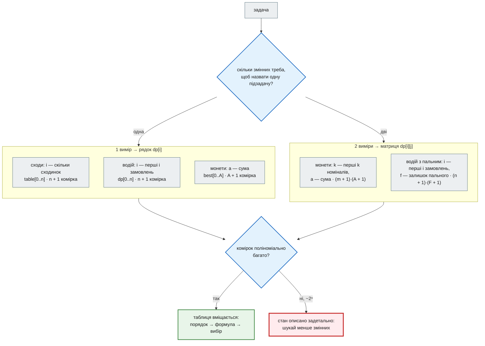

# Діаграми — Урок 27: Динамічне програмування + greedy

---

## 1. Матрична параметризація: скільки змінних у стані

Перший крок підготовки ДП — визначити, скільки змінних (вимірів) описує одну підзадачу. Від цього залежить форма таблиці: одна змінна дає рядок `dp[i]`, дві — матрицю `dp[i][j]`. Другий крок — переконатися, що комірок поліноміально багато, а не `2ⁿ`.

**Приклад двох вимірів — монети `[1, 3, 4]`.** `best[k][a]` — найменше монет для суми `a`, якщо дозволено лише перші `k` номіналів: `best[k][a] = min(best[k - 1][a], best[k][a - c] + 1)`, де `c = coins[k - 1]`.

| `k` \ `a` | 0 | 1 | 2 | 3 | 4 | 5 | 6 |
|---|---|---|---|---|---|---|---|
| 0 — без монет | 0 | ∞ | ∞ | ∞ | ∞ | ∞ | ∞ |
| 1 — `[1]` | 0 | 1 | 2 | 3 | 4 | 5 | 6 |
| 2 — `[1, 3]` | 0 | 1 | 2 | 1 | 2 | 3 | 2 |
| 3 — `[1, 3, 4]` | 0 | 1 | 2 | 1 | 1 | 2 | 2 |

Останній рядок збігається з одновимірною таблицею `best[a]`: монету можна брати скільки завгодно разів, тож другий вимір тут зайвий. Він потрібен, коли кожну монету можна взяти лише раз (задача про рюкзак).

**Де використовується:**
- 1 вимір: сходи, заробіток водія (`dp[i]`), найменше монет для суми (`best[a]`)
- 2 виміри: монети з обмеженим набором номіналів, рюкзак, водій із залишком пального
